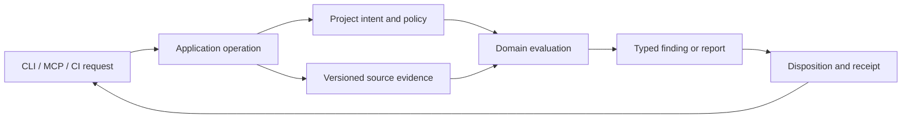

# Software architecture and development backlog

The goal is to make KiCad Team Tooling easier to extend, reason about, and
release as a product. This plan concerns ownership and the path from a project
request to a trustworthy result. Moving files and reducing line counts are
implementation details within that plan.

Project repositories own designs, requirements, catalog records, rule choices,
and engineering approvals. This repository owns reusable services, typed
contracts, native adapters, CLI/MCP/CI surfaces, and regressions. The
[design-lint backlog](DESIGN_LINT_BACKLOG.md) owns proposed electrical rules;
this backlog owns how rules and other capabilities are built and operated.

## The product model

Every capability should follow the same traceable path:

The application operation owns orchestration and authorization. Project policy
expresses what the team intended; evidence records what the exact source and
tool versions showed. A domain service compares those inputs. The resulting
report retains source hashes, supported versions, limitations, and review
state. An adapter presents that report without reinterpreting it.

| Capability owner     | Owns                                                 | Must preserve                                          |
| -------------------- | ---------------------------------------------------- | ------------------------------------------------------ |
| Repository/discovery | Layout, selection, catalogs, portable paths          | Project-owned records and source boundaries            |
| Native evidence      | KiCad/simulator invocation, parsing, version binding | Tool identity, source hashes, unsupported states       |
| Design lint          | Theme predicates, catalog, coverage, findings        | Heuristic versus contract meaning and rule provenance  |
| Electrical analysis  | Requirements, calculations, simulation checks        | Model hashes, measurements, failure details            |
| Parts/CAD/BOM        | Part identity, preview/apply, population, handoff    | Reviewed choices and purchasing authority              |
| Product/release      | Cross-project relationships, package integrity       | Clean source commit, scoped evidence, restore behavior |
| Surfaces             | CLI, MCP, browser, CI request/response mapping       | Shared operation and explicit parity exceptions        |

These are ownership boundaries, not a command to create seven new packages
immediately. First make existing services follow the boundaries; then move
stable owners into directories where that improves navigation.

## Why the current development path is strained

Snapshot at clean revision `5d9b0b41` on 2026-10-29:

- The packaged design-lint catalog has 251 active rules, but the candidate
  aggregator accepts 49 parameters and the public evaluator accepts 33. A new
  evidence type can require edits across central signatures and report models
  even when only one electrical theme needs it.
- `hwrepo/models.py` defines 211 classes and is imported by 336 production
  modules. It is a compatibility registry that remains a source of new
  dependencies unless internal callers move to their domain owners.
- `mcp_server.py` registers many capabilities in one factory. CLI/MCP parity
  and `tool-surfaces.json` already give a useful contract, but every added
  operation still needs a clear application-service owner.
- Current design-lint maturity is entirely `synthetic_validated`. Synthetic
  predicate tests, exact native fixtures, cohort applicability, and reviewer
  confirmation are different evidence levels; rule count alone is not product
  progress.
- The general 500-line architecture gate emphasizes size. Cohesion, import
  direction, signature growth, duplicated behavior, and source provenance are
  better architecture signals. This revision has no Alphus dev pin or checked-in
  Alphus policy, so its findings are not a reproducible gate here yet.

## Decisions for new work

1. **One operation per user capability.** CLI, MCP, browser, and CI call a
   shared typed operation. They may differ in transport and permissions, but
   preserve the same inputs, validation, result meaning, and side effects.
2. **Evidence and intent remain separate.** Native output, inferred patterns,
   project-authored requirements, and reviewer dispositions have distinct
   records and statuses. Missing evidence is visible; it is not a pass.
3. **New sniffers extend a theme.** A rule has one predicate owner, catalog
   record, source/evidence boundary, fault and valid-control fixtures, and an
   explicit default mode. Theme services receive typed theme inputs. Avoid
   growing a global parameter list or passing `dict[str, object]` between
   phases. Registration remains explicit and inspectable.
4. **Contracts evolve deliberately.** A serialized report change gets a schema
   version and compatibility path. Public Python re-exports are kept for
   supported callers; internal code imports its owning model module directly.
5. **Gates test architecture claims.** Source-derived tests should catch a
   broken owner reference, wrong dependency direction, CLI/MCP drift, missing
   evidence provenance, or accidental signature growth. Line count is a review
   prompt, not the main measure of design quality.

## Strategic backlog, in delivery order

### SA-01 — Decide the data route before moving modules

**Outcome:** each stage knows which authored intent and observed evidence it
receives, who produced them, and what absence or staleness means. **Start:**
the [design-lint data routing decision](DESIGN_LINT_DATA_ROUTING.md), which
traces I²C pull-up hints from native capture through finding disposition, and
the [component-map coverage routing decision](COMPONENT_MAP_COVERAGE_ROUTING.md),
which traces authored topology maps and supplied coverage through source
binding, candidate generation, and report reconciliation, and
the [electrical analysis routing decision](ELECTRICAL_ANALYSIS_DATA_ROUTING.md),
which traces authored requirements, source-bound netlist/PCB evidence, and
simulation results through the versioned receipt.

Specify the run identity, project-owned intent, native observations, optional
theme coverage, derived scans, candidates, and report fields as separate typed
inputs. Record which hashes and exact tool versions bind them. Decide whether a
theme receives an unavailable-evidence state or stops before scanning. Keep
the current public report and fingerprints stable during the pilot.

Electrical analysis now has a parallel route decision and a typed netlist
admission in `electrical_netlist_evidence.py`. The admission keeps the full
`ContractCoachReport`, checks project identity and exact source hashes, and
distinguishes `NOT_REQUESTED`, `UNAVAILABLE`, and `OBSERVED` evidence before
existing theme predicates run. I²C pull-up, CAN termination, USB-C, and SPI
state dispatch now belongs to `electrical_bus_evaluation.py`, whose narrow
request pairs those four typed requirement sections with the admitted netlist.
The runner keeps the established check order while delegating those predicates
to their existing owners. Focused tests cover blocked, incomplete,
cross-project, stale-source, unrequested evidence, and attempted status
misclassification. On 2026-10-31, the electrical and capability architecture
slice passed with 288 tests and 34 subtests; one exact native KiCad test was
skipped because this run did not configure its native lane. Ruff, focused
Pyright, Rumdl, and `git diff --check` also passed. Preserve the existing
report schema; do not introduce a global optional evidence context or split
modules to meet a line threshold.

PCB return-path and test-access evaluation now have separate typed requests in
`electrical_pcb_evaluation.py`. `electrical_pcb_evidence.py` preserves the
capture state, returned command, snapshot, and probe-request digest. The
runner plans and performs capture, then delegates return-path, schematic
access, PCB pad access, and probe-envelope evaluation in their existing order.
Focused source-bound receipt and CLI/MCP parity tests continue to cover those
stages; architecture checks now prevent the runner from calling their
predicates directly.
Connector peer assignment routing now returns a named, read-only
`PeerAssignmentPartition` containing the peer-group identity, scoped observed
assignments, and reviewed basis. Missing or incomplete authored scope stays
unscoped as a whole; partial scope is not treated as reviewed coverage.
Connector alias checks now consume a named `ConnectorFootprintPeerPinInventory`
with a read-only per-reference display-number map; missing or ambiguous pin
inventories remain unavailable to the comparison.
IC decoupling review now returns named requirement and capacitor-value records
from the authored map and observed netlist. The candidate boundary continues to
emit the established evidence fields and requirement digest.

The I²C low-equivalent-resistance scan now returns named per-line observations
with typed resistor paths and numeric effective resistance, alongside explicit
SDA and SCL pin assignments. Candidate formatting owns the legacy evidence
projection, so the scan no longer hands three correlated line-keyed maps to
the candidate layer. Internal design-lint services call the owning module;
the `bus_heuristics.py` compatibility facade preserves its former map-shaped
return record for existing Python callers.

Control-input and open-output candidates now retain their typed inventory or
heuristic source records. The theme-owned evidence projector produces the
existing report fields and rejects mismatches between a source record and its
serialized rule/evidence pair. Focused regressions cover all three source
families and the compatibility report shape; the candidate scanner remains
responsible for selection and message wording.
CAN peer-assignment candidates now follow the same boundary in a CAN peer
evidence owner kept separate from termination evidence. The typed divergence
record remains available internally while the report fields and fingerprint
inputs stay stable.

Unconnected I²C, CAN direction, generic SPI/USB-C/CAN pin, USB data, SPI data,
SPI clock, and serial findings now retain their protocol-specific source
records behind one report projector. Predicate owners keep their own partial-
assignment rules; the scanner keeps ordering and wording. RS-485 and USB-C SBU
remain specialized translators with their own owners.

Signal-pair findings now retain `ComplementaryLineGap` or
`NamedDifferentialPair` records through a theme-owned projection. The
complementary scan record's positive/negative pin and net views are immutable
and use a bounded side-key type; named accessors guide internal callers while
the previous mapping attributes remain compatibility views.
The generic component peer-pin outlier now retains its `PeerPinAssignmentOutlier`
record through a theme-owned projection, and its peer assignments are copied
into a read-only map. This keeps the identity, majority, outlier pins, and
shared-anchor context attached to the finding while preserving its public
evidence fields and fingerprint. The component peer-pin slice passed 80
synthetic and architecture tests with four native-lane tests deselected, plus
Ruff, focused Pyright, Markdown checks, and `git diff --check`; it does not
claim native-tool coverage.
The generic split, named split, partially open, and all-open component power-
input findings now retain separate typed variants of their peer scan records.
The generic split carries the peer function observations used in its report;
their projector preserves existing fields and conditional PART_ID identity.
Recognized supply/return divergence and open power-output, signal-output,
signal-input, and bidirectional findings now retain their role-specific scan
records too. The component-peer candidate adapter has no inline evidence-map
construction. The complete typed-routing, projection, marker, architecture,
determinism, scanner parity, and CLI/MCP selection passed 170 tests with 3
skips. The focused evidence selector passed 10 tests, with 9 deselected. No
exact native KiCad fixture lane was run in this checkpoint. Ruff, format,
project-aware Pyright, Rumdl, and `git diff --check` passed.
The six BJT/MOSFET terminal-tie rules now retain one typed terminal-pair source
record and use a component-owned projection for their existing role-specific
report fields. Their predicate functions and catalog owners remain in place.
The focused route, six rule suites, and their architecture guards passed 51
tests, with two additional MCP/report parity tests passing. Ruff, focused
Pyright, Markdown checks, and `git diff --check` passed. Native fixtures were
excluded from these runs.

PCB fitted-footprint absence and identity-mismatch findings now retain typed
per-reference comparisons with their netlist, board, snapshot, schema, KiCad
image/version, and probe identities. DNP mismatches also retain their typed
comparison and paired named-variant exports; blocked named-variant coverage
retains an explicit blocked source record. PCB-owned projectors preserve the
existing report evidence and fingerprints. Value mismatches and blocked value
comparisons now retain typed sources as well; their projector preserves the
distinct evidence shapes for complete and blocked inventory states. Top-level
blocked inventory coverage now retains a `PcbBlockedComponentInventoryEvidence`
record shared by the footprint and DNP findings, with separate projectors
preserving their existing sparse wire fields. The combined focused source-route,
inventory, population, value, catalog-boundary, architecture, and CLI/MCP parity
run passed 62 tests under `design_lint and not native_kicad`. This advances SA-01
without a line-count-driven split or public report change.
Schematic-to-PCB pad-net findings now retain their typed mismatch and shared
native receipt; blocked findings preserve both inventory and comparison
states. The source receipt's report constructor is reused by the inventory and
pad-net translators. Opt-in board-only and project-required fitted-reference
candidates retain their typed comparisons, native receipts, authored
requirement coverage, and named-variant evidence. Their blocked states keep the
enclosing report and coverage context. The combined pad-net, board-only,
required-reference, catalog, inventory, and parity slice passed 55 tests with
8 tests deselected by the tag's focused marker expression; Ruff, format, and
project-aware Pyright passed.
Differential-pair DRC findings now retain the incomplete entry and its complete
source-bound report in a PCB-owned typed evidence record. Its projector keeps
the existing evidence fields and fingerprint, while evaluation remains the
owner of map and source freshness checks. The source-binding fixtures now
identify the same synthetic project as the evaluation request, so they exercise
current source checks rather than the cross-project rejection path.
Signal-path and skew-bundle DRC findings now also retain their incomplete
entry and full source-bound report behind a PCB-owned projector. Path and
bundle messages, finding order, evidence fields, and fingerprints are
preserved. Corrected fixture project IDs exercise the same-project source-
freshness path rather than cross-project rejection. The combined DRC and
signal-path selection passed 98 tests, with 20 deselected by the tag's
`design_lint and pcb_lint` expression. Parity used the public template at
`ed89536f0dbbcb013145af2994fef41b2250143e`; Ruff, format, and project-aware
Pyright passed.
Switching-loop, named keepout, RF antenna, and touch-pad clearance candidates
now retain their exact coverage entries and source-bound reports behind
separate PCB owners. Their projectors preserve area/route/return-plane,
geometry/layer/restriction, module/feed/antenna, and measured-clearance fields.
The combined DRC, signal-path, switching-loop, keepout, RF, touch-pad,
catalog, scanner, and MCP parity selection passed 193 tests, with 20 deselected
by the tag's `design_lint and pcb_lint` expression. Parity used the public template at
`ed89536f0dbbcb013145af2994fef41b2250143e`; Ruff, format, and project-aware
Pyright passed. The switching-loop fixture's project identity now matches its
evaluation request, enabling its source-bound coverage assertions to run
instead of cross-project rejection.
Touch-pad blocked and per-entry findings now retain distinct typed source
records in a candidate-evidence owner separate from the geometry measurement
service. The old service function delegates as a compatibility adapter, and
the internal PCB translator uses the owner directly. Focused touch-pad,
architecture, determinism, catalog, scanner, and MCP-parity checks passed 36
tests under `design_lint and not native_kicad`.
Decoupling, protection-path, track-width, and reference-plane findings now
retain their exact measurements and source-bound coverage reports in separate
theme-owned candidate evidence modules. Existing evidence projections and
fingerprints remain stable, and complete controls stay quiet. The focused
measurement evidence, architecture, and rule regression selection passed 29
tests with `design_lint and pcb_lint`; the marker, collection, and theme
architecture selection passed 15 tests with `design_lint and architecture`.
Generic connector footprint-peer divergence and open findings now retain their
typed scan records through a connector-owned projector. The source assignment
maps are immutable and the existing public evidence fields remain stable.
Full evaluation retains native netlist identity on `DesignLintReport` and
`ConnectorPeerPinHeuristicCoverage`, where report validation checks digest
equality and finding counts; the internal candidate does not duplicate it.
The four unconnected component power-pin rules now retain their typed scanner
record through one component-owned projection. Named pins use a closed
`supply`/`return` category; generic pins distinguish literal `power_in` and
`power_out` roles and preserve optional native pin-function evidence. Existing
rule selection, wording, and serialized fields remain in their theme owners.
The combined component unconnected-pin, connector footprint-peer, architecture,
rule-registry, LED topology, and CLI/MCP parity selection passed 190 tests with
3 skipped (193 collected) using the separate public template at `ed89536`.
The LED topology findings now flow through one component-owned projector. Its
candidate retains either direct-bridge or output-driven scanner records;
custom role-map evidence is emitted only after its retained digest is validated.
Existing LED wording and report fields remain owned by their current services.
Changed Python files passed Ruff check and format validation. Project-aware
Pyright on macOS and Windows, Rumdl, mdrepo, and diff checks passed. No exact
native KiCad lane was run.

The six direct evidence maps in the schematic power candidate adapter now use
one typed power-owned projector and retain their source records. This includes
the source-path heuristic's conditional anchor state, derived from its typed
source-net list, plus immutable same-voltage, repeated-supply, and numbered-
rail source maps. Existing rule order, wording, evidence fields, and
fingerprints are preserved. Focused rule, source-projection, architecture,
marker, and CLI/MCP parity checks passed 144 tests using public template
revision `ed89536`; no native KiCad lane was run.

The three return-domain candidate maps now retain typed connector-return or
return-net-group variants behind a return-owned projector. The source variants
distinguish numbered returns from return-like labels without explicit pin
roles; existing optional label clues, messages, and report fields are
preserved. Connector and net source maps are copied and frozen. Focused rule,
projection, architecture, marker, and CLI/MCP parity checks passed 91 tests
against public template revision `ed89536`. Ruff, macOS and Windows Pyright,
and the focused source checks passed; no native KiCad lane was run.

SPI and serial peer-voltage findings now share one bus-owned evidence
projection. Each candidate retains the exact `DigitalPeerVoltageReview` and
its authored-map scope, while the projection preserves protocol-specific
assignment keys and optional source identity. Existing heuristics and
coverage state handling remain in the scan/evaluation owners. The combined
voltage, serial, determinism, architecture, marker, and CLI/MCP parity
selection passed 79 tests; macOS and Windows Pyright and Ruff passed. No native
KiCad lane was run.

The authored connector return-distribution finding now retains its exact entry
and source-bound coverage report behind a connector-owned projector. Its six
role maps are immutable internally and serialize as regular mappings; report
fields, status selection, and policy behavior are preserved. The focused
distribution, source-projection, architecture, marker, and CLI/MCP parity
selection passed 52 tests. Ruff and macOS and Windows Pyright passed. No native
KiCad lane was run.

The combined local synthetic, rule, and architecture retest across power,
return-domain, return-distribution, and digital-peer-voltage evidence owners
passed 295 tests. Ruff, formatting, Pyright on changed production and test modules,
Markdown checks across 273 files, and mdrepo passed. This local selection did
not run the public-template CLI/MCP parity modules or exact native KiCad.

Serial roster and reference-domain candidates now retain their typed endpoint
or exact review-and-scan source records. The serial source, behavior,
determinism, and architecture selection passed 49 tests; CLI/MCP parity passed
6 tests and 6 subtests against public template revision `ed89536`. Marker and
collection architecture checks passed 14 tests, with focused Pyright and Ruff
clean. SPI bias and shared-clock reference candidates now retain their exact
heuristic gap or review-and-scan source while the shared clock identity remains
available for coverage reconciliation. The SPI source, rule, and architecture
slice passed 46 tests, CLI/MCP parity passed 3 tests, and marker/collection
checks passed 14 tests. SPI bias report parity passed one additional test.
Pyright and Ruff passed for both routes. No exact native KiCad lane was run.
I²C reference findings now use the same source-bound pattern, retaining the
review and scan plus canonical SDA/SCL identity. Its rule, source, and
architecture selection passed 27 tests; CLI/MCP parity passed 3 tests.
Marker and collection checks passed 14 tests. Focused Pyright and Ruff passed;
no exact native KiCad lane was run.

A fresh AST inventory at this checkpoint finds no direct
`Candidate(evidence=...)` constructions in candidate adapters and no
`PeerReferenceCandidate.from_identity(evidence=...)` calls. The broad scan
before this route found 17 direct candidate constructions across six theme
owners, including USB data polarity. That route now retains its exact
`NetlistContract` through `UsbDataPolarityCandidate`; source construction checks
the pin function, net assignment, and polarity identities. A refreshed scan
leaves 13 direct constructions across three theme owners: one power-decoupling
route, one regulator-passive route, and eleven schematic-geometry routes. The
two transformer routes retain named winding groups, typed pin-to-net
assignments, and their exact netlist through `TransformerCandidate`. The
connector supply-domain route retains its exact netlist, coverage report, and
mapped pin records through `MappedSupplyDomainsCandidate`. I3C one-sided-open,
unmapped SPI, two-pin same-net, USB-C port, and USB peer-reference findings
retain their exact typed source records. SPI, I²C, CAN, and RS-485 reference
candidates retain their scan and bus/pair records through protocol-owned
subtypes while preserving the common identity used for coverage
reconciliation. This inventory is limited to direct candidate construction;
it does not claim that every dictionary in scanners, coverage records, or
application services has become typed. Continue by tracing each remaining
producer, provenance, absence state, and consumer before changing module
boundaries.

The USB-C port route passed its source and behavior selection (13 tests), CLI/MCP
parity (1 test), and marker/collection architecture checks (14 tests). The USB
peer-reference source and behavior selection passed 89 tests, with CLI/MCP
parity passing 4 tests. Focused Pyright, Ruff, and format checks passed for the
new owner and adapter. No exact native KiCad lane was run.

USB data-polarity candidates now retain their source netlist and validate their
serialized evidence against the typed conflict. The source, behavior, and
architecture selection passed 11 tests; marker and collection architecture
checks passed 14 tests. Focused Pyright and Ruff passed. No exact native KiCad
lane was run.

Transformer winding findings now retain the exact netlist through named
`SupportedTransformerObservation`, `TransformerWindingPinGroup`, and
`TransformerPinNetAssignment` records. The same-winding and cross-winding
projectors preserve their current report fields and candidate order. The
focused source, behavior, catalog, architecture, marker, collection, and
CLI/MCP parity selection passed 87 tests. Pyright and Ruff passed. No exact
native KiCad lane was run.

Mapped connector supply-domain findings now retain the exact netlist, source
coverage report, and ordered `ConnectorMappedPinEvidence` records through
`MappedSupplyDomainsCandidate`. Construction verifies each grouped pin against
current source-matched coverage; the report fields and fingerprint input remain
stable. The source, behavior, and architecture selection passed 10 tests;
marker and collection checks passed 14 tests. Pyright and Ruff passed. No exact
native KiCad lane was run.

The combined source-projection, rule, architecture, size, marker, and CLI/MCP
parity selection passed 237 tests against the clean public `KiCAD-Test`
checkout at `ed89536f0dbbcb013145af2994fef41b2250143e`. Pyright reported zero
errors; Ruff, format, the changed Markdown checks, and mdrepo passed. No exact
native KiCad lane was run.

After adding the I²C peer-source route, the expanded focused selection passed
313 tests against the same clean public template revision. It includes the
generic peer-identity coverage checks and I²C CLI/MCP parity. Pyright reported
zero errors; Ruff, formatting, Markdown, mdrepo, and both SPI/I²C marker
selectors passed. No exact native KiCad lane was run.

The next source-projection slice adds CAN and RS-485 peer references, I3C
one-sided-open pins, same-net two-pin components, unmapped SPI participants,
and USB-C port coverage. Its focused source, rule, architecture, size, marker,
and CLI/MCP parity selection passed 227 tests, with one hosted USB-C native
fixture test skipped because it belongs to the digest-pinned acceptance lane.
The run used public `KiCAD-Test` revision `ed89536f0dbbcb013145af2994fef41b2250143e`.
Separate selectors passed 17 CAN/RS-485/I3C interface tests, 12 return-path
tests, and 16 two-pin component/evidence tests; the SPI/USB-C interface
selector passed 26 tests with the same one native-fixture skip. Pyright
reported zero errors; Ruff, formatting, Rumdl on the changed docs, and mdrepo
passed. No exact native KiCad lane was run.

Adding the source-bound USB peer-reference projector expanded that focused
selection to 308 passed and one skipped, against the same public template
revision. The USB peer slice passed 69 interface-selector tests and 68
return-path-selector tests, including CLI/MCP parity. Adding the USB
data-polarity source route expanded the full focused selection to 320 passed
and one skipped; its interface selector passed 12 tests. Pyright reported
zero errors; Ruff, formatting, Rumdl, and mdrepo passed. The sole skip is the
USB-C native fixture reserved for digest-pinned acceptance. No exact native
KiCad lane was run.

**Done when:** existing rule families have agreed input/output tables and
fresh, missing, stale, and not-applicable cases; the feature lane can identify
the right producer for a new datum; no module split is needed to express the
route. Hold physical reorganization until each family route and its focused
checks pass.

### SA-02 — Publish the capability and dependency map

**Outcome:** contributors know where a new capability enters and which module
owns each decision. **Start:** the seven owner groups above and current
`tool-surfaces.json`, rule catalog, and project configuration.

The [capability and dependency map](ARCHITECTURE_MAP.md) and its active-rule
dependency gate are already checked in. Extend that map for major operations:
project discovery, native capture, design lint, electrical analysis, parts/CAD,
product, and release. Record input/output contracts, source authority, allowed
dependencies, and CLI/MCP/CI mapping. The transport dependency check now covers
active rule owners, every `design_lint_*` service and facade, and the
schematic-geometry services and facade, alongside the previously listed stable
service families. Existing catalog architecture checks guard active rule owners
and their theme functions.
Audit hybrid modules that host both a CLI and reusable stage functions as
explicit migration items. Project verification's portable and native lanes now
call typed services under `hwrepo`; the `ci.py` and `check_all.py` functions
remain compatibility adapters. Governance lint also has focused owners in
`governance_lint.py` and `governance_records.py`, and its former 579-line CLI
module is now a small adapter. Declared project source hashing now belongs to
`project_source_hashes.hash_project_sources`; `validate.hashes` is its legacy
export. Single-project native validation now belongs to
`native_project_validation.validate_project` with a strict
`NativeProjectValidationRequest`. `native_report_parsing.py` and
`native_command.py` own native output parsing and command capture, while
`native_toolchain.py` owns catalog selection and executable resolution.
`validate.py` keeps the registered CLI and old positional Python adapter;
`check_toolchain.py` likewise keeps its CLI and compatibility exports.
Standalone diagnostics and release preparation now call the selected-project
portable lane with `ProjectStaticPipelineRequest`; the services no longer
import its compatibility adapter from `ci.py`.
Release preparation now calls the typed native dependency owner directly;
`native_deps.py` remains the registered CLI and positional compatibility
adapter, and `native_dependency_models.py` owns its strict request contract.
Saved history receipts now admit only the native summary, findings view, or
project-verification report models their owner parses. Shared before/after
states now have one neutral model and service owner across BOM, board/product
variant, and history comparisons; `bom_change.py` keeps the compatibility
export.

**Done when:** a contributor can place a proposed feature without guessing;
one intentionally wrong import and one wrong catalog owner fail focused tests;
the map matches live surface and catalog inventories.

### SA-03 — Define a common evidence lifecycle

**Outcome:** services consume evidence with consistent source, tool, coverage,
and freshness semantics. **Start:** native KiCad and simulator capture paths,
report models, and project inspection orchestration.

Document and normalize the stages: requested source scope, exact toolchain,
capture, parsed typed evidence, applicability/coverage, evaluation, and
receipt. Use `project_source_hashes.hash_project_sources` for declared source
inventories and the shared path service for path boundaries. Keep native adapters bounded
to the versions they support. A rule may opt into only the evidence it needs,
but its report must show why evidence was unavailable or stale.

The I²C pull-up coverage pilot now retains its netlist hash for a `COMPLETE`
scan with no hint entries. Evaluation rejects a missing or stale hash for that
positive state, while old serialized records remain parseable. Apply the same
positive-state source-binding check to other coverage families during their
route reviews.

Project inspection now rechecks the declared source inventory after scanning
and connectivity capture. An edit, addition, or removal during that work
blocks the result rather than presenting findings bound to the earlier source.
The native coach and project inspection also recheck the validation summary,
netlist, and netlist-command bytes across their reads. Project inspection
revalidates the selected exact toolchain against the summary and checks it
again before returning. These are freshness checks, not filesystem locks.
The shared PCB DRC evidence service likewise rechecks the native summary, DRC
report, and DRC command after parsing and after coverage evaluation; the
reported DRC hash remains the one bound by the summary.
The path-to-SHA inventory now has a shared `SourceHashInventory` type whose
key and value are `RepositoryPath` and `Digest`. PCB board matching, mapped DRC
coverage normalization, native DRC capture, DRC rule review, native-summary
binding, native netlist evidence, and hierarchical schematic source readers use
that type end to end; serialized report maps are unchanged. Byte-content maps
remain separate. Keep maps keyed by references, rule IDs, or artifact IDs
under their own domain types.
Saved findings-view source binding now uses `SourceHashInventory` through
snapshot admission, native ERC mapping, and schematic drawing association;
the serialized findings report remains unchanged. The project overview now
uses the same contract from both project and full-checkout inventory producers
through freshness checks and receipt assembly. Artifact-path-to-digest maps
remain separate. Product visualization aggregation, PCB variant-capture input,
and STM32 IOC coverage now preserve typed repository paths and digests.
Read-only handoffs use `SourceHashInventory`; mutable accumulators use
`dict[RepositoryPath, Digest]` where source discovery adds entries.
Electrical-view freshness and verification history now use the shared
inventory type for their saved-source comparisons.
Both netlist and DRC consumers validate the summary's project, exact toolchain,
and completed source-scope hashes through the same native-summary boundary.
A completed DRC with violations can still provide evidence; it is not treated
as a clean DRC result.
Design-lint preparation checks source-bound contract-coach evidence against
the requested project ID before preparing candidates. A cross-project
mismatch returns `BLOCKED` without attaching the other project's source hashes
or netlist digest to the selected project's report. Unbound synthetic inputs
remain usable through the lower-level evaluator compatibility route.
Differential-pair evaluation now checks both the authored map and the current
coach source inventory before accepting scanned DRC coverage. Project, board,
and rules identities must also agree with that inventory; stale coverage is
blocked before it can create findings. Signal-path evaluation uses the same
source-binding check and also requires the current authored map. Regression
cases cover complete, incomplete, stale, disabled, and mapless reports.
Keepout, RF antenna, and touch-pad coverage now require their retained board
path and digest to match the current source inventory, with a current authored
map. Their common policy owns this check in
`design_lint_pcb_geometry_coverage_policy`; the mapped DRC policy stays
separate.
PCB geometry capture now retains explicit null observations required by its
versioned snapshot schema, verifies the typed snapshot and command against
their receipt bytes, and checks them again after coverage evaluation. Signal
path coverage applies the same checks when called independently.
Native PCB capture now returns a named `NativePcbConnectivityCapture` to
internal operations, keeping `CommandEvidence` beside the optional snapshot
until the evidence admission service assigns its explicit state. The original
tuple-returning function remains as a compatibility adapter. The electrical
runner now passes that record intact to evidence admission; the old separate
command/snapshot admission function remains a compatibility adapter too.
Schematic parsing now returns a named `SchematicSourceDocument` with decoded
text and its parsed root span. Wire, junction, and label parsing return named
geometry records with unsupported reasons; the scan coordinator routes those
reasons through catalogued `SchematicGeometryRuleId` keys before assembling
the source-bound report. The serialized report shape is unchanged.
PCB switching-loop route topology now projects native track ends into named
`_TrackEndpointObservation` records before resolving pad, via, and neighboring
track connectivity, replacing a positional five-field tuple at that boundary.
The manifest, lint policy, and consulted project-owned requirements are also
rechecked after capture; a changed input blocks the assembled report.
Electrical analysis separately checks that its selected configuration and
parsed requirements still match after input hashes are captured and again
after evaluation, so a mid-binding edit cannot produce a passing report for
an older in-memory contract with newer recorded input hashes.
Retained electrical evidence verification also rechecks the report, declared
inputs, and retained artifact hashes after parsing and evaluating them. A
changed receipt or source input cannot be accepted on the initial hash alone.
When replay needs a native netlist, it validates the summary's project,
toolchain, source scope, netlist hash, and export command through the shared
native owner; it rechecks that evidence after electrical evaluation.
Release native verification also rechecks the retained summary, its artifact
inventory, and the repository source state after replaying the native checks.

Control-input bias coverage now enters `resolve_control_input_bias_coverage`
with the coach's netlist identity. A completed scan keeps the observed digest
even when it finds no candidate nets. Stale, unbound, contradictory, or
previously blocked coverage is resolved by that theme owner before entries can
suppress a prompt; a blocked result retains the recorded contract and netlist
identity while withholding entries. Legacy unbound records remain readable,
but they cannot authorize evaluation against a current netlist.
External-protection coverage now follows that source boundary through a
theme-owned `ExternalProtectionCoverageRequest` and resolver. Stale or unbound
positive coverage becomes `BLOCKED`, preserves its scope, recorded digest,
and contract identity, and withholds rows from candidate generation. The
published report independently checks the coverage digest against its own
native netlist identity.
Crystal-network, regulator-feedback, and RC-filter scans now require positive
aggregate states to agree with their entry rows. `COMPLETE` has nonempty rows
without structural incompleteness; `INCOMPLETE` has at least one incomplete
row. `OUT_OF_RANGE` remains a covered comparison state and still produces a
review finding. Their candidate translators ignore rows from blocked reports.
Component-map coverage now enters its owning resolver through one typed
`ComponentMapCoverageRequest`. Supplied positive coverage with a stale or
unavailable netlist digest is blocked, its rows are withheld from candidate
generation, and its original digest is retained for diagnosis. Return-
distribution coverage likewise keeps its original interface-catalog digest
when blocked. The
[routing decision](COMPONENT_MAP_COVERAGE_ROUTING.md) records that a missing
supplied report requests a scan of the authored map and distinguishes this
from an explicit `NOT_REQUESTED` result.
Covered control-input and I²C pull-up or voltage entries also require a
contract path and digest at evaluation. Project inspection verifies the
contract bytes during the run; a direct evaluator caller must verify those
bytes itself because the evaluator has no project root.
Evaluation also rejects covered control-input or I²C decisions carried by
`NOT_CONFIGURED`, `PENDING`, or `NOT_APPLICABLE` coverage. `OPEN` coverage may
still resolve some entries while leaving others reviewable.
I²C pull-up and input-voltage coverage now follows its own
`resolve_i2c_pullup_coverage` request, preserving the empty-`COMPLETE` scan
identity and returning stale or unbound coverage as `BLOCKED` with its original
contract and netlist identity. Both heuristic owners return named resolutions
so preparation uses the same evidence result for early-blocked reports and the
normal candidate route.

Electrical simulation now has a typed request and result lifecycle. The
request checks every case's reviewed source-hash map against the current
design-source inventory before simulator invocation. Version evidence
distinguishes no cases, unavailable exact-version capture, and a matching
version command; each result retains its authored case, command when one was
returned, and measurement/waveform checks. A wrong or unavailable simulator
version leaves all cases `NOT_RUN`, while case preparation failures remain
case-scoped `FAIL` results. The public command index is unchanged; the failed
version command remains available in its hashed artifact receipt.

**Done when:** a stale hash, wrong native version, absent source, and unsupported
topology produce distinct, tested outcomes across representative schematic
and PCB capabilities. Receipts remain portable and comparable.

### SA-04 — Clarify policy, finding, and disposition semantics

**Outcome:** teams can tell observation from requirement failure and review
decision. **Start:** design-lint policy, report, reconciliation, and project
contract models.

Define one documented state model for heuristic `REVIEW`, project-authored
contract mismatch, native diagnostic, coverage gap, ignored finding, rule-off
finding, and stale disposition. Preserve current project modes and exact
fingerprints. Keep catalog maturity separate from project mode: synthetic
validation does not authorize a default blocking rule. Any serialized report
change uses an explicit schema migration and old-report tests.

Reconciliation treats a changed declared source or native netlist digest as
reviewable context even when the finding set and captured pin connectivity
are identical. It retains the source paths and both netlist digests in the
existing report schema. Changes to coverage and other report fields are also
named in review context, including fields added to the report later. A
reconciliation result does not accept findings or authorize a build.
Evaluation blocks duplicate candidate fingerprints before applying ignores.
When disposition is blocked and no complete finding list is available, the
report retains source-bound coverage without requiring its counts to match an
absent list; source identities are still validated. Peer-reference and mapped
check records produced before a disposition failure remain in that blocked
report so the evidence gap is visible to CLI and MCP consumers.
External-protection coverage now binds positive rows to the current native
netlist before candidate generation. Its aggregate state must agree with its
rows: `COMPLETE` requires nonempty resolved rows, `INCOMPLETE` requires an
incomplete row, and `UNDECLARED` requires an undeclared row without an
incomplete row. Complete finding lists also reconcile undeclared and
mismatched-protection rows with their catalogued findings. A stale input is
retained by digest but blocked with its candidate rows withheld; a blocked
report with no complete finding list keeps the source identities without a
row-count comparison.
Crystal-network, regulator-feedback, and RC-filter report rows likewise
reconcile with their rule findings when the report has a complete finding
list; an out-of-range comparison is covered and must retain its finding.
Reconciliation does not assign finding transitions when either report is
blocked or unbound, the project IDs differ, fingerprints are duplicated, or
native snapshot versions are incompatible. It retains the raw findings from
both sides for review instead of treating an incomplete list as a removal.
For a blocked report with no finding list, text output says the findings are
unavailable or incomplete; consumers of the unchanged JSON schema must use
`status` and `issues` rather than interpreting an empty list as a clean scan.

**Done when:** CLI, MCP, CI, and reconciliation present the same state for the
same source revision; transitions remain reviewable; no source change silently
turns a previous finding into an approval.

### SA-05 — Make the sniffer extension path stable

**Outcome:** a rule is added through its theme without widening central APIs.
**Depends on:** SA-01–SA-04. **Start:**
`design_lint_candidate_aggregation.py`, `design_lint_evaluator.py`, and
`design_lint_evaluation_types.py`.

The I²C pull-up route now enters one typed theme service, and the I²C address
route carries the observed netlist, project map, and resolved coverage as one
theme input. The bus coordinator now receives both through `BusCandidateInputs`
and rejects mixed native observations. The
[data-routing decision](DESIGN_LINT_DATA_ROUTING.md) records their different
absence rules and the pull-up migration comparison. Keep the
current public evaluator as a compatibility adapter while callers migrate.
Preserve deterministic ordering, fingerprints, catalog ownership checks, and
source-bound evidence. Route the next agreed theme inputs only after their
producers and absence states are specified; avoid adding a new electrical
predicate solely for the architecture migration.

The evaluation path now validates the complete candidate set after theme,
native, and rule-specific additions, before applying project modes or ignores.
This keeps new extension paths under the same active-catalog check. The next
internal API seam now accepts one complete `DesignLintEvaluationRequest`.
Project inspection passes that request to `evaluate_request` instead of
unpacking it into the 33-parameter compatibility function. The old
`evaluate(...)` route builds the same request and delegates; parity covers
source-bound, cross-project-blocked, and unbound synthetic evidence. Keep the
public signature compatible while remaining internal callers move to the
typed request. A source-derived architecture guard now confines imports of
legacy `evaluate` to the public `design_lint.py` facade.
The source-freshness, evaluator-parity, project-inspection, and MCP report
regressions passed (34 tests), followed by 30 evaluator-signature, capability
coverage, peer-coverage, and catalog architecture tests. Ruff, focused Pyright,
Markdown checks, and `git diff --check` passed. The integration run used the
documented public template checkout and excluded native KiCad tests.
The capability dependency gate also passed 20 tests; a final evaluator and
inspection-architecture rerun passed 15 tests after adding the adapter-import
guard.

The architecture regression suite now caps the established public candidate
and evaluator compatibility signatures at 49 and 33 parameters. New evidence
must enter through a typed theme input or prepared internal record; changing
either cap requires an explicit migration plan and a corresponding removal of
legacy surface parameters.

The public `candidates()` adapter and prepared evaluation now construct the
same required capability-group inputs and call `scan_candidates()`. The
synthetic I²C missing-pull-up fault and valid-control cases compare candidate
order, fingerprints, serialized report JSON, and coverage dispositions through
both routes. The input groups keep shared power requirements in one owner and
require connector, component, control, power, bus, peer, mapped, and PCB groups
at the scanner boundary. Continue migrating direct candidate consumers by capability
group; remove a legacy argument only after its callers have moved and the
fault/control outputs remain unchanged.

The authored USB data-path map now enters the scanner in
`UsbDataPathCandidateInputs` and is shared by the USB peer and mapped-path
candidate owners. It no longer sits as a loose optional field beside the
capability groups. Keep its single map digest and candidate ordering stable
while the internal theme consumers migrate.
The scanner also has no catch-all `additional_candidates` input now. Project
DRU review and native DRC findings enter through separate fields on
`PcbCandidateInputs`, keeping their route within the PCB capability group and
the scanner's shared catalog validation.
Evaluation preparation now assembles the complete required
`DesignLintCandidateInputs` bundle, including normalized coverage, policy
maps, peer scans, and PCB candidate sources. Candidate scanning passes that
prepared bundle through intact instead of rebuilding theme records from the
flat public request at the last moment. The bundle now requires a concrete
catalog; the public candidate adapter resolves its optional legacy catalog
before constructing the bundle, so catalog fallback cannot occur inside the
scanner.

I²C, SPI, CAN, and RS-485 peer rule owners now attach typed identities to their
internal candidates. Construction and coverage assembly check that each
identity matches the public evidence fields; coverage uses the typed identities.
The report and fingerprint continue to use the existing serialized evidence.
Those four owners now derive the identity-owned public evidence keys from the
typed identity through a compatibility projection. Supplemental evidence
cannot override the projected keys, while report JSON and fingerprints remain
unchanged. Continue this pattern for other rule-specific evidence only after
its typed owner and wire projection are explicit.
The identity-to-report route is represented by a named
`PeerReferenceIdentityProjection`, which pairs the rule ID with a read-only
view of its reserved wire fields. The candidate adapter still emits the
established evidence mapping for report serialization. Candidate construction
copies and freezes that mapping so later internal consumers cannot change the
fingerprint or disagree with typed coverage identity. This protects the
current wire contract. The I²C pull-up theme now carries the owning typed
source record on each internal candidate and projects it through
`project_i2c_pullup_evidence`; its report fields and fingerprint input remain
stable. Extend that source-to-wire pattern across other themes before changing
the serialized evidence schema or fingerprint normalization.
The USB data-path finding now follows the same route: each candidate retains a
typed `UsbDataPathMismatch` plus its authored map digest, and one USB-owned
projection preserves the established report evidence and fingerprint. Continue
with other bounded themes where the producing record fully explains the finding.
The I²C address mismatch, collision, and unmapped-responder candidates now keep
their source coverage or named scan record through a typed projection as well.
The I²C pull-up, I²C address, and USB data-path owners now share one immutable
`CandidateEvidenceProjection` contract, while each theme retains its own
source-specific formatter.

The PCB measurement candidate route now follows that source-to-wire contract
for decoupling, protection-path, track-width, and reference-plane findings. Each
finding retains its exact typed coverage entry and full source-bound report;
theme-owned projectors preserve the established evidence and fingerprint.
Candidate qualification remains rule-specific, so complete controls do not
become findings and complete-but-below-threshold measurements remain visible
where the rule requires review. Continue migrating bounded theme routes whose
source records fully explain their findings; keep policy normalization and
source freshness in evaluation preparation rather than the evidence projectors.
Regulator-feedback and crystal-network findings now follow that contract too.
Their source records retain the configured coverage report and exact entry;
projectors preserve the established numeric, pin, and issue fields. The
`OUT_OF_RANGE` state remains reviewable even when the enclosing coverage report
is `COMPLETE`. Continue with other bounded mapped themes after checking their
absence states and current source-bound report contracts. The focused crystal,
regulator, evidence-owner, and architecture selection passed 39 tests; marker
and collection architecture checks passed 14 more. The tag's narrower
`design_lint and evidence_lint` selection passed 7 tests, with 32 deselected.
Ruff, format, and project-aware Pyright passed.
Mapped power-path findings now retain their exact mismatch and the canonical
project-map digest; one theme-owned digest function is shared by candidate and
coverage preparation. RC-filter findings retain their exact coverage entry
and configured report. External-protection findings retain either an
unreviewed applicability entry or a mapped-device mismatch with the enclosing
coverage report. Their projectors preserve the previous report fields and
fingerprints, while map/source normalization remains in evaluation. The
power-path, RC-filter, external-protection, and power-sequence area selection
passed 76 tests; the narrower `design_lint and evidence_lint` selection passed
23 tests, with 53 deselected. Marker and collection architecture checks passed
14 more. Ruff, format, project-aware Pyright, documentation checks, and
`git diff --check` passed.
Power-sequence mismatch and cycle findings now retain distinct typed source
records and share the canonical authored-map digest owner with mapped-coverage
preparation. All mapped-coverage candidate branches now enter through
theme-owned typed evidence projectors; their report fields, fingerprints, and
rule-specific absence states remain stable. At that checkpoint, the AST
inventory contained 10 direct candidate evidence mappings across three
modules: eight schematic geometry routes and two power routes. Subsequent
schematic pin/wire, wire-topology, and label routes reduced that count.
STM32/CubeMX findings now keep either a typed pin mismatch or an unmapped
device observation with its coverage report. The source records verify the
report's netlist, map, and IOC identities, while one interface-owned projector
preserves the established public evidence. The combined mapped-theme and
STM32 evidence regression selection passed 165 tests; focused Pyright, Ruff,
format, Rumdl, mdrepo, and `git diff --check` passed.
The follow-up typed-evidence checkpoint also moves generic connector
footprint-peer divergence and open candidates through a connector-owned
projector, preserving their frozen assignment snapshots and existing report
fields. Against the separate public `KiCAD-Test` checkout, the current
connector/interface selection passed 35 tests and the combined evidence
selection passed 11 tests (24 deselected); pytest marker, collection, and rule
selector architecture checks passed 110 tests. Project-aware Pyright, Ruff,
format, Rumdl, and `git diff --check` passed. Existing generic peer assignment,
open-state, inventory, and CLI/MCP parity regressions passed 24 tests; the
all-open CLI/MCP parity case passed separately. No native KiCad lane was run.
CAN missing and excess termination candidates now retain their named scan
records and use that same projection contract.
The bus theme now returns its findings with those peer keys in a
BusCandidateResult. Prepared evaluation consumes the typed result directly;
the flattened scan_candidates() remains an adapter for existing callers.
The connector coordinator now returns ConnectorPeerPinFindingCounts with its
candidate tuple. Prepared evaluation no longer recovers sixteen coverage
counts by scanning the flattened candidates; the aggregate result checks the
typed counts against its candidates, while published-report validation still
reconciles counts with findings. Apply the same result contract to other
themes when their findings carry secondary coverage or deduplication data,
without widening the public candidate API.
Component-peer assignment evaluation now follows that route: its typed result
returns per-rule finding counts to source-bound coverage, and the aggregate
scan checks those counts against combined findings. Coverage assembly no
longer derives component-peer counts from the globally flattened candidate
list. The old keyword-based function remains a compatibility adapter.
Mapped topology now uses typed `MappedCoverageCandidateInputs` and
`ComponentTopologyCandidateInputs`; their results provide USB, mapped power,
sequence, and oscillator finding counts to `MappedTopologyFindingCounts`.
The aggregate scan verifies those counts against its complete candidate list;
published-report validation still reconciles them with final findings.

The control-input theme now receives its observed netlist and explicit bias
coverage as one typed input, and returns a named result containing candidates
and the pin keys used for peer deduplication. The scanner rejects mixed control
and bus observations; the existing tuple-returning control function remains a
compatibility adapter. Fault, valid-control, and unconnected cases compare
candidate fingerprints and complete report JSON across the central routes.
Component-peer identity wording and source identity now travel as a named
`ComponentPeerPinIdentityContext`; its compatibility projection emits the
existing evidence fields without carrying identity as an opaque four-value
tuple.
The PCB candidate group now has a PCB-owned input record. The central scanner
passes it intact to typed measurement and requirement entry points, retaining
the keyword-based translators as compatibility functions. Differential-pair
fault and valid-control cases compare candidate order and fingerprints across
the old and typed routes; the route and absence states are documented in the
data-routing decision.
Evaluation now also groups signal-path, keepout, RF-antenna, and touch-pad
coverage into `PcbInputCoverageInputs`, owned by the geometry-coverage policy
service. The public evaluator packs its legacy parameters into that record;
preparation passes the record intact to the owner that applies authored-map
modes and board/source identity checks. An absent report remains distinct from
an explicit `NOT_REQUESTED` or `DISABLED` report, so configured-map gaps still
become blocked coverage and mapless inputs retain their existing disposition.
Differential-pair, switching-loop, reference-plane, and protection-path
reports enter their separate mapped-coverage policy as `PcbMappedCoverageInputs`.
That policy remains the owner of each map-mode and board/source binding check;
the group does not collapse their individual statuses or map identities.
The peer evidence coordinator now receives its digital-voltage, serial-peer,
and RS-485 project contexts as `PeerDesignLintScanInputs`. It resolves absent
contexts to the same explicit `not_configured` states while retaining pending,
not-applicable, and source-bound records unchanged for their owning scans.
Serial reference scanning now builds one named `SerialPeerPinIndex` from its
observed netlist and routes its related indexes by field through domain and
map-matching checks. Native-function and channel-label discovery share that
index; current map validation receives the same record instead of separate
pin, symbol, footprint, and DNP maps. Channel-label TX/RX accumulation now uses
named role records instead of nested role dictionaries. Digital-peer voltage
analysis likewise returns one named, read-only `DigitalPeerPinAssignmentIndex`
for pin-to-net, canonical-reference,
and symbol lookups; the scanner passes that record through supply and authored
link matching instead of unpacking a positional tuple of maps. The USB peer
route now uses a similarly named `UsbPeerPinNetIndex` for its paired
pin-to-net and net-to-pin views across endpoint, crossing, path, and shunt
analysis. LED rail and direct-output review now carry those two views in a
`LedNetAssignmentIndex` shared by both predicates rather than a positional map
pair. The authored regulator-passive map now travels in the power-owned
`PowerCandidateInputs`, defined in `design_lint_power_inputs.py`; prepared
evaluation passes that group to the power theme scanner. Evaluation assembly
no longer appends this power rule outside the shared candidate scan, so active
catalog validation remains at the candidate boundary. The public candidate
adapter keeps its established signature. Control-bias evaluation likewise
uses `ControlCandidateInputs` from `design_lint_control_inputs.py`, pairing its
observed netlist with the source-bound heuristic coverage. The bundle and
scanner now import that record from its owner; the former service and bundle
imports remain identity-compatible.

The protocol peer scanner now accepts one `PeerCandidateScanInputs` record
containing the observed netlist, peer evidence, reviewed connector references,
SPI roster, and `UsbDataPathCandidateInputs`. Candidate aggregation builds
that request from the existing capability groups and routes it through the
typed scanner; the legacy multi-argument peer coordinator remains an adapter.
`PeerCandidateInputs` and the scan request live in
`design_lint_peer_inputs.py`; internal consumers import from that owner, while
the older bundle path remains an identity-compatible re-export. USB map intent
and its canonical digest travel together in `design_lint_usb_data_path_inputs.py`.
Peer and mapped-path scans receive the same record, and map identity is
computed by `usb_data_path_models.usb_data_path_map_sha256`, shared with
source-bound and mapped-topology coverage.
The connector unconnected supply, return, generic power-input, and generic
power-output findings now retain their scanner records through one
connector-owned evidence projector. The scanner records use closed role and
source literals; project-interface provenance and optional native pin
functions remain present in the public report projection. Selection,
suppression, and wording stay in the connector translator.
Repeated-function, generic peer-outlier, and generic peer-divergence candidates
in that translator now use the same typed-source boundary. Peer assignment
records freeze their per-reference maps; the repeated-function source retains
its pin group, observed netlist, and reviewed role context. Their existing
deduplication and message choices remain with the translator, and the
connector-owned projection preserves the existing role, identity, assignment,
and scope fields.
On 2026-11-04, the focused 11-module connector peer source, scope, role,
CLI/MCP, and pytest-architecture selection passed 65 tests using the clean
public template at `ed89536`. Full Ruff and format checks, Pyright for macOS
and Windows, Rumdl, mdrepo, and diff checks passed. No exact native KiCad lane
was run.
The combined connector, LED, component-pin, CLI/MCP parity, and focused
architecture selection passed 107 tests with 3 deselected by the marker
expression; architecture and collection guards passed 24 tests. It used the
clean public `KiCAD-Test` checkout at `ed89536`. Ruff, format, Linux and Windows
Pyright, Rumdl, mdrepo, and staged/unstaged diff checks passed. No exact native
KiCad lane was run.
The dedicated direct-rail LED CLI/MCP parity case and the current marker
registry selection then passed 10 tests after the parity case moved into its
focused test module.
The connector pin evidence route now also covers repeated-function,
generic-peer outlier, and generic-peer divergence findings. Their combined
connector, LED, component-pin, and CLI/MCP selection passed 238 tests with 5
deselected; the current architecture, marker, collection, and lint-suite gates
passed 33 tests. Full Ruff, format, Linux and Windows Pyright, Rumdl, mdrepo,
and diff checks passed. The public template remained clean at `ed89536`; no
exact native KiCad lane was run.

**Done when:** the pilot yields equivalent findings and report meaning; adding
a second rule in that theme needs no new parameter on the 49- or 33-parameter
central functions; no opaque mapping substitutes for typed inputs; focused
synthetic/native and catalog tests pass.

### SA-06 — Establish application services beneath all surfaces

**Outcome:** a capability has one implementation even when exposed by several
adapters. **Start:** high-traffic project verify, design lint, electrical run,
parts preview/apply, and release operations.

For each operation, name the typed request, response, authority checks, and
side effects. Keep startup permissions and path scoping at the adapter edge;
move domain decisions out of MCP/CLI/browser handlers. Use
`tool-surfaces.json` and parity tests as the external contract. Do this one
vertical capability at a time.

The supplier handoff tranche moved generated-artifact scope and stable file
reads into `hwrepo/artifact_access.py`. The supplier service now uses that
shared owner directly; MCP keeps its existing import surface. A focused
architecture check guards the service against MCP imports, and the existing
artifact safety and supplier CLI/MCP parity tests cover the route.
Single-project lookup now has a shared selection owner and a typed missing-ID
error. Electrical analysis, contract coaching, part-CAD, and MCP workflows use
it while retaining their existing user-facing guidance; registry failures are
not relabeled as missing projects. Other consumers can migrate incrementally.
Electrical setup and input binding, design-lint inspection, and release-native
verification use the same error when a project disappears between lookups;
design lint reports that failure as `BLOCKED` with a nonempty issue.
MCP project detail now uses a typed request and a read-only project-detail
service. The service owns inventory gating, registered-ID resolution, manifest
and authored-contract reads; the MCP handler retains operation policy and
argument mapping. The capability map records the response and no-side-effect
boundary.
Design-lint inspection now uses `DesignLintInspectionRequest` for the project
ID and retained native summary path. CLI, MCP workflow, and verification route
through the same typed operation; the compatibility facade maps its older
three-argument call into that request. The inspection service owns evaluator
selection, project-policy reads, source freshness checks, and report assembly.
Electrical analysis now follows the same operation pattern with
`ElectricalAnalysisRequest`. CLI, MCP, verification, release preparation, and
scope checks select the same typed operation; runner choice, native summary,
tool names, and receipt path travel together. The former positional `analyze`
call remains an adapter, including its injected runner seam for native tests.
Parts preparation now uses `PartsPreparationRequest` across CLI and MCP. The
operation receives the already-scoped receipt path, optional native summary,
reviewed preferences, quantity overrides, and runner selection; it calls the
shared planner and owns report, HTML, and artifact-manifest publication. MCP's
fresh-capture and export permissions stay at the adapter boundary, and the old
positional planner remains available for existing callers.
Project verification now has a capability-owned `project_verification`
orchestrator and strict `ProjectVerificationRequest`. CLI and MCP map into the
same request; portable/native/electrical depth compatibility is validated by
the request contract, and the former positional Python function remains a
thin adapter. The orchestrator owns source hashing, fresh receipt creation,
stage execution, and the composed verification report.
The portable lane now accepts `ProjectStaticPipelineRequest`, and native
validation accepts `NativeProjectCheckRequest`; CI, MCP, and verification use
those service owners. `ci.py`, `check_all.py`, and `lint_registry.py` retain
their command and compatibility surfaces. Governance catalog and record
decisions now live in `governance_lint.py` and `governance_records.py`.
Findings-view export registration now lives with the other visualization
exports in `mcp_visualization_exports.py`. It retains the export permission
gate and delegates to the same typed `build_findings_view` service used by the
CLI; an architecture regression guards that ownership boundary.
Release checks and archive operations now register through `mcp_release.py`.
Read-only checks retain their default availability, while package and restore
remain behind the export permission; every handler delegates to the existing
path-scoped workflow service.
Project diagnosis, import diagnosis, and local rescue now receive strict
requests with the selected project and their declared source/evidence. The
project request validates portable-report identity and requires a native
summary when a BOM is supplied. Every operation checks that its diagnostic
journal belongs to the same checkout and project before writing evidence.
CLI, MCP, import review, and project verification now route through these
request operations. The rescue CLI uses its positional adapter to build the
same typed request. The former service functions remain compatibility
adapters. The portable pipeline report still comes from the compatibility
registry boundary; `StaticPipelineReport` is now owned by
`static_pipeline_models.py`, and pipeline consumers import that owner directly.
The typed diagnosis/import/rescue operation tranche was revalidated against the
separate clean public template checkout with `KICAD_TEMPLATE_ROOT` configured:
60 tests and 18 subtests passed. Targeted Ruff and project-aware Pyright passed;
native KiCad execution was not part of this route suite.

The dependency guard now includes electrical, parts, CAD, layout, selection,
product, supplier handoff, artifact, project-source, and purchasing-preference
services, including imports of `hwrepo.mcp_*` adapters. Project-source reads
and optimistic edits are owned by `project_source_access.py`, with bounded
file reads shared with artifact access; MCP retains compatibility exports.
The same scoped path, model validation, exact hash, atomic publication, and
readback checks serve purchasing writes and MCP source edits. Purchasing
receipts verify the digest of the exact intended bytes, including no-op saves;
an equivalent reserialization observed during readback cannot claim success.

**Done when:** the selected operation's CLI and MCP tests compare equivalent
typed results and failures, and its adapter contains no copied predicate or
project-source parser. Installed-wheel smoke runs against a separate project
checkout before release.

### SA-07 — Give contracts and schemas durable owners

**Outcome:** `models.py` becomes a compatibility facade rather than the default
home for new records. **Depends on:** the SA-01 data decision and SA-05 pilot.
**Start:** a leaf intake/report group that depends only on primitives, followed
by project, evidence, parts, and release groups.

Move one contract family at a time, update internal imports to its owner, and
retain identity-compatible public re-exports. Check import cycles and schema
identity. A physical package hierarchy can follow once owners and dependency
edges are stable. Keep an inventory of supported import and JSON contracts so
renames do not masquerade as harmless refactors.

The bounded file-content, edit-preview, and edit-result records now belong to
`file_access_models.py`. Their established `Mcp*` names remain identity
exports from `models.py`; the source and artifact services import the owner
directly. The three generated JSON schemas were compared with their pre-move
versions, and legacy JSON round trips are regression-tested. Purchasing
preferences, their schema-version base, and their write result now belong to
`purchasing_preference_models.py`, with identity-compatible registry exports.
The preference service and its consumers import that owner directly; nested
purchasing and selection schemas retain their existing JSON shape.
Surface inventory and parity records now live in `surface_models.py`, with a
shared transport-neutral `PolicyIssue` in `policy_issue_models.py`. The
surface service and MCP adapter import their owner directly, while the former
registry exports remain identical. Internal policy consumers now import the
shared issue owner directly; an architecture test guards the registry boundary.
`CommandEvidence` now belongs to `command_evidence_models.py`, whose only
dependency is the shared model-primitives layer. Native, electrical, PCB, CAD,
release, and journal services import that owner directly; `models.py` keeps an
identity-compatible export. A focused architecture test guards the leaf
boundary, direct imports, size, JSON round trip, and compatibility identity.
The manually captured `SupplierOffer`, `SourcingSnapshot`, and
`SourcingSnapshotReport` records now belong to `sourcing_models.py`. The
sourcing service, CLI, MCP planning adapter, and schema generator import them
from that owner; `models.py` preserves identity-compatible exports. The
report's non-authorizing build state and schema version stay unchanged.
Project configuration, manifests, validation contracts, registry records,
toolchain catalogs, and intake receipts now belong to `project_models.py`.
That owner depends on shared primitives plus the design-lint policy and
connector-review contract owners. Production modules import project records
directly across the repository; `models.py` retains identity-compatible
exports for existing callers. The schemas keep their existing fields and
serialization behavior.
Project inventory rows, grouping/toolchain summaries, and the MCP project
detail report now belong to `project_inventory_models.py`, which composes the
project contract owner with shared primitives and policy issues. Inventory and
MCP services import these records directly; legacy registry exports retain
their identity and JSON contracts.
Product indexes, assemblies, terminals, connections, variants, evidence links,
assurance, product policy, BOM/harness schedules, and generated product views
now belong to `product_models.py`. Product, generation, selection, inventory,
impact, and release services import those records from the product owner;
`models.py` remains the compatibility export for existing callers.
The release maturity enum now belongs to `release_model_types.py`; readiness
and package reports belong to `release_report_models.py`, whose only record
dependencies are shared primitives, policy issues, and release types. Release
services, the MCP adapter, and the CLI import the owner modules directly.
`models.py` retains identity-compatible exports, and architecture tests guard
module size, import boundaries, identity, and JSON round trips.
The authored parts status, CAD binding, part record, and catalog now belong to
`part_catalog_models.py`. Purchasing, product, CAD, sourcing, inventory,
release, and catalog services import those records directly; the registry
keeps identity-compatible exports and the catalog JSON shape is unchanged.
The sourced-CAD lifecycle contracts now belong to `cad_source_models.py`:
provider identity, frozen bundles, source and STEP reports, bundle checks,
import plans and reports, and the combined sourcing review. Contract parsing,
source capture, library validation, STEP review, workflows, MCP, and the browser
adapter import these records directly. `models.py` retains identity-compatible
exports; focused architecture coverage guards the primitive/evidence boundary,
internal imports, and JSON round trips.
Diagnostic findings, project coaching reports, and partial rescue reports now
belong to `diagnostics_models.py`. Diagnostic, rescue, import-review,
project-verification, and MCP services import those contracts directly;
`models.py` retains identity-compatible exports. Their existing schema version
and the explicit non-authorizing rescue state are unchanged. Architecture
coverage guards primitive-only dependencies, direct internal imports, export
identity, and JSON round trips.
The selected-project static pipeline's generation, project-test, and combined
reports now belong to `project_static_pipeline_models.py`. Its governance and
repository subreports have leaf owners in `governance_lint_models.py` and
`repository_policy_models.py`. Pipeline, CI, diagnostic, and verification
services import these records from their owners; `models.py` keeps
identity-compatible exports. A focused architecture test guards dependency
direction, owner size, public identity, and JSON round trips.
The authored documentation graph policy, waiver, issue, and report records now
belong to `documentation_models.py`. The documentation checker imports them
directly, and the central registry preserves the former public names. The
architecture suite guards the primitive-only dependency boundary, direct
service import, export identity, and serialized policy/report round trips.
Authored `ComponentContract` and observed `NetlistContract` now belong to
`netlist_contract_models.py`; the old registry and `project_models` import
paths preserve class identity. All production consumers under `kicad_tooling/`
and `scripts/` import the owner directly; tests retain registry imports where
they verify compatibility. The architecture suite guards the owner boundary,
field contract, registry identity, input normalization, and production import
ownership.
Runner readiness contracts now belong to `doctor_models.py`; the all-project
native summary and its per-project rows belong to `native_project_check_models.py`
alongside the native-check request. The doctor, electrical doctor, native
check, project-verification, and MCP services import those models from their
owners. `models.py` preserves identity-compatible exports.
Per-project `CheckEvidence` and `ValidationSummary` now join
`NativeProjectValidationRequest` in `native_project_validation_models.py`.
Native validation and its evidence, release, review, and CLI consumers import
that owner; the registry keeps identity-compatible exports and the serialized
report round-trips unchanged.
The non-authorizing `ContractCoachReport` and its nested difference records
now belong to `contract_coach_models.py`. All production consumers import that
owner directly; compatibility identity and the existing source-identity
admission route remain guarded.
Observed source identity now belongs to `source_state_models.py`, and the
repository-wide static gate report belongs to `static_pipeline_models.py`.
Evidence, native, electrical, release, and CI services import these owners
directly; registry exports and the static gate's `scope` validation remain
unchanged. Electrical check, analysis, suite, setup, and input-inventory
contracts now belong to `electrical_report_models.py`; all 44 production
consumers import those records from the owner, while `models.py` retains
identity-compatible exports and the serialized report shape. The focused
architecture test guards dependency direction and JSON round trips. The late
`DesignLintReport` registration/rebuild cycle is removed; the report now
imports its typed owner directly and is re-exported by `models.py`. The project
verification result now belongs to `project_verification_report_models.py`,
with its production consumers importing that owner directly. Its architecture
test guards dependency direction, registry identity, and nested JSON round
trips. Authored release policies, manifests, artifacts, approvals, deviations,
and evidence references now belong to `release_contract_models.py`. Release,
generation, evidence, packaging, metrics, CLI, and MCP consumers import the
owner directly; the compatibility registry preserves the old exports. The
focused architecture test guards the dependency boundary, direct imports,
identity, and serialized manifest/policy contracts.
Template contracts, adoption and upgrade records, lifecycle reports, and
template metrics now belong to `template_models.py`. Template, initialization,
adoption, generation, and metrics services import the owner directly;
`models.py` preserves identity-compatible exports. The capability map records
the lifecycle owner, and the architecture regression guards its primitive and
policy dependencies plus JSON round trips and non-authorizing report defaults.
Purchasing preferences remain in `purchasing_preference_models.py`; typed
order-review plans and source-bound parts reports now belong to
`purchasing_models.py`. The DigiKey request/response DTOs belong to
`digikey_handoff_models.py`; the source-bound supplier submission plan and
receipt belong to `supplier_handoff_models.py`. Parts, BOM, CLI, MCP, and review
services import these contracts from their domain owners; `models.py` keeps
identity-compatible exports. The architecture regression guards owner
dependencies and direct production imports. Existing order, receipt, handoff,
and API tests cover serialized behavior and explicit non-authorization.

**Done when:** a new feature's record is placed with its domain, the selected
legacy imports shrink, old supported imports resolve, and serialized reports
round-trip across supported schema versions.

### SA-08 — Replace size-first review with meaningful quality gates

**Outcome:** CI catches architecture drift while leaving room for cohesive
1,000–2,000-line modules. **Start:** the existing architecture suite and a
reviewed Alphus revision/policy on this branch.

Keep narrow limits for individual rule owners. Use a general size threshold as
review guidance with explicit exceptions and a shrink plan for existing very
large files. Add gates for dependency direction, public surface parity, rule
catalog ownership, new central-signature growth, and typed evidence
boundaries. Apply a facade ceiling to dispatchers, and the focused owner limit
to predicates; a typed sniffer service should not be forced under a facade
ceiling. Treat Alphus's language/framework/category/complaint IDs as a
filterable code-quality inventory; keep electrical rule themes, maturity, and
project policy in their own catalog. Open only clean, reproducible blocking
checks; keep disputed guidance review-only and record upstream complaints
outside this repository.

The optional `dev-experimental` extra pins Alphus, and `quality-gates.toml`
defines reproducible runtime-types, Pydantic practices, and Python-style
scopes. CI opts in to the extra for the two advisory reports and the
experimental policy regressions; Python-style remains available on demand
while its broader output is reviewed. See
`ALPHUS_QUALITY_GATES.md` for the command and enforcement boundary.
The source-derived raw-JSON boundary now recognizes aliased `json.load(s)`
imports and classifies native KiCad report and bounded GLB parsing as explicit
adapters; it no longer exempts `validate.py` after parsing moved to its owner.
The typed-boundary architecture suite now scans annotations throughout
`kicad_tooling/` and `scripts/`, rejecting `Any` and collections whose element
or value type falls back to `Any` or `object`. The two remaining `object`
inputs are limited to Pydantic validators that must accept arbitrary raw input
before validation; they are not open collection contracts.
The contract-owner architecture gate now requires production references to
`ComponentContract`, `NetlistContract`, `CheckEvidence`, and
`ValidationSummary`, `ContractCoachReport`, and `ContractDifference` to import
from their domain owner; separate assertions keep the legacy public exports
identity-compatible.
Prerelease area tags that declare both explicit `Test-Path` entries and
`Native-Fixture` switches are checked against the selected tests' pytest
markers. Each declared switch must guard a selected `native_kicad` test with a
matching `skipif` condition, preventing the scoped gate from claiming a native
lane its test paths do not collect. The packaging guide includes the preflight
contract and a PCB DRC example; focused tests cover module-, class-, and
function-level markers plus missing, mismatched, and inverted environment
guards.

**Done when:** the checked-in gate plan and installed Alphus revision agree;
representative bad dependencies and rule registrations fail; existing valid
Pydantic/default-factory patterns do not need mechanical rewrites; CI reports
which gate failed and why.

### SA-09 — Validate the product through representative journeys

**Outcome:** refactors preserve workflows people use, not just internal unit
behavior. Maintain three bounded journeys against separate public or reviewed
project checkouts: onboard and verify a project; run and reconcile source-bound
design lint; prepare a reviewed parts or release artifact.

Each journey checks missing/stale evidence, a valid control, CLI/MCP parity,
exact native tool selection where applicable, and retained receipts. Keep
synthetic fixtures for predicate behavior and distinct cohort/reviewer
evidence for usefulness. Record runtime and the slowest stage so gate cost is
visible when adding new sniffers.

**Done when:** a feature or architecture tranche names the affected journey,
passes its focused regressions, and the full package/wheel gate passes before
release. A passing journey is tooling evidence, not electrical or manufacturing
approval.

## Feature-development workflow and measures

For a proposed capability or sniffer, make a short change note before coding:

1. Name the user decision it supports, the domain owner, the project-authored
   intent it needs, and the exact source/tool evidence it can observe.
2. Define a typed input/output contract and failure states. State what the
   result cannot establish and whether it is a heuristic, contract comparison,
   or native diagnostic.
3. Add a fault case, a valid control, and boundary cases at the narrowest
   service layer. Add exact native fixtures when the claim depends on native
   export behavior. Keep fixture data separate from production modules.
4. Expose the operation through needed surfaces using the shared service and
   update the surface catalog and parity tests. Record any intentional adapter
   exception.
5. Measure real review value separately from test maturity. Promote modes or
   expand supported topologies only with reviewed project policy and evidence.

Review the change path after each rule tranche: which central signatures or
reports changed, how many unrelated modules were touched, whether an existing
service was copied, whether source/version provenance survived, and which
tests were needed. SA-05 succeeds when ordinary theme rules stop expanding the
central evaluator and aggregator. SA-06 succeeds when a surface addition maps
to a named shared operation. SA-09 succeeds when the representative journeys
remain reproducible and their cost is recorded. Do not substitute file-count
or rule-count growth for these measures.

## How the two development lanes work

The feature lane owns new predicates, catalog entries, and focused fixtures.
The architecture lane owns the stable extension path, shared operations,
contract ownership, and structural gates. Both use the same domain map and
project evidence contract. Only one lane edits a shared coordinator, report
schema, `models.py`, or catalog file at a time. Integrate a feature tranche,
then adapt that stable revision in the architecture lane; rebase and run the
affected journey before the next feature tranche.

A change proposal should state the capability owner, project input, evidence
source, typed result, surface changes, regression slice, and evidence level.
For each finished tranche, report what changed for a caller, what contracts
were preserved or versioned, the relevant test/CI evidence, and remaining
risks. A reduction in line count is useful only when it makes those boundaries
clearer.

All 11 schematic geometry candidate routes now retain their exact
`SchematicGeometryScan` finding through one of three behavior owners:
`SchematicPinGeometryCandidate` handles three pin/wire proximity rules,
`SchematicWireTopologyCandidate` handles crossings and T-junctions,
`SchematicLabelEndpointCandidate` handles near-wire labels,
`SchematicTextGeometryCandidate` handles text anchors and text/wire overlaps,
and `SchematicSymbolBodyObstructionCandidate` handles text and wire overlap
with symbol bodies. The geometry adapter preserves scan order and contains no
direct `Candidate(...)` construction. Shared source binding and coordinate
formatters have one owner. Existing rule IDs, messages, report evidence, and
fingerprints remain stable.

A repository-wide AST inventory of direct `Candidate(evidence=...)` calls
finds 167 constructions across 139 Python modules: 95 in production code
across 93 modules and 72 in tests across 46 modules. The evidence argument is
a dictionary literal in 83 production calls and 24 test calls; other calls
reuse a named, attributed, or computed mapping. This is a triage inventory,
not a claim that every construction is an opaque source route: test-only
candidate builders and already-owned report projections need separate
classification. The mapped connector-interface route carries all nine
findings through a typed source record and projector that verifies the current
netlist, coverage, mapped pin, role, connectivity, and any rail-label clue. Its
two open-contact rules retain their pre-existing coverage semantics; the other
seven still require complete interface coverage. The global PCB DRC severity
route carries source-bound settings and typed check/category findings while
retaining its exact path, digest, project kind, KiCad version, configured
severity, and version gates. The custom PCB DRC rule route carries ignored
and excluded declarations as canonical parser records, and text-variable
findings retain distinct project and board source identities with source
inventory checks, linked-path rejection, byte rechecks, and existing report
fields. The six named connector power-alias routes now retain their guarded
PART_ID peer source, tie rule and finding kind to the pin electrical type, and
validate the exact supplemental pin assignments. The shared peer assignment
record is immutable. Mapped shield/signal and signal/return routes retain
complete coverage, the current netlist, and exact source-matched pin-role
evidence; their typed source owner verifies that both roles remain assigned to
the same native net. The two repeated-signal component findings now retain
their exact typed pin group and current `NetlistContract` through one source
record and projector. The unassigned-pin variant validates its assigned and
open pin lists against that group; both variants verify pin functions,
electrical types, and exact net assignments before projecting the existing
report fields. Stateful contact-map identity and topology findings now retain
the authored contact map, exact requirement, and current native identity or
pin-net assignments. Their projector validates source mismatch details and
topology state while preserving the existing fields. The largest remaining
production concentrations tie at two each in `connector_peer_pin_all_open.py`
and `mosfet_gate_connectivity.py`. Ethernet data-pair and management-label
findings now retain the current native pin function and role, assigned label,
and recognized label role through typed source variants. Their shared
projector preserves each rule's distinct report fields. Review the remaining
peer-open and MOSFET source families before selecting another shared owner.
Call counts alone do not determine whether their evidence should share an owner.

The schematic geometry tranche passed 75 synthetic and architecture tests and
4 CLI/MCP parity tests against the separate public `KiCAD-Test` checkout.
Ruff, format, Pyright, Markdown checks, mdrepo, and `git diff --check` passed.
No exact native KiCad lane was run.

The global-severity evidence selection passed 142 focused source, architecture,
marker/selector, and CLI/MCP parity tests; the custom-rule evidence selection
passed 73. These selections overlap in shared architecture and marker checks,
so their counts are reported separately. The combined selector passed 175
tests, running those shared checks once. Ruff, format, targeted Pyright, the
repository Markdown check, mdrepo, and `git diff --check` passed. The tests use
synthetic projects; no exact native KiCad lane was run.

The connector candidate-evidence tranche passed 100 focused source,
architecture, marker/selector, determinism, and CLI/MCP parity tests. Ruff,
format, targeted Pyright, Markdown checks, mdrepo, and `git diff --check` passed.
No exact native KiCad lane was run.

The mapped connector contact-sharing tranche passed 47 source, architecture,
marker/collection, selector, and CLI/MCP parity tests. Ruff, format, targeted
Pyright, Markdown checks, mdrepo, and `git diff --check` passed. No exact native
KiCad lane was run.

The repeated-signal candidate tranche passed 80 source, architecture,
marker/collection, and selector tests; four exact-native tests were skipped for
the digest-pinned package acceptance lane.
Ruff, format, targeted Pyright, Markdown checks, mdrepo, and `git diff --check`
passed. No exact native KiCad lane was run.

The stateful-contact evidence tranche passed 59 source, architecture,
marker/collection, and selector tests; two exact-native tests were skipped for
the digest-pinned package acceptance lane.
Ruff, format, targeted Pyright, Markdown checks, mdrepo, and `git diff --check`
passed. No exact native KiCad lane was run.

The combined repeated-signal and stateful-contact selector passed 94 tests;
the six digest-pinned native cases were skipped for package acceptance, and
shared architecture and marker checks ran once.

The Ethernet label evidence tranche passed 176 source, architecture, catalog,
marker, and selector tests. Ruff, format, targeted Pyright, Markdown checks,
mdrepo, and `git diff --check` passed. No exact native KiCad lane was run.
