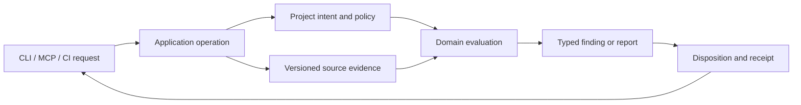

# Software architecture and development backlog

The goal is to make KiCad Team Tooling easier to extend, reason about, and
release as a product. This plan concerns ownership and the path from a project
request to a trustworthy result. Moving files and reducing line counts are
implementation details within that plan.

Project repositories own designs, requirements, catalog records, rule choices,
and engineering approvals. This repository owns reusable services, typed
contracts, native adapters, CLI/MCP/CI surfaces, and regressions. The
[design-lint backlog](DESIGN_LINT_BACKLOG.md) owns proposed electrical rules;
this backlog owns how rules and other capabilities are built and operated.

## The product model

Every capability should follow the same traceable path:

The application operation owns orchestration and authorization. Project policy
expresses what the team intended; evidence records what the exact source and
tool versions showed. A domain service compares those inputs. The resulting
report retains source hashes, supported versions, limitations, and review
state. An adapter presents that report without reinterpreting it.

| Capability owner     | Owns                                                 | Must preserve                                          |
| -------------------- | ---------------------------------------------------- | ------------------------------------------------------ |
| Repository/discovery | Layout, selection, catalogs, portable paths          | Project-owned records and source boundaries            |
| Native evidence      | KiCad/simulator invocation, parsing, version binding | Tool identity, source hashes, unsupported states       |
| Design lint          | Theme predicates, catalog, coverage, findings        | Heuristic versus contract meaning and rule provenance  |
| Electrical analysis  | Requirements, calculations, simulation checks        | Model hashes, measurements, failure details            |
| Parts/CAD/BOM        | Part identity, preview/apply, population, handoff    | Reviewed choices and purchasing authority              |
| Product/release      | Cross-project relationships, package integrity       | Clean source commit, scoped evidence, restore behavior |
| Surfaces             | CLI, MCP, browser, CI request/response mapping       | Shared operation and explicit parity exceptions        |

These are ownership boundaries, not a command to create seven new packages
immediately. First make existing services follow the boundaries; then move
stable owners into directories where that improves navigation.

## Why the current development path is strained

Snapshot at clean revision `5d9b0b41` on 2026-10-29:

- The packaged design-lint catalog has 251 active rules, but the candidate
  aggregator accepts 49 parameters and the public evaluator accepts 33. A new
  evidence type can require edits across central signatures and report models
  even when only one electrical theme needs it.
- `hwrepo/models.py` defines 211 classes and is imported by 336 production
  modules. It is a compatibility registry that remains a source of new
  dependencies unless internal callers move to their domain owners.
- `mcp_server.py` registers many capabilities in one factory. CLI/MCP parity
  and `tool-surfaces.json` already give a useful contract, but every added
  operation still needs a clear application-service owner.
- Current design-lint maturity is entirely `synthetic_validated`. Synthetic
  predicate tests, exact native fixtures, cohort applicability, and reviewer
  confirmation are different evidence levels; rule count alone is not product
  progress.
- The general 500-line architecture gate emphasizes size. Cohesion, import
  direction, signature growth, duplicated behavior, and source provenance are
  better architecture signals. This revision has no Alphus dev pin or checked-in
  Alphus policy, so its findings are not a reproducible gate here yet.

## Decisions for new work

1. **One operation per user capability.** CLI, MCP, browser, and CI call a
   shared typed operation. They may differ in transport and permissions, but
   preserve the same inputs, validation, result meaning, and side effects.
2. **Evidence and intent remain separate.** Native output, inferred patterns,
   project-authored requirements, and reviewer dispositions have distinct
   records and statuses. Missing evidence is visible; it is not a pass.
3. **New sniffers extend a theme.** A rule has one predicate owner, catalog
   record, source/evidence boundary, fault and valid-control fixtures, and an
   explicit default mode. Theme services receive typed theme inputs. Avoid
   growing a global parameter list or passing `dict[str, object]` between
   phases. Registration remains explicit and inspectable.
4. **Contracts evolve deliberately.** A serialized report change gets a schema
   version and compatibility path. Public Python re-exports are kept for
   supported callers; internal code imports its owning model module directly.
5. **Gates test architecture claims.** Source-derived tests should catch a
   broken owner reference, wrong dependency direction, CLI/MCP drift, missing
   evidence provenance, or accidental signature growth. Line count is a review
   prompt, not the main measure of design quality.

## Strategic backlog, in delivery order

### SA-01 — Decide the data route before moving modules

**Outcome:** each stage knows which authored intent and observed evidence it
receives, who produced them, and what absence or staleness means. **Start:**
the [design-lint data routing decision](DESIGN_LINT_DATA_ROUTING.md), which
traces I²C pull-up hints from native capture through finding disposition.

Specify the run identity, project-owned intent, native observations, optional
theme coverage, derived scans, candidates, and report fields as separate typed
inputs. Record which hashes and exact tool versions bind them. Decide whether a
theme receives an unavailable-evidence state or stops before scanning. Keep
the current public report and fingerprints stable during the pilot.

**Done when:** one existing rule family has an agreed input/output table and
fresh, missing, stale, and not-applicable cases; the feature lane can identify
the right producer for a new datum; no module split is needed to express the
route. Hold physical reorganization until this decision and its pilot pass.

### SA-02 — Publish the capability and dependency map

**Outcome:** contributors know where a new capability enters and which module
owns each decision. **Start:** the seven owner groups above and current
`tool-surfaces.json`, rule catalog, and project configuration.

The [capability and dependency map](ARCHITECTURE_MAP.md) and its active-rule
dependency gate are already checked in. Extend that map for major operations:
project discovery, native capture, design lint, electrical analysis, parts/CAD,
product, and release. Record input/output contracts, source authority, allowed
dependencies, and CLI/MCP/CI mapping. Extend the transport dependency check
from active rule owners to other stable domain service families. Existing
catalog architecture checks guard active rule owners and their theme functions.

**Done when:** a contributor can place a proposed feature without guessing;
one intentionally wrong import and one wrong catalog owner fail focused tests;
the map matches live surface and catalog inventories.

### SA-03 — Define a common evidence lifecycle

**Outcome:** services consume evidence with consistent source, tool, coverage,
and freshness semantics. **Start:** native KiCad and simulator capture paths,
report models, and project inspection orchestration.

Document and normalize the stages: requested source scope, exact toolchain,
capture, parsed typed evidence, applicability/coverage, evaluation, and
receipt. Reuse existing hash and path services. Keep native adapters bounded
to the versions they support. A rule may opt into only the evidence it needs,
but its report must show why evidence was unavailable or stale.

The I²C pull-up coverage pilot now retains its netlist hash for a `COMPLETE`
scan with no hint entries. Evaluation rejects a missing or stale hash for that
positive state, while old serialized records remain parseable. Apply the same
positive-state source-binding check to other coverage families during their
route reviews.

Project inspection now rechecks the declared source inventory after scanning
and connectivity capture. An edit, addition, or removal during that work
blocks the result rather than presenting findings bound to the earlier source.
The manifest, lint policy, and consulted project-owned requirements are also
rechecked after capture; a changed input blocks the assembled report.

Control-input bias coverage follows the same boundary: a completed scan keeps
the observed netlist hash even when it finds no candidate nets. Evaluation
blocks stale or unbound completed coverage and coverage containing entries
before those entries can suppress a prompt. Legacy unbound records remain
readable; they cannot authorize evaluation against a current netlist.
Covered control-input and I²C pull-up or voltage entries also require a
contract path and digest at evaluation. Project inspection verifies the
contract bytes during the run; a direct evaluator caller must verify those
bytes itself because the evaluator has no project root.
Evaluation also rejects covered control-input or I²C decisions carried by
`NOT_CONFIGURED`, `PENDING`, or `NOT_APPLICABLE` coverage. `OPEN` coverage may
still resolve some entries while leaving others reviewable.

**Done when:** a stale hash, wrong native version, absent source, and unsupported
topology produce distinct, tested outcomes across representative schematic
and PCB capabilities. Receipts remain portable and comparable.

### SA-04 — Clarify policy, finding, and disposition semantics

**Outcome:** teams can tell observation from requirement failure and review
decision. **Start:** design-lint policy, report, reconciliation, and project
contract models.

Define one documented state model for heuristic `REVIEW`, project-authored
contract mismatch, native diagnostic, coverage gap, ignored finding, rule-off
finding, and stale disposition. Preserve current project modes and exact
fingerprints. Keep catalog maturity separate from project mode: synthetic
validation does not authorize a default blocking rule. Any serialized report
change uses an explicit schema migration and old-report tests.

Reconciliation treats a changed declared source or native netlist digest as
reviewable context even when the finding set and captured pin connectivity
are identical. It retains the source paths and both netlist digests in the
existing report schema. Changes to coverage and other report fields are also
named in review context, including fields added to the report later. A
reconciliation result does not accept findings or authorize a build.
Evaluation blocks duplicate candidate fingerprints before applying ignores.
When disposition is blocked and no complete finding list is available, the
report retains source-bound coverage without requiring its counts to match an
absent list; source identities are still validated. Peer-reference and mapped
check records produced before a disposition failure remain in that blocked
report so the evidence gap is visible to CLI and MCP consumers.
For a blocked report with no finding list, text output says the findings are
unavailable or incomplete; consumers of the unchanged JSON schema must use
`status` and `issues` rather than interpreting an empty list as a clean scan.

**Done when:** CLI, MCP, CI, and reconciliation present the same state for the
same source revision; transitions remain reviewable; no source change silently
turns a previous finding into an approval.

### SA-05 — Make the sniffer extension path stable

**Outcome:** a rule is added through its theme without widening central APIs.
**Depends on:** SA-01–SA-04. **Start:**
`design_lint_candidate_aggregation.py`, `design_lint_evaluator.py`, and
`design_lint_evaluation_types.py`.

The I²C pull-up route now enters one typed theme service, and the I²C address
route carries the observed netlist, project map, and resolved coverage as one
theme input. The bus coordinator now receives both through `BusCandidateInputs`
and rejects mixed native observations. The
[data-routing decision](DESIGN_LINT_DATA_ROUTING.md) records their different
absence rules and the pull-up migration comparison. Keep the
current public evaluator as a compatibility adapter while callers migrate.
Preserve deterministic ordering, fingerprints, catalog ownership checks, and
source-bound evidence. Route the next agreed theme inputs only after their
producers and absence states are specified; avoid adding a new electrical
predicate solely for the architecture migration.

The evaluation path now validates the complete candidate set after theme,
native, and rule-specific additions, before applying project modes or ignores.
This keeps new extension paths under the same active-catalog check. The next
internal API step is to pass prepared, source-bound theme records directly
without widening the public compatibility signature or introducing a global
optional context.

The architecture regression suite now caps the established public candidate
and evaluator compatibility signatures at 49 and 33 parameters. New evidence
must enter through a typed theme input or prepared internal record; changing
either cap requires an explicit migration plan and a corresponding removal of
legacy surface parameters.

The public `candidates()` adapter and prepared evaluation now construct the
same required capability-group inputs and call `scan_candidates()`. The
synthetic I²C missing-pull-up fault and valid-control cases compare candidate
order, fingerprints, serialized report JSON, and coverage dispositions through
both routes. The input groups keep shared power requirements in one owner and
require connector, component, control, power, bus, peer, mapped, and PCB groups
at the scanner boundary. Continue migrating direct candidate consumers by capability
group; remove a legacy argument only after its callers have moved and the
fault/control outputs remain unchanged.

I²C, SPI, CAN, and RS-485 peer rule owners now attach typed identities to their
internal candidates. Construction and coverage assembly check that each
identity matches the public evidence fields; coverage uses the typed identities.
The report and fingerprint continue to use the existing serialized evidence.
The remaining work is to make typed theme results the general extension path,
without widening the public candidate API.

**Done when:** the pilot yields equivalent findings and report meaning; adding
a second rule in that theme needs no new parameter on the 49- or 33-parameter
central functions; no opaque mapping substitutes for typed inputs; focused
synthetic/native and catalog tests pass.

### SA-06 — Establish application services beneath all surfaces

**Outcome:** a capability has one implementation even when exposed by several
adapters. **Start:** high-traffic project verify, design lint, electrical run,
parts preview/apply, and release operations.

For each operation, name the typed request, response, authority checks, and
side effects. Keep startup permissions and path scoping at the adapter edge;
move domain decisions out of MCP/CLI/browser handlers. Use
`tool-surfaces.json` and parity tests as the external contract. Do this one
vertical capability at a time.

The supplier handoff tranche moved generated-artifact scope and stable file
reads into `hwrepo/artifact_access.py`. The supplier service now uses that
shared owner directly; MCP keeps its existing import surface. A focused
architecture check guards the service against MCP imports, and the existing
artifact safety and supplier CLI/MCP parity tests cover the route. Project
selection still has separate CLI and MCP messages around the same registry;
unify that lookup only when its error contract is decided.

The dependency guard now includes electrical, parts, CAD, layout, selection,
product, supplier handoff, artifact, project-source, and purchasing-preference
services, including imports of `hwrepo.mcp_*` adapters. Project-source reads
and optimistic edits are owned by `project_source_access.py`, with bounded
file reads shared with artifact access; MCP retains compatibility exports.
The same scoped path, model validation, exact hash, atomic publication, and
readback checks serve purchasing writes and MCP source edits. Purchasing
receipts verify the digest of the exact intended bytes, including no-op saves;
an equivalent reserialization observed during readback cannot claim success.

**Done when:** the selected operation's CLI and MCP tests compare equivalent
typed results and failures, and its adapter contains no copied predicate or
project-source parser. Installed-wheel smoke runs against a separate project
checkout before release.

### SA-07 — Give contracts and schemas durable owners

**Outcome:** `models.py` becomes a compatibility facade rather than the default
home for new records. **Depends on:** the SA-01 data decision and SA-05 pilot.
**Start:** a leaf intake/report group that depends only on primitives, followed
by project, evidence, parts, and release groups.

Move one contract family at a time, update internal imports to its owner, and
retain identity-compatible public re-exports. Check import cycles and schema
identity. A physical package hierarchy can follow once owners and dependency
edges are stable. Keep an inventory of supported import and JSON contracts so
renames do not masquerade as harmless refactors.

The bounded file-content, edit-preview, and edit-result records now belong to
`file_access_models.py`. Their established `Mcp*` names remain identity
exports from `models.py`; the source and artifact services import the owner
directly. The three generated JSON schemas were compared with their pre-move
versions, and legacy JSON round trips are regression-tested. Purchasing
preferences, their schema-version base, and their write result now belong to
`purchasing_preference_models.py`, with identity-compatible registry exports.
The preference service and its consumers import that owner directly; nested
purchasing and selection schemas retain their existing JSON shape.

**Done when:** a new feature's record is placed with its domain, the selected
legacy imports shrink, old supported imports resolve, and serialized reports
round-trip across supported schema versions.

### SA-08 — Replace size-first review with meaningful quality gates

**Outcome:** CI catches architecture drift while leaving room for cohesive
1,000–2,000-line modules. **Start:** the existing architecture suite and a
reviewed Alphus revision/policy on this branch.

Keep narrow limits for individual rule owners. Use a general size threshold as
review guidance with explicit exceptions and a shrink plan for existing very
large files. Add gates for dependency direction, public surface parity, rule
catalog ownership, new central-signature growth, and typed evidence
boundaries. Apply a facade ceiling to dispatchers, and the focused owner limit
to predicates; a typed sniffer service should not be forced under a facade
ceiling. Treat Alphus's language/framework/category/complaint IDs as a
filterable code-quality inventory; keep electrical rule themes, maturity, and
project policy in their own catalog. Open only clean, reproducible blocking
checks; keep disputed guidance review-only and record upstream complaints
outside this repository.

The development extra now pins Alphus, and `quality-gates.toml` defines a
reproducible runtime-types, Pydantic practices, and Python-style scopes. The
package CI job runs the first two in advisory report mode; Python-style is
available on demand while its broader output is reviewed. See
`ALPHUS_QUALITY_GATES.md` for the command and enforcement boundary.

**Done when:** the checked-in gate plan and installed Alphus revision agree;
representative bad dependencies and rule registrations fail; existing valid
Pydantic/default-factory patterns do not need mechanical rewrites; CI reports
which gate failed and why.

### SA-09 — Validate the product through representative journeys

**Outcome:** refactors preserve workflows people use, not just internal unit
behavior. Maintain three bounded journeys against separate public or reviewed
project checkouts: onboard and verify a project; run and reconcile source-bound
design lint; prepare a reviewed parts or release artifact.

Each journey checks missing/stale evidence, a valid control, CLI/MCP parity,
exact native tool selection where applicable, and retained receipts. Keep
synthetic fixtures for predicate behavior and distinct cohort/reviewer
evidence for usefulness. Record runtime and the slowest stage so gate cost is
visible when adding new sniffers.

**Done when:** a feature or architecture tranche names the affected journey,
passes its focused regressions, and the full package/wheel gate passes before
release. A passing journey is tooling evidence, not electrical or manufacturing
approval.

## Feature-development workflow and measures

For a proposed capability or sniffer, make a short change note before coding:

1. Name the user decision it supports, the domain owner, the project-authored
   intent it needs, and the exact source/tool evidence it can observe.
2. Define a typed input/output contract and failure states. State what the
   result cannot establish and whether it is a heuristic, contract comparison,
   or native diagnostic.
3. Add a fault case, a valid control, and boundary cases at the narrowest
   service layer. Add exact native fixtures when the claim depends on native
   export behavior. Keep fixture data separate from production modules.
4. Expose the operation through needed surfaces using the shared service and
   update the surface catalog and parity tests. Record any intentional adapter
   exception.
5. Measure real review value separately from test maturity. Promote modes or
   expand supported topologies only with reviewed project policy and evidence.

Review the change path after each rule tranche: which central signatures or
reports changed, how many unrelated modules were touched, whether an existing
service was copied, whether source/version provenance survived, and which
tests were needed. SA-05 succeeds when ordinary theme rules stop expanding the
central evaluator and aggregator. SA-06 succeeds when a surface addition maps
to a named shared operation. SA-09 succeeds when the representative journeys
remain reproducible and their cost is recorded. Do not substitute file-count
or rule-count growth for these measures.

## How the two development lanes work

The feature lane owns new predicates, catalog entries, and focused fixtures.
The architecture lane owns the stable extension path, shared operations,
contract ownership, and structural gates. Both use the same domain map and
project evidence contract. Only one lane edits a shared coordinator, report
schema, `models.py`, or catalog file at a time. Integrate a feature tranche,
then adapt that stable revision in the architecture lane; rebase and run the
affected journey before the next feature tranche.

A change proposal should state the capability owner, project input, evidence
source, typed result, surface changes, regression slice, and evidence level.
For each finished tranche, report what changed for a caller, what contracts
were preserved or versioned, the relevant test/CI evidence, and remaining
risks. A reduction in line count is useful only when it makes those boundaries
clearer.
