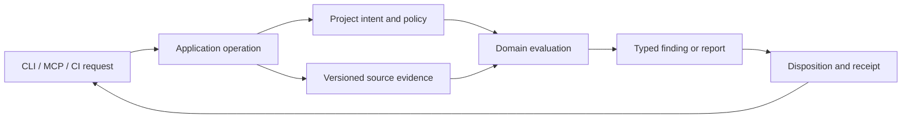

# Software architecture and development backlog

The goal is to make KiCad Team Tooling easier to extend, reason about, and
release as a product. This plan concerns ownership and the path from a project
request to a trustworthy result. Moving files and reducing line counts are
implementation details within that plan.

Project repositories own designs, requirements, catalog records, rule choices,
and engineering approvals. This repository owns reusable services, typed
contracts, native adapters, CLI/MCP/CI surfaces, and regressions. The
[design-lint backlog](DESIGN_LINT_BACKLOG.md) owns proposed electrical rules;
this backlog owns how rules and other capabilities are built and operated.

## The product model

Every capability should follow the same traceable path:

The application operation owns orchestration and authorization. Project policy
expresses what the team intended; evidence records what the exact source and
tool versions showed. A domain service compares those inputs. The resulting
report retains source hashes, supported versions, limitations, and review
state. An adapter presents that report without reinterpreting it.

| Capability owner     | Owns                                                 | Must preserve                                          |
| -------------------- | ---------------------------------------------------- | ------------------------------------------------------ |
| Repository/discovery | Layout, selection, catalogs, portable paths          | Project-owned records and source boundaries            |
| Native evidence      | KiCad/simulator invocation, parsing, version binding | Tool identity, source hashes, unsupported states       |
| Design lint          | Theme predicates, catalog, coverage, findings        | Heuristic versus contract meaning and rule provenance  |
| Electrical analysis  | Requirements, calculations, simulation checks        | Model hashes, measurements, failure details            |
| Parts/CAD/BOM        | Part identity, preview/apply, population, handoff    | Reviewed choices and purchasing authority              |
| Product/release      | Cross-project relationships, package integrity       | Clean source commit, scoped evidence, restore behavior |
| Surfaces             | CLI, MCP, browser, CI request/response mapping       | Shared operation and explicit parity exceptions        |

These are ownership boundaries, not a command to create seven new packages
immediately. First make existing services follow the boundaries; then move
stable owners into directories where that improves navigation.

## Why the current development path is strained

Snapshot at clean revision `5d9b0b41` on 2026-10-29:

- The packaged design-lint catalog has 251 active rules, but the candidate
  aggregator accepts 49 parameters and the public evaluator accepts 33. A new
  evidence type can require edits across central signatures and report models
  even when only one electrical theme needs it.
- `hwrepo/models.py` defines 211 classes and is imported by 336 production
  modules. It is a compatibility registry that remains a source of new
  dependencies unless internal callers move to their domain owners.
- `mcp_server.py` registers many capabilities in one factory. CLI/MCP parity
  and `tool-surfaces.json` already give a useful contract, but every added
  operation still needs a clear application-service owner.
- Current design-lint maturity is entirely `synthetic_validated`. Synthetic
  predicate tests, exact native fixtures, cohort applicability, and reviewer
  confirmation are different evidence levels; rule count alone is not product
  progress.
- The general 500-line architecture gate emphasizes size. Cohesion, import
  direction, signature growth, duplicated behavior, and source provenance are
  better architecture signals. This revision has no Alphus dev pin or checked-in
  Alphus policy, so its findings are not a reproducible gate here yet.

## Decisions for new work

1. **One operation per user capability.** CLI, MCP, browser, and CI call a
   shared typed operation. They may differ in transport and permissions, but
   preserve the same inputs, validation, result meaning, and side effects.
2. **Evidence and intent remain separate.** Native output, inferred patterns,
   project-authored requirements, and reviewer dispositions have distinct
   records and statuses. Missing evidence is visible; it is not a pass.
3. **New sniffers extend a theme.** A rule has one predicate owner, catalog
   record, source/evidence boundary, fault and valid-control fixtures, and an
   explicit default mode. Theme services receive typed theme inputs. Avoid
   growing a global parameter list or passing `dict[str, object]` between
   phases. Registration remains explicit and inspectable.
4. **Contracts evolve deliberately.** A serialized report change gets a schema
   version and compatibility path. Public Python re-exports are kept for
   supported callers; internal code imports its owning model module directly.
5. **Gates test architecture claims.** Source-derived tests should catch a
   broken owner reference, wrong dependency direction, CLI/MCP drift, missing
   evidence provenance, or accidental signature growth. Line count is a review
   prompt, not the main measure of design quality.

## Strategic backlog, in delivery order

### SA-01 — Decide the data route before moving modules

**Outcome:** each stage knows which authored intent and observed evidence it
receives, who produced them, and what absence or staleness means. **Start:**
the [design-lint data routing decision](DESIGN_LINT_DATA_ROUTING.md), which
traces I²C pull-up hints from native capture through finding disposition, and
the [component-map coverage routing decision](COMPONENT_MAP_COVERAGE_ROUTING.md),
which traces authored topology maps and supplied coverage through source
binding, candidate generation, and report reconciliation, and
the [electrical analysis routing decision](ELECTRICAL_ANALYSIS_DATA_ROUTING.md),
which traces authored requirements, source-bound netlist/PCB evidence, and
simulation results through the versioned receipt.

Specify the run identity, project-owned intent, native observations, optional
theme coverage, derived scans, candidates, and report fields as separate typed
inputs. Record which hashes and exact tool versions bind them. Decide whether a
theme receives an unavailable-evidence state or stops before scanning. Keep
the current public report and fingerprints stable during the pilot.

Electrical analysis now has a parallel route decision and a typed netlist
admission in `electrical_netlist_evidence.py`. The admission keeps the full
`ContractCoachReport`, checks project identity and exact source hashes, and
distinguishes `NOT_REQUESTED`, `UNAVAILABLE`, and `OBSERVED` evidence before
existing theme predicates run. I²C pull-up, CAN termination, USB-C, and SPI
state dispatch now belongs to `electrical_bus_evaluation.py`, whose narrow
request pairs those four typed requirement sections with the admitted netlist.
The runner keeps the established check order while delegating those predicates
to their existing owners. Focused tests cover blocked, incomplete,
cross-project, stale-source, unrequested evidence, and attempted status
misclassification. On 2026-10-31, the electrical and capability architecture
slice passed with 288 tests and 34 subtests; one exact native KiCad test was
skipped because this run did not configure its native lane. Ruff, focused
Pyright, Rumdl, and `git diff --check` also passed. Preserve the existing
report schema; do not introduce a global optional evidence context or split
modules to meet a line threshold.

PCB return-path and test-access evaluation now have separate typed requests in
`electrical_pcb_evaluation.py`. `electrical_pcb_evidence.py` preserves the
capture state, returned command, snapshot, and probe-request digest. The
runner plans and performs capture, then delegates return-path, schematic
access, PCB pad access, and probe-envelope evaluation in their existing order.
Focused source-bound receipt and CLI/MCP parity tests continue to cover those
stages; architecture checks now prevent the runner from calling their
predicates directly.
Connector peer assignment routing now returns a named, read-only
`PeerAssignmentPartition` containing the peer-group identity, scoped observed
assignments, and reviewed basis. Missing or incomplete authored scope stays
unscoped as a whole; partial scope is not treated as reviewed coverage.
The scope map now carries `ConnectorComparisonScope` records with named
`group` and `basis` fields across peer, return, and supply comparisons. The
source-matched producers return read-only maps, and a case-insensitive index
owner guards duplicate connector references. The report projection remains
unchanged. Architecture coverage checks that all connector scope parameters
use the typed record instead of a two-string tuple.
`connector_pins.py` remains below the 100-line facade limit; its tuple-valued
legacy adapters live in `connector_peer_pin_compat.py`, and internal hosted and
native services import connector identity operations from their owner.
Connector alias checks now consume a named `ConnectorFootprintPeerPinInventory`
with a read-only per-reference display-number map; missing or ambiguous pin
inventories remain unavailable to the comparison.
IC decoupling review now returns named requirement and capacitor-value records
from the authored map and observed netlist. The candidate boundary continues to
emit the established evidence fields and requirement digest.

The I²C low-equivalent-resistance scan now returns named per-line observations
with typed resistor paths and numeric effective resistance, alongside explicit
SDA and SCL pin assignments. Candidate formatting owns the legacy evidence
projection, so the scan no longer hands three correlated line-keyed maps to
the candidate layer. Internal design-lint services call the owning module;
the `bus_heuristics.py` compatibility facade preserves its former map-shaped
return record for existing Python callers.

Control-input and open-output candidates now retain their typed inventory or
heuristic source records. The theme-owned evidence projector produces the
existing report fields and rejects mismatches between a source record and its
serialized rule/evidence pair. Focused regressions cover all three source
families and the compatibility report shape; the candidate scanner remains
responsible for selection and message wording.
CAN peer-assignment candidates now follow the same boundary in a CAN peer
evidence owner kept separate from termination evidence. The typed divergence
record remains available internally while the report fields and fingerprint
inputs stay stable.

Unconnected I²C, CAN direction, generic SPI/USB-C/CAN pin, USB data, SPI data,
SPI clock, and serial findings now retain their protocol-specific source
records behind one report projector. Predicate owners keep their own partial-
assignment rules; the scanner keeps ordering and wording. RS-485 and USB-C SBU
remain specialized translators with their own owners.

Signal-pair findings now retain `ComplementaryLineGap` or
`NamedDifferentialPair` records through a theme-owned projection. The
complementary scan record's positive/negative pin and net views are immutable
and use a bounded side-key type; named accessors guide internal callers while
the previous mapping attributes remain compatibility views.
The generic component peer-pin outlier now retains its `PeerPinAssignmentOutlier`
record through a theme-owned projection, and its peer assignments are copied
into a read-only map. This keeps the identity, majority, outlier pins, and
shared-anchor context attached to the finding while preserving its public
evidence fields and fingerprint. The component peer-pin slice passed 80
synthetic and architecture tests with four native-lane tests deselected, plus
Ruff, focused Pyright, Markdown checks, and `git diff --check`; it does not
claim native-tool coverage.
The generic split, named split, partially open, and all-open component power-
input findings now retain separate typed variants of their peer scan records.
The generic split carries the peer function observations used in its report;
their projector preserves existing fields and conditional PART_ID identity.
Recognized supply/return divergence and open power-output, signal-output,
signal-input, and bidirectional findings now retain their role-specific scan
records too. The component-peer candidate adapter has no inline evidence-map
construction. The complete typed-routing, projection, marker, architecture,
determinism, scanner parity, and CLI/MCP selection passed 170 tests with 3
skips. The focused evidence selector passed 10 tests, with 9 deselected. No
exact native KiCad fixture lane was run in this checkpoint. Ruff, format,
project-aware Pyright, Rumdl, and `git diff --check` passed.
The six BJT/MOSFET terminal-tie rules now retain one typed terminal-pair source
record and use a component-owned projection for their existing role-specific
report fields. Their predicate functions and catalog owners remain in place.
The focused route, six rule suites, and their architecture guards passed 51
tests, with two additional MCP/report parity tests passing. Ruff, focused
Pyright, Markdown checks, and `git diff --check` passed. Native fixtures were
excluded from these runs.

PCB fitted-footprint absence and identity-mismatch findings now retain typed
per-reference comparisons with their netlist, board, snapshot, schema, KiCad
image/version, and probe identities. DNP mismatches also retain their typed
comparison and paired named-variant exports; blocked named-variant coverage
retains an explicit blocked source record. PCB-owned projectors preserve the
existing report evidence and fingerprints. Value mismatches and blocked value
comparisons now retain typed sources as well; their projector preserves the
distinct evidence shapes for complete and blocked inventory states. Top-level
blocked inventory coverage now retains a `PcbBlockedComponentInventoryEvidence`
record shared by the footprint and DNP findings, with separate projectors
preserving their existing sparse wire fields. The combined focused source-route,
inventory, population, value, catalog-boundary, architecture, and CLI/MCP parity
run passed 62 tests under `design_lint and not native_kicad`. This advances SA-01
without a line-count-driven split or public report change.
Schematic-to-PCB pad-net findings now retain their typed mismatch and shared
native receipt; blocked findings preserve both inventory and comparison
states. The source receipt's report constructor is reused by the inventory and
pad-net translators. Opt-in board-only and project-required fitted-reference
candidates retain their typed comparisons, native receipts, authored
requirement coverage, and named-variant evidence. Their blocked states keep the
enclosing report and coverage context. The combined pad-net, board-only,
required-reference, catalog, inventory, and parity slice passed 55 tests with
8 tests deselected by the tag's focused marker expression; Ruff, format, and
project-aware Pyright passed.
Differential-pair DRC findings now retain the incomplete entry and its complete
source-bound report in a PCB-owned typed evidence record. Its projector keeps
the existing evidence fields and fingerprint, while evaluation remains the
owner of map and source freshness checks. The source-binding fixtures now
identify the same synthetic project as the evaluation request, so they exercise
current source checks rather than the cross-project rejection path.
Signal-path and skew-bundle DRC findings now also retain their incomplete
entry and full source-bound report behind a PCB-owned projector. Path and
bundle messages, finding order, evidence fields, and fingerprints are
preserved. Corrected fixture project IDs exercise the same-project source-
freshness path rather than cross-project rejection. The combined DRC and
signal-path selection passed 98 tests, with 20 deselected by the tag's
`design_lint and pcb_lint` expression. Parity used the public template at
`ed89536f0dbbcb013145af2994fef41b2250143e`; Ruff, format, and project-aware
Pyright passed.
Switching-loop, named keepout, RF antenna, and touch-pad clearance candidates
now retain their exact coverage entries and source-bound reports behind
separate PCB owners. Their projectors preserve area/route/return-plane,
geometry/layer/restriction, module/feed/antenna, and measured-clearance fields.
The combined DRC, signal-path, switching-loop, keepout, RF, touch-pad,
catalog, scanner, and MCP parity selection passed 193 tests, with 20 deselected
by the tag's `design_lint and pcb_lint` expression. Parity used the public template at
`ed89536f0dbbcb013145af2994fef41b2250143e`; Ruff, format, and project-aware
Pyright passed. The switching-loop fixture's project identity now matches its
evaluation request, enabling its source-bound coverage assertions to run
instead of cross-project rejection.
Touch-pad blocked and per-entry findings now retain distinct typed source
records in a candidate-evidence owner separate from the geometry measurement
service. The old service function delegates as a compatibility adapter, and
the internal PCB translator uses the owner directly. Focused touch-pad,
architecture, determinism, catalog, scanner, and MCP-parity checks passed 36
tests under `design_lint and not native_kicad`.
Decoupling, protection-path, track-width, and reference-plane findings now
retain their exact measurements and source-bound coverage reports in separate
theme-owned candidate evidence modules. Existing evidence projections and
fingerprints remain stable, and complete controls stay quiet. The focused
measurement evidence, architecture, and rule regression selection passed 29
tests with `design_lint and pcb_lint`; the marker, collection, and theme
architecture selection passed 15 tests with `design_lint and architecture`.
Generic connector footprint-peer divergence and open findings now retain their
typed scan records through a connector-owned projector. The source assignment
maps are immutable and the existing public evidence fields remain stable.
Full evaluation retains native netlist identity on `DesignLintReport` and
`ConnectorPeerPinHeuristicCoverage`, where report validation checks digest
equality and finding counts; the internal candidate does not duplicate it.
The four unconnected component power-pin rules now retain their typed scanner
record through one component-owned projection. Named pins use a closed
`supply`/`return` category; generic pins distinguish literal `power_in` and
`power_out` roles and preserve optional native pin-function evidence. Existing
rule selection, wording, and serialized fields remain in their theme owners.
The combined component unconnected-pin, connector footprint-peer, architecture,
rule-registry, LED topology, and CLI/MCP parity selection passed 190 tests with
3 skipped (193 collected) using the separate public template at `ed89536`.
The LED topology findings now flow through one component-owned projector. Its
candidate retains either direct-bridge or output-driven scanner records;
custom role-map evidence is emitted only after its retained digest is validated.
Existing LED wording and report fields remain owned by their current services.
Changed Python files passed Ruff check and format validation. Project-aware
Pyright on macOS and Windows, Rumdl, mdrepo, and diff checks passed. No exact
native KiCad lane was run.

The six direct evidence maps in the schematic power candidate adapter now use
one typed power-owned projector and retain their source records. This includes
the source-path heuristic's conditional anchor state, derived from its typed
source-net list, plus immutable same-voltage, repeated-supply, and numbered-
rail source maps. Existing rule order, wording, evidence fields, and
fingerprints are preserved. Focused rule, source-projection, architecture,
marker, and CLI/MCP parity checks passed 144 tests using public template
revision `ed89536`; no native KiCad lane was run.

The three return-domain candidate maps now retain typed connector-return or
return-net-group variants behind a return-owned projector. The source variants
distinguish numbered returns from return-like labels without explicit pin
roles; existing optional label clues, messages, and report fields are
preserved. Connector and net source maps are copied and frozen. Focused rule,
projection, architecture, marker, and CLI/MCP parity checks passed 91 tests
against public template revision `ed89536`. Ruff, macOS and Windows Pyright,
and the focused source checks passed; no native KiCad lane was run.

SPI and serial peer-voltage findings now share one bus-owned evidence
projection. Each candidate retains the exact `DigitalPeerVoltageReview` and
its authored-map scope, while the projection preserves protocol-specific
assignment keys and optional source identity. Existing heuristics and
coverage state handling remain in the scan/evaluation owners. The combined
voltage, serial, determinism, architecture, marker, and CLI/MCP parity
selection passed 79 tests; macOS and Windows Pyright and Ruff passed. No native
KiCad lane was run.

The authored connector return-distribution finding now retains its exact entry
and source-bound coverage report behind a connector-owned projector. Its six
role maps are immutable internally and serialize as regular mappings; report
fields, status selection, and policy behavior are preserved. The focused
distribution, source-projection, architecture, marker, and CLI/MCP parity
selection passed 52 tests. Ruff and macOS and Windows Pyright passed. No native
KiCad lane was run.

The combined local synthetic, rule, and architecture retest across power,
return-domain, return-distribution, and digital-peer-voltage evidence owners
passed 295 tests. Ruff, formatting, Pyright on changed production and test modules,
Markdown checks across 273 files, and mdrepo passed. This local selection did
not run the public-template CLI/MCP parity modules or exact native KiCad.

Serial roster and reference-domain candidates now retain their typed endpoint
or exact review-and-scan source records. The serial source, behavior,
determinism, and architecture selection passed 49 tests; CLI/MCP parity passed
6 tests and 6 subtests against public template revision `ed89536`. Marker and
collection architecture checks passed 14 tests, with focused Pyright and Ruff
clean. SPI bias and shared-clock reference candidates now retain their exact
heuristic gap or review-and-scan source while the shared clock identity remains
available for coverage reconciliation. The SPI source, rule, and architecture
slice passed 46 tests, CLI/MCP parity passed 3 tests, and marker/collection
checks passed 14 tests. SPI bias report parity passed one additional test.
Pyright and Ruff passed for both routes. No exact native KiCad lane was run.
I²C reference findings now use the same source-bound pattern, retaining the
review and scan plus canonical SDA/SCL identity. Its rule, source, and
architecture selection passed 27 tests; CLI/MCP parity passed 3 tests.
Marker and collection checks passed 14 tests. Focused Pyright and Ruff passed;
no exact native KiCad lane was run.

A fresh AST inventory at this checkpoint finds no direct
`Candidate(evidence=...)` constructions in candidate adapters and no
`PeerReferenceCandidate.from_identity(evidence=...)` calls. The broad scan
before this route found 17 direct candidate constructions across six theme
owners, including USB data polarity. That route now retains its exact
`NetlistContract` through `UsbDataPolarityCandidate`; source construction checks
the pin function, net assignment, and polarity identities. A refreshed scan
leaves 13 direct constructions across three theme owners: one power-decoupling
route, one regulator-passive route, and eleven schematic-geometry routes. The
two transformer routes retain named winding groups, typed pin-to-net
assignments, and their exact netlist through `TransformerCandidate`. The
connector supply-domain route retains its exact netlist, coverage report, and
mapped pin records through `MappedSupplyDomainsCandidate`. I3C one-sided-open,
unmapped SPI, two-pin same-net, USB-C port, and USB peer-reference findings
retain their exact typed source records. SPI, I²C, CAN, and RS-485 reference
candidates retain their scan and bus/pair records through protocol-owned
subtypes while preserving the common identity used for coverage
reconciliation. This inventory is limited to direct candidate construction;
it does not claim that every dictionary in scanners, coverage records, or
application services has become typed. Continue by tracing each remaining
producer, provenance, absence state, and consumer before changing module
boundaries.

The USB-C port route passed its source and behavior selection (13 tests), CLI/MCP
parity (1 test), and marker/collection architecture checks (14 tests). The USB
peer-reference source and behavior selection passed 89 tests, with CLI/MCP
parity passing 4 tests. Focused Pyright, Ruff, and format checks passed for the
new owner and adapter. No exact native KiCad lane was run.

USB data-polarity candidates now retain their source netlist and validate their
serialized evidence against the typed conflict. The source, behavior, and
architecture selection passed 11 tests; marker and collection architecture
checks passed 14 tests. Focused Pyright and Ruff passed. No exact native KiCad
lane was run.

Transformer winding findings now retain the exact netlist through named
`SupportedTransformerObservation`, `TransformerWindingPinGroup`, and
`TransformerPinNetAssignment` records. The same-winding and cross-winding
projectors preserve their current report fields and candidate order. The
focused source, behavior, catalog, architecture, marker, collection, and
CLI/MCP parity selection passed 87 tests. Pyright and Ruff passed. No exact
native KiCad lane was run.

Mapped connector supply-domain findings now retain the exact netlist, source
coverage report, and ordered `ConnectorMappedPinEvidence` records through
`MappedSupplyDomainsCandidate`. Construction verifies each grouped pin against
current source-matched coverage; the report fields and fingerprint input remain
stable. The source, behavior, and architecture selection passed 10 tests;
marker and collection checks passed 14 tests. Pyright and Ruff passed. No exact
native KiCad lane was run.

The combined source-projection, rule, architecture, size, marker, and CLI/MCP
parity selection passed 237 tests against the clean public `KiCAD-Test`
checkout at `ed89536f0dbbcb013145af2994fef41b2250143e`. Pyright reported zero
errors; Ruff, format, the changed Markdown checks, and mdrepo passed. No exact
native KiCad lane was run.

After adding the I²C peer-source route, the expanded focused selection passed
313 tests against the same clean public template revision. It includes the
generic peer-identity coverage checks and I²C CLI/MCP parity. Pyright reported
zero errors; Ruff, formatting, Markdown, mdrepo, and both SPI/I²C marker
selectors passed. No exact native KiCad lane was run.

The next source-projection slice adds CAN and RS-485 peer references, I3C
one-sided-open pins, same-net two-pin components, unmapped SPI participants,
and USB-C port coverage. Its focused source, rule, architecture, size, marker,
and CLI/MCP parity selection passed 227 tests, with one hosted USB-C native
fixture test skipped because it belongs to the digest-pinned acceptance lane.
The run used public `KiCAD-Test` revision `ed89536f0dbbcb013145af2994fef41b2250143e`.
Separate selectors passed 17 CAN/RS-485/I3C interface tests, 12 return-path
tests, and 16 two-pin component/evidence tests; the SPI/USB-C interface
selector passed 26 tests with the same one native-fixture skip. Pyright
reported zero errors; Ruff, formatting, Rumdl on the changed docs, and mdrepo
passed. No exact native KiCad lane was run.

Adding the source-bound USB peer-reference projector expanded that focused
selection to 308 passed and one skipped, against the same public template
revision. The USB peer slice passed 69 interface-selector tests and 68
return-path-selector tests, including CLI/MCP parity. Adding the USB
data-polarity source route expanded the full focused selection to 320 passed
and one skipped; its interface selector passed 12 tests. Pyright reported
zero errors; Ruff, formatting, Rumdl, and mdrepo passed. The sole skip is the
USB-C native fixture reserved for digest-pinned acceptance. No exact native
KiCad lane was run.

**Done when:** existing rule families have agreed input/output tables and
fresh, missing, stale, and not-applicable cases; the feature lane can identify
the right producer for a new datum; no module split is needed to express the
route. Hold physical reorganization until each family route and its focused
checks pass.

### SA-02 — Publish the capability and dependency map

**Outcome:** contributors know where a new capability enters and which module
owns each decision. **Start:** the seven owner groups above and current
`tool-surfaces.json`, rule catalog, and project configuration.

The [capability and dependency map](ARCHITECTURE_MAP.md) and its active-rule
dependency gate are already checked in. Extend that map for major operations:
project discovery, native capture, design lint, electrical analysis, parts/CAD,
product, and release. Record input/output contracts, source authority, allowed
dependencies, and CLI/MCP/CI mapping. The transport dependency check now covers
active rule owners, every `design_lint_*` service and facade, and the
schematic-geometry services and facade, alongside the previously listed stable
service families. Existing catalog architecture checks guard active rule owners
and their theme functions.
Audit hybrid modules that host both a CLI and reusable stage functions as
explicit migration items. Project verification's portable and native lanes now
call typed services under `hwrepo`; the `ci.py` and `check_all.py` functions
remain compatibility adapters. Governance lint also has focused owners in
`governance_lint.py` and `governance_records.py`, and its former 579-line CLI
module is now a small adapter. Declared project source hashing now belongs to
`project_source_hashes.hash_project_sources`; `validate.hashes` is its legacy
export. Single-project native validation now belongs to
`native_project_validation.validate_project` with a strict
`NativeProjectValidationRequest`. `native_report_parsing.py` and
`native_command.py` own native output parsing and command capture, while
`native_toolchain.py` owns catalog selection and executable resolution.
`validate.py` keeps the registered CLI and old positional Python adapter;
`check_toolchain.py` likewise keeps its CLI and compatibility exports.
Standalone diagnostics and release preparation now call the selected-project
portable lane with `ProjectStaticPipelineRequest`; the services no longer
import its compatibility adapter from `ci.py`.
Release preparation now calls the typed native dependency owner directly;
`native_deps.py` remains the registered CLI and positional compatibility
adapter, and `native_dependency_models.py` owns its strict request contract.
Saved history receipts now admit only the native summary, findings view, or
project-verification report models their owner parses. Shared before/after
states now have one neutral model and service owner across BOM, board/product
variant, and history comparisons; `bom_change.py` keeps the compatibility
export.

**Done when:** a contributor can place a proposed feature without guessing;
one intentionally wrong import and one wrong catalog owner fail focused tests;
the map matches live surface and catalog inventories.

### SA-03 — Define a common evidence lifecycle

**Outcome:** services consume evidence with consistent source, tool, coverage,
and freshness semantics. **Start:** native KiCad and simulator capture paths,
report models, and project inspection orchestration.

Document and normalize the stages: requested source scope, exact toolchain,
capture, parsed typed evidence, applicability/coverage, evaluation, and
receipt. Use `project_source_hashes.hash_project_sources` for declared source
inventories and the shared path service for path boundaries. Keep native adapters bounded
to the versions they support. A rule may opt into only the evidence it needs,
but its report must show why evidence was unavailable or stale.

The I²C pull-up coverage pilot now retains its netlist hash for a `COMPLETE`
scan with no hint entries. Evaluation rejects a missing or stale hash for that
positive state, while old serialized records remain parseable. Apply the same
positive-state source-binding check to other coverage families during their
route reviews.

Project inspection now rechecks the declared source inventory after scanning
and connectivity capture. An edit, addition, or removal during that work
blocks the result rather than presenting findings bound to the earlier source.
The native coach and project inspection also recheck the validation summary,
netlist, and netlist-command bytes across their reads. Project inspection
revalidates the selected exact toolchain against the summary and checks it
again before returning. These are freshness checks, not filesystem locks.
The shared PCB DRC evidence service likewise rechecks the native summary, DRC
report, and DRC command after parsing and after coverage evaluation; the
reported DRC hash remains the one bound by the summary.
The path-to-SHA inventory now has a shared `SourceHashInventory` type whose
key and value are `RepositoryPath` and `Digest`. PCB board matching, mapped DRC
coverage normalization, native DRC capture, DRC rule review, native-summary
binding, native netlist evidence, and hierarchical schematic source readers use
that type end to end; serialized report maps are unchanged. Byte-content maps
remain separate. Keep maps keyed by references, rule IDs, or artifact IDs
under their own domain types.
Saved findings-view source binding now uses `SourceHashInventory` through
snapshot admission, native ERC mapping, and schematic drawing association;
the serialized findings report remains unchanged. The project overview now
uses the same contract from both project and full-checkout inventory producers
through freshness checks and receipt assembly. Artifact-path-to-digest maps
remain separate. Product visualization aggregation, PCB variant-capture input,
and STM32 IOC coverage now preserve typed repository paths and digests.
Read-only handoffs use `SourceHashInventory`; mutable accumulators use
`dict[RepositoryPath, Digest]` where source discovery adds entries.
Electrical-view freshness and verification history now use the shared
inventory type for their saved-source comparisons.
Both netlist and DRC consumers validate the summary's project, exact toolchain,
and completed source-scope hashes through the same native-summary boundary.
A completed DRC with violations can still provide evidence; it is not treated
as a clean DRC result.
Design-lint preparation checks source-bound contract-coach evidence against
the requested project ID before preparing candidates. A cross-project
mismatch returns `BLOCKED` without attaching the other project's source hashes
or netlist digest to the selected project's report. Unbound synthetic inputs
remain usable through the lower-level evaluator compatibility route.
Differential-pair evaluation now checks both the authored map and the current
coach source inventory before accepting scanned DRC coverage. Project, board,
and rules identities must also agree with that inventory; stale coverage is
blocked before it can create findings. Signal-path evaluation uses the same
source-binding check and also requires the current authored map. Regression
cases cover complete, incomplete, stale, disabled, and mapless reports.
Keepout, RF antenna, and touch-pad coverage now require their retained board
path and digest to match the current source inventory, with a current authored
map. Their common policy owns this check in
`design_lint_pcb_geometry_coverage_policy`; the mapped DRC policy stays
separate.
PCB geometry capture now retains explicit null observations required by its
versioned snapshot schema, verifies the typed snapshot and command against
their receipt bytes, and checks them again after coverage evaluation. Signal
path coverage applies the same checks when called independently.
Native PCB capture now returns a named `NativePcbConnectivityCapture` to
internal operations, keeping `CommandEvidence` beside the optional snapshot
until the evidence admission service assigns its explicit state. The original
tuple-returning function remains as a compatibility adapter. The electrical
runner now passes that record intact to evidence admission; the old separate
command/snapshot admission function remains a compatibility adapter too.
Schematic parsing now returns a named `SchematicSourceDocument` with decoded
text and its parsed root span. Wire, junction, and label parsing return named
geometry records with unsupported reasons; the scan coordinator routes those
reasons through catalogued `SchematicGeometryRuleId` keys before assembling
the source-bound report. The serialized report shape is unchanged.
PCB switching-loop route topology now projects native track ends into named
`_TrackEndpointObservation` records before resolving pad, via, and neighboring
track connectivity, replacing a positional five-field tuple at that boundary.
The manifest, lint policy, and consulted project-owned requirements are also
rechecked after capture; a changed input blocks the assembled report.
Electrical analysis separately checks that its selected configuration and
parsed requirements still match after input hashes are captured and again
after evaluation, so a mid-binding edit cannot produce a passing report for
an older in-memory contract with newer recorded input hashes.
Retained electrical evidence verification also rechecks the report, declared
inputs, and retained artifact hashes after parsing and evaluating them. A
changed receipt or source input cannot be accepted on the initial hash alone.
When replay needs a native netlist, it validates the summary's project,
toolchain, source scope, netlist hash, and export command through the shared
native owner; it rechecks that evidence after electrical evaluation.
Release native verification also rechecks the retained summary, its artifact
inventory, and the repository source state after replaying the native checks.

Control-input bias coverage now enters `resolve_control_input_bias_coverage`
with the coach's netlist identity. A completed scan keeps the observed digest
even when it finds no candidate nets. Stale, unbound, contradictory, or
previously blocked coverage is resolved by that theme owner before entries can
suppress a prompt; a blocked result retains the recorded contract and netlist
identity while withholding entries. Legacy unbound records remain readable,
but they cannot authorize evaluation against a current netlist.
External-protection coverage now follows that source boundary through a
theme-owned `ExternalProtectionCoverageRequest` and resolver. Stale or unbound
positive coverage becomes `BLOCKED`, preserves its scope, recorded digest,
and contract identity, and withholds rows from candidate generation. The
published report independently checks the coverage digest against its own
native netlist identity.
Crystal-network, regulator-feedback, and RC-filter scans now require positive
aggregate states to agree with their entry rows. `COMPLETE` has nonempty rows
without structural incompleteness; `INCOMPLETE` has at least one incomplete
row. `OUT_OF_RANGE` remains a covered comparison state and still produces a
review finding. Their candidate translators ignore rows from blocked reports.
Component-map coverage now enters its owning resolver through one typed
`ComponentMapCoverageRequest`. Supplied positive coverage with a stale or
unavailable netlist digest is blocked, its rows are withheld from candidate
generation, and its original digest is retained for diagnosis. Return-
distribution coverage likewise keeps its original interface-catalog digest
when blocked. The
[routing decision](COMPONENT_MAP_COVERAGE_ROUTING.md) records that a missing
supplied report requests a scan of the authored map and distinguishes this
from an explicit `NOT_REQUESTED` result.
Covered control-input and I²C pull-up or voltage entries also require a
contract path and digest at evaluation. Project inspection verifies the
contract bytes during the run; a direct evaluator caller must verify those
bytes itself because the evaluator has no project root.
Evaluation also rejects covered control-input or I²C decisions carried by
`NOT_CONFIGURED`, `PENDING`, or `NOT_APPLICABLE` coverage. `OPEN` coverage may
still resolve some entries while leaving others reviewable.
I²C pull-up and input-voltage coverage now follows its own
`resolve_i2c_pullup_coverage` request, preserving the empty-`COMPLETE` scan
identity and returning stale or unbound coverage as `BLOCKED` with its original
contract and netlist identity. Both heuristic owners return named resolutions
so preparation uses the same evidence result for early-blocked reports and the
normal candidate route.

Electrical simulation now has a typed request and result lifecycle. The
request checks every case's reviewed source-hash map against the current
design-source inventory before simulator invocation. Version evidence
distinguishes no cases, unavailable exact-version capture, and a matching
version command; each result retains its authored case, command when one was
returned, and measurement/waveform checks. A wrong or unavailable simulator
version leaves all cases `NOT_RUN`, while case preparation failures remain
case-scoped `FAIL` results. The public command index is unchanged; the failed
version command remains available in its hashed artifact receipt.

**Done when:** a stale hash, wrong native version, absent source, and unsupported
topology produce distinct, tested outcomes across representative schematic
and PCB capabilities. Receipts remain portable and comparable.

### SA-04 — Clarify policy, finding, and disposition semantics

**Outcome:** teams can tell observation from requirement failure and review
decision. **Start:** design-lint policy, report, reconciliation, and project
contract models.

Define one documented state model for heuristic `REVIEW`, project-authored
contract mismatch, native diagnostic, coverage gap, ignored finding, rule-off
finding, and stale disposition. Preserve current project modes and exact
fingerprints. Keep catalog maturity separate from project mode: synthetic
validation does not authorize a default blocking rule. Any serialized report
change uses an explicit schema migration and old-report tests.

Reconciliation treats a changed declared source or native netlist digest as
reviewable context even when the finding set and captured pin connectivity
are identical. It retains the source paths and both netlist digests in the
existing report schema. Changes to coverage and other report fields are also
named in review context, including fields added to the report later. A
reconciliation result does not accept findings or authorize a build.
Evaluation blocks duplicate candidate fingerprints before applying ignores.
When disposition is blocked and no complete finding list is available, the
report retains source-bound coverage without requiring its counts to match an
absent list; source identities are still validated. Peer-reference and mapped
check records produced before a disposition failure remain in that blocked
report so the evidence gap is visible to CLI and MCP consumers.
External-protection coverage now binds positive rows to the current native
netlist before candidate generation. Its aggregate state must agree with its
rows: `COMPLETE` requires nonempty resolved rows, `INCOMPLETE` requires an
incomplete row, and `UNDECLARED` requires an undeclared row without an
incomplete row. Complete finding lists also reconcile undeclared and
mismatched-protection rows with their catalogued findings. A stale input is
retained by digest but blocked with its candidate rows withheld; a blocked
report with no complete finding list keeps the source identities without a
row-count comparison.
Crystal-network, regulator-feedback, and RC-filter report rows likewise
reconcile with their rule findings when the report has a complete finding
list; an out-of-range comparison is covered and must retain its finding.
Reconciliation does not assign finding transitions when either report is
blocked or unbound, the project IDs differ, fingerprints are duplicated, or
native snapshot versions are incompatible. It retains the raw findings from
both sides for review instead of treating an incomplete list as a removal.
For a blocked report with no finding list, text output says the findings are
unavailable or incomplete; consumers of the unchanged JSON schema must use
`status` and `issues` rather than interpreting an empty list as a clean scan.

**Done when:** CLI, MCP, CI, and reconciliation present the same state for the
same source revision; transitions remain reviewable; no source change silently
turns a previous finding into an approval.

### SA-05 — Make the sniffer extension path stable

**Outcome:** a rule is added through its theme without widening central APIs.
**Depends on:** SA-01–SA-04. **Start:**
`design_lint_candidate_aggregation.py`, `design_lint_evaluator.py`, and
`design_lint_evaluation_types.py`.

The I²C pull-up route now enters one typed theme service, and the I²C address
route carries the observed netlist, project map, and resolved coverage as one
theme input. The bus coordinator now receives both through `BusCandidateInputs`
and rejects mixed native observations. The
[data-routing decision](DESIGN_LINT_DATA_ROUTING.md) records their different
absence rules and the pull-up migration comparison. Keep the
current public evaluator as a compatibility adapter while callers migrate.
Preserve deterministic ordering, fingerprints, catalog ownership checks, and
source-bound evidence. Route the next agreed theme inputs only after their
producers and absence states are specified; avoid adding a new electrical
predicate solely for the architecture migration.

The evaluation path now validates the complete candidate set after theme,
native, and rule-specific additions, before applying project modes or ignores.
This keeps new extension paths under the same active-catalog check. The next
internal API seam now accepts one complete `DesignLintEvaluationRequest`.
Project inspection passes that request to `evaluate_request` instead of
unpacking it into the 33-parameter compatibility function. The old
`evaluate(...)` route builds the same request and delegates; parity covers
source-bound, cross-project-blocked, and unbound synthetic evidence. Keep the
public signature compatible while remaining internal callers move to the
typed request. A source-derived architecture guard now confines imports of
legacy `evaluate` to the public `design_lint.py` facade.
The source-freshness, evaluator-parity, project-inspection, and MCP report
regressions passed (34 tests), followed by 30 evaluator-signature, capability
coverage, peer-coverage, and catalog architecture tests. Ruff, focused Pyright,
Markdown checks, and `git diff --check` passed. The integration run used the
documented public template checkout and excluded native KiCad tests.
The capability dependency gate also passed 20 tests; a final evaluator and
inspection-architecture rerun passed 15 tests after adding the adapter-import
guard.

The architecture regression suite now caps the established public candidate
and evaluator compatibility signatures at 49 and 33 parameters. New evidence
must enter through a typed theme input or prepared internal record; changing
either cap requires an explicit migration plan and a corresponding removal of
legacy surface parameters.

The public `candidates()` adapter and prepared evaluation now construct the
same required capability-group inputs and call `scan_candidates()`. The
synthetic I²C missing-pull-up fault and valid-control cases compare candidate
order, fingerprints, serialized report JSON, and coverage dispositions through
both routes. The input groups keep shared power requirements in one owner and
require connector, component, control, power, bus, peer, mapped, and PCB groups
at the scanner boundary. Continue migrating direct candidate consumers by capability
group; remove a legacy argument only after its callers have moved and the
fault/control outputs remain unchanged.

The authored USB data-path map now enters the scanner in
`UsbDataPathCandidateInputs` and is shared by the USB peer and mapped-path
candidate owners. It no longer sits as a loose optional field beside the
capability groups. Keep its single map digest and candidate ordering stable
while the internal theme consumers migrate.
The scanner also has no catch-all `additional_candidates` input now. Project
DRU review and native DRC findings enter through separate fields on
`PcbCandidateInputs`, keeping their route within the PCB capability group and
the scanner's shared catalog validation.
Evaluation preparation now assembles the complete required
`DesignLintCandidateInputs` bundle, including normalized coverage, policy
maps, peer scans, and PCB candidate sources. Candidate scanning passes that
prepared bundle through intact instead of rebuilding theme records from the
flat public request at the last moment. The bundle now requires a concrete
catalog; the public candidate adapter resolves its optional legacy catalog
before constructing the bundle, so catalog fallback cannot occur inside the
scanner.

I²C, SPI, CAN, and RS-485 peer rule owners now attach typed identities to their
internal candidates. Construction and coverage assembly check that each
identity matches the public evidence fields; coverage uses the typed identities.
The report and fingerprint continue to use the existing serialized evidence.
Those four owners now derive the identity-owned public evidence keys from the
typed identity through a compatibility projection. Supplemental evidence
cannot override the projected keys, while report JSON and fingerprints remain
unchanged. Continue this pattern for other rule-specific evidence only after
its typed owner and wire projection are explicit.
The identity-to-report route is represented by a named
`PeerReferenceIdentityProjection`, which pairs the rule ID with a read-only
view of its reserved wire fields. The candidate adapter still emits the
established evidence mapping for report serialization. Candidate construction
copies and freezes that mapping so later internal consumers cannot change the
fingerprint or disagree with typed coverage identity. This protects the
current wire contract. The I²C pull-up theme now carries the owning typed
source record on each internal candidate and projects it through
`project_i2c_pullup_evidence`; its report fields and fingerprint input remain
stable. Extend that source-to-wire pattern across other themes before changing
the serialized evidence schema or fingerprint normalization.
The USB data-path finding now follows the same route: each candidate retains a
typed `UsbDataPathMismatch` plus its authored map digest, and one USB-owned
projection preserves the established report evidence and fingerprint. Continue
with other bounded themes where the producing record fully explains the finding.
The I²C address mismatch, collision, and unmapped-responder candidates now keep
their source coverage or named scan record through a typed projection as well.
The I²C pull-up, I²C address, and USB data-path owners now share one immutable
`CandidateEvidenceProjection` contract, while each theme retains its own
source-specific formatter.

The PCB measurement candidate route now follows that source-to-wire contract
for decoupling, protection-path, track-width, and reference-plane findings. Each
finding retains its exact typed coverage entry and full source-bound report;
theme-owned projectors preserve the established evidence and fingerprint.
Candidate qualification remains rule-specific, so complete controls do not
become findings and complete-but-below-threshold measurements remain visible
where the rule requires review. Continue migrating bounded theme routes whose
source records fully explain their findings; keep policy normalization and
source freshness in evaluation preparation rather than the evidence projectors.
Regulator-feedback and crystal-network findings now follow that contract too.
Their source records retain the configured coverage report and exact entry;
projectors preserve the established numeric, pin, and issue fields. The
`OUT_OF_RANGE` state remains reviewable even when the enclosing coverage report
is `COMPLETE`. Continue with other bounded mapped themes after checking their
absence states and current source-bound report contracts. The focused crystal,
regulator, evidence-owner, and architecture selection passed 39 tests; marker
and collection architecture checks passed 14 more. The tag's narrower
`design_lint and evidence_lint` selection passed 7 tests, with 32 deselected.
Ruff, format, and project-aware Pyright passed.
Mapped power-path findings now retain their exact mismatch and the canonical
project-map digest; one theme-owned digest function is shared by candidate and
coverage preparation. RC-filter findings retain their exact coverage entry
and configured report. External-protection findings retain either an
unreviewed applicability entry or a mapped-device mismatch with the enclosing
coverage report. Their projectors preserve the previous report fields and
fingerprints, while map/source normalization remains in evaluation. The
power-path, RC-filter, external-protection, and power-sequence area selection
passed 76 tests; the narrower `design_lint and evidence_lint` selection passed
23 tests, with 53 deselected. Marker and collection architecture checks passed
14 more. Ruff, format, project-aware Pyright, documentation checks, and
`git diff --check` passed.
Power-sequence mismatch and cycle findings now retain distinct typed source
records and share the canonical authored-map digest owner with mapped-coverage
preparation. All mapped-coverage candidate branches now enter through
theme-owned typed evidence projectors; their report fields, fingerprints, and
rule-specific absence states remain stable. At that checkpoint, the AST
inventory contained 10 direct candidate evidence mappings across three
modules: eight schematic geometry routes and two power routes. Subsequent
schematic pin/wire, wire-topology, and label routes reduced that count.
STM32/CubeMX findings now keep either a typed pin mismatch or an unmapped
device observation with its coverage report. The source records verify the
report's netlist, map, and IOC identities, while one interface-owned projector
preserves the established public evidence. The combined mapped-theme and
STM32 evidence regression selection passed 165 tests; focused Pyright, Ruff,
format, Rumdl, mdrepo, and `git diff --check` passed.
The follow-up typed-evidence checkpoint also moves generic connector
footprint-peer divergence and open candidates through a connector-owned
projector, preserving their frozen assignment snapshots and existing report
fields. Against the separate public `KiCAD-Test` checkout, the current
connector/interface selection passed 35 tests and the combined evidence
selection passed 11 tests (24 deselected); pytest marker, collection, and rule
selector architecture checks passed 110 tests. Project-aware Pyright, Ruff,
format, Rumdl, and `git diff --check` passed. Existing generic peer assignment,
open-state, inventory, and CLI/MCP parity regressions passed 24 tests; the
all-open CLI/MCP parity case passed separately. No native KiCad lane was run.
CAN missing and excess termination candidates now retain their named scan
records and use that same projection contract.
The bus theme now returns its findings with those peer keys in a
BusCandidateResult. Prepared evaluation consumes the typed result directly;
the flattened scan_candidates() remains an adapter for existing callers.
The connector coordinator now returns ConnectorPeerPinFindingCounts with its
candidate tuple. Prepared evaluation no longer recovers sixteen coverage
counts by scanning the flattened candidates; the aggregate result checks the
typed counts against its candidates, while published-report validation still
reconciles counts with findings. Apply the same result contract to other
themes when their findings carry secondary coverage or deduplication data,
without widening the public candidate API.
Component-peer assignment evaluation now follows that route: its typed result
returns per-rule finding counts to source-bound coverage, and the aggregate
scan checks those counts against combined findings. Coverage assembly no
longer derives component-peer counts from the globally flattened candidate
list. The old keyword-based function remains a compatibility adapter.
Mapped topology now uses typed `MappedCoverageCandidateInputs` and
`ComponentTopologyCandidateInputs`; their results provide USB, mapped power,
sequence, and oscillator finding counts to `MappedTopologyFindingCounts`.
The aggregate scan verifies those counts against its complete candidate list;
published-report validation still reconciles them with final findings.

The control-input theme now receives its observed netlist and explicit bias
coverage as one typed input, and returns a named result containing candidates
and the pin keys used for peer deduplication. The scanner rejects mixed control
and bus observations; the existing tuple-returning control function remains a
compatibility adapter. Fault, valid-control, and unconnected cases compare
candidate fingerprints and complete report JSON across the central routes.
Component-peer identity wording and source identity now travel as a named
`ComponentPeerPinIdentityContext`; its compatibility projection emits the
existing evidence fields without carrying identity as an opaque four-value
tuple.
The PCB candidate group now has a PCB-owned input record. The central scanner
passes it intact to typed measurement and requirement entry points, retaining
the keyword-based translators as compatibility functions. Differential-pair
fault and valid-control cases compare candidate order and fingerprints across
the old and typed routes; the route and absence states are documented in the
data-routing decision.
Evaluation now also groups signal-path, keepout, RF-antenna, and touch-pad
coverage into `PcbInputCoverageInputs`, owned by the geometry-coverage policy
service. The public evaluator packs its legacy parameters into that record;
preparation passes the record intact to the owner that applies authored-map
modes and board/source identity checks. An absent report remains distinct from
an explicit `NOT_REQUESTED` or `DISABLED` report, so configured-map gaps still
become blocked coverage and mapless inputs retain their existing disposition.
Differential-pair, switching-loop, reference-plane, and protection-path
reports enter their separate mapped-coverage policy as `PcbMappedCoverageInputs`.
That policy remains the owner of each map-mode and board/source binding check;
the group does not collapse their individual statuses or map identities.
The peer evidence coordinator now receives its digital-voltage, serial-peer,
and RS-485 project contexts as `PeerDesignLintScanInputs`. It resolves absent
contexts to the same explicit `not_configured` states while retaining pending,
not-applicable, and source-bound records unchanged for their owning scans.
Serial reference scanning now builds one named `SerialPeerPinIndex` from its
observed netlist and routes its related indexes by field through domain and
map-matching checks. Native-function and channel-label discovery share that
index; current map validation receives the same record instead of separate
pin, symbol, footprint, and DNP maps. Channel-label TX/RX accumulation now uses
named role records instead of nested role dictionaries. Digital-peer voltage
analysis likewise returns one named, read-only `DigitalPeerPinAssignmentIndex`
for pin-to-net, canonical-reference,
and symbol lookups; the scanner passes that record through supply and authored
link matching instead of unpacking a positional tuple of maps. The USB peer
route now uses a similarly named `UsbPeerPinNetIndex` for its paired
pin-to-net and net-to-pin views across endpoint, crossing, path, and shunt
analysis. LED rail and direct-output review now carry those two views in a
`LedNetAssignmentIndex` shared by both predicates rather than a positional map
pair. The authored regulator-passive map now travels in the power-owned
`PowerCandidateInputs`, defined in `design_lint_power_inputs.py`; prepared
evaluation passes that group to the power theme scanner. Evaluation assembly
no longer appends this power rule outside the shared candidate scan, so active
catalog validation remains at the candidate boundary. The public candidate
adapter keeps its established signature. Control-bias evaluation likewise
uses `ControlCandidateInputs` from `design_lint_control_inputs.py`, pairing its
observed netlist with the source-bound heuristic coverage. The bundle and
scanner now import that record from its owner; the former service and bundle
imports remain identity-compatible.

The protocol peer scanner now accepts one `PeerCandidateScanInputs` record
containing the observed netlist, peer evidence, reviewed connector references,
SPI roster, and `UsbDataPathCandidateInputs`. Candidate aggregation builds
that request from the existing capability groups and routes it through the
typed scanner; the legacy multi-argument peer coordinator remains an adapter.
`PeerCandidateInputs` and the scan request live in
`design_lint_peer_inputs.py`; internal consumers import from that owner, while
the older bundle path remains an identity-compatible re-export. USB map intent
and its canonical digest travel together in `design_lint_usb_data_path_inputs.py`.
Peer and mapped-path scans receive the same record, and map identity is
computed by `usb_data_path_models.usb_data_path_map_sha256`, shared with
source-bound and mapped-topology coverage.
The connector unconnected supply, return, generic power-input, and generic
power-output findings now retain their scanner records through one
connector-owned evidence projector. The scanner records use closed role and
source literals; project-interface provenance and optional native pin
functions remain present in the public report projection. Selection,
suppression, and wording stay in the connector translator.
Repeated-function, generic peer-outlier, and generic peer-divergence candidates
in that translator now use the same typed-source boundary. Peer assignment
records freeze their per-reference maps; the repeated-function source retains
its pin group, observed netlist, and reviewed role context. Their existing
deduplication and message choices remain with the translator, and the
connector-owned projection preserves the existing role, identity, assignment,
and scope fields.
On 2026-11-04, the focused 11-module connector peer source, scope, role,
CLI/MCP, and pytest-architecture selection passed 65 tests using the clean
public template at `ed89536`. Full Ruff and format checks, Pyright for macOS
and Windows, Rumdl, mdrepo, and diff checks passed. No exact native KiCad lane
was run.
The combined connector, LED, component-pin, CLI/MCP parity, and focused
architecture selection passed 107 tests with 3 deselected by the marker
expression; architecture and collection guards passed 24 tests. It used the
clean public `KiCAD-Test` checkout at `ed89536`. Ruff, format, Linux and Windows
Pyright, Rumdl, mdrepo, and staged/unstaged diff checks passed. No exact native
KiCad lane was run.
The dedicated direct-rail LED CLI/MCP parity case and the current marker
registry selection then passed 10 tests after the parity case moved into its
focused test module.
The connector pin evidence route now also covers repeated-function,
generic-peer outlier, and generic-peer divergence findings. Their combined
connector, LED, component-pin, and CLI/MCP selection passed 238 tests with 5
deselected; the current architecture, marker, collection, and lint-suite gates
passed 33 tests. Full Ruff, format, Linux and Windows Pyright, Rumdl, mdrepo,
and diff checks passed. The public template remained clean at `ed89536`; no
exact native KiCad lane was run.

**Done when:** the pilot yields equivalent findings and report meaning; adding
a second rule in that theme needs no new parameter on the 49- or 33-parameter
central functions; no opaque mapping substitutes for typed inputs; focused
synthetic/native and catalog tests pass.

### SA-06 — Establish application services beneath all surfaces

**Outcome:** a capability has one implementation even when exposed by several
adapters. **Start:** high-traffic project verify, design lint, electrical run,
parts preview/apply, and release operations.

For each operation, name the typed request, response, authority checks, and
side effects. Keep startup permissions and path scoping at the adapter edge;
move domain decisions out of MCP/CLI/browser handlers. Use
`tool-surfaces.json` and parity tests as the external contract. Do this one
vertical capability at a time.

The supplier handoff tranche moved generated-artifact scope and stable file
reads into `hwrepo/artifact_access.py`. The supplier service now uses that
shared owner directly; MCP keeps its existing import surface. A focused
architecture check guards the service against MCP imports, and the existing
artifact safety and supplier CLI/MCP parity tests cover the route.
Single-project lookup now has a shared selection owner and a typed missing-ID
error. Electrical analysis, contract coaching, part-CAD, and MCP workflows use
it while retaining their existing user-facing guidance; registry failures are
not relabeled as missing projects. Other consumers can migrate incrementally.
Electrical setup and input binding, design-lint inspection, and release-native
verification use the same error when a project disappears between lookups;
design lint reports that failure as `BLOCKED` with a nonempty issue.
MCP project detail now uses a typed request and a read-only project-detail
service. The service owns inventory gating, registered-ID resolution, manifest
and authored-contract reads; the MCP handler retains operation policy and
argument mapping. The capability map records the response and no-side-effect
boundary.
Design-lint inspection now uses `DesignLintInspectionRequest` for the project
ID and retained native summary path. CLI, MCP workflow, and verification route
through the same typed operation; the compatibility facade maps its older
three-argument call into that request. The inspection service owns evaluator
selection, project-policy reads, source freshness checks, and report assembly.
Electrical analysis now follows the same operation pattern with
`ElectricalAnalysisRequest`. CLI, MCP, verification, release preparation, and
scope checks select the same typed operation; runner choice, native summary,
tool names, and receipt path travel together. The former positional `analyze`
call remains an adapter, including its injected runner seam for native tests.
Parts preparation now uses `PartsPreparationRequest` across CLI and MCP. The
operation receives the already-scoped receipt path, optional native summary,
reviewed preferences, quantity overrides, and runner selection; it calls the
shared planner and owns report, HTML, and artifact-manifest publication. MCP's
fresh-capture and export permissions stay at the adapter boundary, and the old
positional planner remains available for existing callers.
Project verification now has a capability-owned `project_verification`
orchestrator and strict `ProjectVerificationRequest`. CLI and MCP map into the
same request; portable/native/electrical depth compatibility is validated by
the request contract, and the former positional Python function remains a
thin adapter. The orchestrator owns source hashing, fresh receipt creation,
stage execution, and the composed verification report.
The portable lane now accepts `ProjectStaticPipelineRequest`, and native
validation accepts `NativeProjectCheckRequest`; CI, MCP, and verification use
those service owners. `ci.py`, `check_all.py`, and `lint_registry.py` retain
their command and compatibility surfaces. Governance catalog and record
decisions now live in `governance_lint.py` and `governance_records.py`.
Findings-view export registration now lives with the other visualization
exports in `mcp_visualization_exports.py`. It retains the export permission
gate and delegates to the same typed `build_findings_view` service used by the
CLI; an architecture regression guards that ownership boundary.
Release checks and archive operations now register through `mcp_release.py`.
Read-only checks retain their default availability, while package and restore
remain behind the export permission; every handler delegates to the existing
path-scoped workflow service.
Project diagnosis, import diagnosis, and local rescue now receive strict
requests with the selected project and their declared source/evidence. The
project request validates portable-report identity and requires a native
summary when a BOM is supplied. Every operation checks that its diagnostic
journal belongs to the same checkout and project before writing evidence.
CLI, MCP, import review, and project verification now route through these
request operations. The rescue CLI uses its positional adapter to build the
same typed request. The former service functions remain compatibility
adapters. The portable pipeline report still comes from the compatibility
registry boundary; `StaticPipelineReport` is now owned by
`static_pipeline_models.py`, and pipeline consumers import that owner directly.
The typed diagnosis/import/rescue operation tranche was revalidated against the
separate clean public template checkout with `KICAD_TEMPLATE_ROOT` configured:
60 tests and 18 subtests passed. Targeted Ruff and project-aware Pyright passed;
native KiCad execution was not part of this route suite.

The dependency guard now includes electrical, parts, CAD, layout, selection,
product, supplier handoff, artifact, project-source, and purchasing-preference
services, including imports of `hwrepo.mcp_*` adapters. Project-source reads
and optimistic edits are owned by `project_source_access.py`, with bounded
file reads shared with artifact access; MCP retains compatibility exports.
The same scoped path, model validation, exact hash, atomic publication, and
readback checks serve purchasing writes and MCP source edits. Purchasing
receipts verify the digest of the exact intended bytes, including no-op saves;
an equivalent reserialization observed during readback cannot claim success.

**Done when:** the selected operation's CLI and MCP tests compare equivalent
typed results and failures, and its adapter contains no copied predicate or
project-source parser. Installed-wheel smoke runs against a separate project
checkout before release.

### SA-07 — Give contracts and schemas durable owners

**Outcome:** `models.py` becomes a compatibility facade rather than the default
home for new records. **Depends on:** the SA-01 data decision and SA-05 pilot.
**Start:** a leaf intake/report group that depends only on primitives, followed
by project, evidence, parts, and release groups.

Move one contract family at a time, update internal imports to its owner, and
retain identity-compatible public re-exports. Check import cycles and schema
identity. A physical package hierarchy can follow once owners and dependency
edges are stable. Keep an inventory of supported import and JSON contracts so
renames do not masquerade as harmless refactors.

The bounded file-content, edit-preview, and edit-result records now belong to
`file_access_models.py`. Their established `Mcp*` names remain identity
exports from `models.py`; the source and artifact services import the owner
directly. The three generated JSON schemas were compared with their pre-move
versions, and legacy JSON round trips are regression-tested. Purchasing
preferences, their schema-version base, and their write result now belong to
`purchasing_preference_models.py`, with identity-compatible registry exports.
The preference service and its consumers import that owner directly; nested
purchasing and selection schemas retain their existing JSON shape.
Surface inventory and parity records now live in `surface_models.py`, with a
shared transport-neutral `PolicyIssue` in `policy_issue_models.py`. The
surface service and MCP adapter import their owner directly, while the former
registry exports remain identical. Internal policy consumers now import the
shared issue owner directly; an architecture test guards the registry boundary.
`CommandEvidence` now belongs to `command_evidence_models.py`, whose only
dependency is the shared model-primitives layer. Native, electrical, PCB, CAD,
release, and journal services import that owner directly; `models.py` keeps an
identity-compatible export. A focused architecture test guards the leaf
boundary, direct imports, size, JSON round trip, and compatibility identity.
The manually captured `SupplierOffer`, `SourcingSnapshot`, and
`SourcingSnapshotReport` records now belong to `sourcing_models.py`. The
sourcing service, CLI, MCP planning adapter, and schema generator import them
from that owner; `models.py` preserves identity-compatible exports. The
report's non-authorizing build state and schema version stay unchanged.
Project configuration, manifests, validation contracts, registry records,
toolchain catalogs, and intake receipts now belong to `project_models.py`.
That owner depends on shared primitives plus the design-lint policy and
connector-review contract owners. Production modules import project records
directly across the repository; `models.py` retains identity-compatible
exports for existing callers. The schemas keep their existing fields and
serialization behavior.
Project inventory rows, grouping/toolchain summaries, and the MCP project
detail report now belong to `project_inventory_models.py`, which composes the
project contract owner with shared primitives and policy issues. Inventory and
MCP services import these records directly; legacy registry exports retain
their identity and JSON contracts.
Product indexes, assemblies, terminals, connections, variants, evidence links,
assurance, product policy, BOM/harness schedules, and generated product views
now belong to `product_models.py`. Product, generation, selection, inventory,
impact, and release services import those records from the product owner;
`models.py` remains the compatibility export for existing callers.
The release maturity enum now belongs to `release_model_types.py`; readiness
and package reports belong to `release_report_models.py`, whose only record
dependencies are shared primitives, policy issues, and release types. Release
services, the MCP adapter, and the CLI import the owner modules directly.
`models.py` retains identity-compatible exports, and architecture tests guard
module size, import boundaries, identity, and JSON round trips.
The authored parts status, CAD binding, part record, and catalog now belong to
`part_catalog_models.py`. Purchasing, product, CAD, sourcing, inventory,
release, and catalog services import those records directly; the registry
keeps identity-compatible exports and the catalog JSON shape is unchanged.
The sourced-CAD lifecycle contracts now belong to `cad_source_models.py`:
provider identity, frozen bundles, source and STEP reports, bundle checks,
import plans and reports, and the combined sourcing review. Contract parsing,
source capture, library validation, STEP review, workflows, MCP, and the browser
adapter import these records directly. `models.py` retains identity-compatible
exports; focused architecture coverage guards the primitive/evidence boundary,
internal imports, and JSON round trips.
Diagnostic findings, project coaching reports, and partial rescue reports now
belong to `diagnostics_models.py`. Diagnostic, rescue, import-review,
project-verification, and MCP services import those contracts directly;
`models.py` retains identity-compatible exports. Their existing schema version
and the explicit non-authorizing rescue state are unchanged. Architecture
coverage guards primitive-only dependencies, direct internal imports, export
identity, and JSON round trips.
The selected-project static pipeline's generation, project-test, and combined
reports now belong to `project_static_pipeline_models.py`. Its governance and
repository subreports have leaf owners in `governance_lint_models.py` and
`repository_policy_models.py`. Pipeline, CI, diagnostic, and verification
services import these records from their owners; `models.py` keeps
identity-compatible exports. A focused architecture test guards dependency
direction, owner size, public identity, and JSON round trips.
The authored documentation graph policy, waiver, issue, and report records now
belong to `documentation_models.py`. The documentation checker imports them
directly, and the central registry preserves the former public names. The
architecture suite guards the primitive-only dependency boundary, direct
service import, export identity, and serialized policy/report round trips.
Authored `ComponentContract` and observed `NetlistContract` now belong to
`netlist_contract_models.py`; the old registry and `project_models` import
paths preserve class identity. All production consumers under `kicad_tooling/`
and `scripts/` import the owner directly; tests retain registry imports where
they verify compatibility. The architecture suite guards the owner boundary,
field contract, registry identity, input normalization, and production import
ownership.
Runner readiness contracts now belong to `doctor_models.py`; the all-project
native summary and its per-project rows belong to `native_project_check_models.py`
alongside the native-check request. The doctor, electrical doctor, native
check, project-verification, and MCP services import those models from their
owners. `models.py` preserves identity-compatible exports.
Per-project `CheckEvidence` and `ValidationSummary` now join
`NativeProjectValidationRequest` in `native_project_validation_models.py`.
Native validation and its evidence, release, review, and CLI consumers import
that owner; the registry keeps identity-compatible exports and the serialized
report round-trips unchanged.
The non-authorizing `ContractCoachReport` and its nested difference records
now belong to `contract_coach_models.py`. All production consumers import that
owner directly; compatibility identity and the existing source-identity
admission route remain guarded.
Observed source identity now belongs to `source_state_models.py`, and the
repository-wide static gate report belongs to `static_pipeline_models.py`.
Evidence, native, electrical, release, and CI services import these owners
directly; registry exports and the static gate's `scope` validation remain
unchanged. Electrical check, analysis, suite, setup, and input-inventory
contracts now belong to `electrical_report_models.py`; all 44 production
consumers import those records from the owner, while `models.py` retains
identity-compatible exports and the serialized report shape. The focused
architecture test guards dependency direction and JSON round trips. The late
`DesignLintReport` registration/rebuild cycle is removed; the report now
imports its typed owner directly and is re-exported by `models.py`. The project
verification result now belongs to `project_verification_report_models.py`,
with its production consumers importing that owner directly. Its architecture
test guards dependency direction, registry identity, and nested JSON round
trips. Authored release policies, manifests, artifacts, approvals, deviations,
and evidence references now belong to `release_contract_models.py`. Release,
generation, evidence, packaging, metrics, CLI, and MCP consumers import the
owner directly; the compatibility registry preserves the old exports. The
focused architecture test guards the dependency boundary, direct imports,
identity, and serialized manifest/policy contracts.
Template contracts, adoption and upgrade records, lifecycle reports, and
template metrics now belong to `template_models.py`. Template, initialization,
adoption, generation, and metrics services import the owner directly;
`models.py` preserves identity-compatible exports. The capability map records
the lifecycle owner, and the architecture regression guards its primitive and
policy dependencies plus JSON round trips and non-authorizing report defaults.
Purchasing preferences remain in `purchasing_preference_models.py`; typed
order-review plans and source-bound parts reports now belong to
`purchasing_models.py`. The DigiKey request/response DTOs belong to
`digikey_handoff_models.py`; the source-bound supplier submission plan and
receipt belong to `supplier_handoff_models.py`. Parts, BOM, CLI, MCP, and review
services import these contracts from their domain owners; `models.py` keeps
identity-compatible exports. The architecture regression guards owner
dependencies and direct production imports. Existing order, receipt, handoff,
and API tests cover serialized behavior and explicit non-authorization.

**Done when:** a new feature's record is placed with its domain, the selected
legacy imports shrink, old supported imports resolve, and serialized reports
round-trip across supported schema versions.

### SA-08 — Replace size-first review with meaningful quality gates

**Outcome:** CI catches architecture drift while leaving room for cohesive
1,000–2,000-line modules. **Start:** the existing architecture suite and a
reviewed Alphus revision/policy on this branch.

Keep narrow limits for individual rule owners. Use a general size threshold as
review guidance with explicit exceptions and a shrink plan for existing very
large files. Add gates for dependency direction, public surface parity, rule
catalog ownership, new central-signature growth, and typed evidence
boundaries. Apply a facade ceiling to dispatchers, and the focused owner limit
to predicates; a typed sniffer service should not be forced under a facade
ceiling. Treat Alphus's language/framework/category/complaint IDs as a
filterable code-quality inventory; keep electrical rule themes, maturity, and
project policy in their own catalog. Open only clean, reproducible blocking
checks; keep disputed guidance review-only and record upstream complaints
outside this repository.

`quality-gates.toml` defines reproducible runtime-types, Pydantic practices,
Python-style, architecture-candidate, and review profiles.
`pyproject.toml` pins Alphus `v0.0.2` in the development extra; most profiles
remain review diagnostics, while the explicit module-role and shared-utility
profiles are CI blockers. Keep consumer complaint IDs and raw reports in the
separate external ledger. The v0.0.3 `test-layout` selector remains disabled
for this behavior-organized test tree. See `ALPHUS_QUALITY_GATES.md` for
configured selectors and the enforcement boundary.
The source-derived raw-JSON boundary now recognizes aliased `json.load(s)`
imports and classifies native KiCad report and bounded GLB parsing as explicit
adapters; it no longer exempts `validate.py` after parsing moved to its owner.
The typed-boundary architecture suite now scans annotations throughout
`kicad_tooling/` and `scripts/`, rejecting `Any` and collections whose element
or value type falls back to `Any` or `object`. The two remaining `object`
inputs are limited to Pydantic validators that must accept arbitrary raw input
before validation; they are not open collection contracts.
The Alphus `module-role-boundaries` profile now checks explicit composition
ownership for cross-probe, design-lint candidate aggregation, and governance
lint. It is a mainline rule when the profile is invoked: a coordinator cannot
silently reclaim named implementation functions from its route owners. A
synthetic fault/control test proves both detection and a clean configured
boundary. This is a symbol-level architecture gate, not a general-purpose
God-file detector or a physical line limit. `scripts/ci.py` invokes the profile
in package and prerelease CI, and the CI stage preserves its JSON report with
the other stage logs.
The post-change v0.0.2 scan passed the enabled module-role profile with zero
findings; all other profile counts were unchanged, with only runtime-types and
python-style above threshold. The new policy test proves one valid control and
one failing reintroduction of a theme implementation. No additional upstream
selector was found.
The shared-utility profile initially identified duplicate runner-selection
logic, duplicated source-index immutability validators, and three direct
SHA-256 implementations. Runner selection now has one owner in
`netlist_runner_selection.py`; CAD and automatic-CAD plan records share the
`SourceIndexPlan` contract; and file and byte hashing use `evidence.digest`
and `evidence.digest_bytes`. The pinned profile now reports zero findings on
this baseline. It is a mainline CI gate with a synthetic clean control and
duplicate-helper fault test; its configured scan covers production Python and
excludes tests and scripts.
The contract-owner architecture gate now requires production references to
`ComponentContract`, `NetlistContract`, `CheckEvidence`, and
`ValidationSummary`, `ContractCoachReport`, and `ContractDifference` to import
from their domain owner; separate assertions keep the legacy public exports
identity-compatible.
Prerelease area tags that declare both explicit `Test-Path` entries and
`Native-Fixture` switches are checked against the selected tests' pytest
markers. Each declared switch must guard a selected `native_kicad` test with a
matching `skipif` condition, preventing the scoped gate from claiming a native
lane its test paths do not collect. The packaging guide includes the preflight
contract and a PCB DRC example; focused tests cover module-, class-, and
function-level markers plus missing, mismatched, and inverted environment
guards.

**Done when:** the checked-in gate plan and installed Alphus revision agree;
representative bad dependencies and rule registrations fail; existing valid
Pydantic/default-factory patterns do not need mechanical rewrites; CI reports
which gate failed and why.

### SA-09 — Validate the product through representative journeys

**Outcome:** refactors preserve workflows people use, not just internal unit
behavior. Maintain three bounded journeys against separate public or reviewed
project checkouts: onboard and verify a project; run and reconcile source-bound
design lint; prepare a reviewed parts or release artifact.

Each journey checks missing/stale evidence, a valid control, CLI/MCP parity,
exact native tool selection where applicable, and retained receipts. Keep
synthetic fixtures for predicate behavior and distinct cohort/reviewer
evidence for usefulness. Record runtime and the slowest stage so gate cost is
visible when adding new sniffers.

**Done when:** a feature or architecture tranche names the affected journey,
passes its focused regressions, and the full package/wheel gate passes before
release. A passing journey is tooling evidence, not electrical or manufacturing
approval.

## Feature-development workflow and measures

For a proposed capability or sniffer, make a short change note before coding:

1. Name the user decision it supports, the domain owner, the project-authored
   intent it needs, and the exact source/tool evidence it can observe.
2. Define a typed input/output contract and failure states. State what the
   result cannot establish and whether it is a heuristic, contract comparison,
   or native diagnostic.
3. Add a fault case, a valid control, and boundary cases at the narrowest
   service layer. Add exact native fixtures when the claim depends on native
   export behavior. Keep fixture data separate from production modules.
4. Expose the operation through needed surfaces using the shared service and
   update the surface catalog and parity tests. Record any intentional adapter
   exception.
5. Measure real review value separately from test maturity. Promote modes or
   expand supported topologies only with reviewed project policy and evidence.

Review the change path after each rule tranche: which central signatures or
reports changed, how many unrelated modules were touched, whether an existing
service was copied, whether source/version provenance survived, and which
tests were needed. SA-05 succeeds when ordinary theme rules stop expanding the
central evaluator and aggregator. SA-06 succeeds when a surface addition maps
to a named shared operation. SA-09 succeeds when the representative journeys
remain reproducible and their cost is recorded. Do not substitute file-count
or rule-count growth for these measures.

## How the two development lanes work

The feature lane owns new predicates, catalog entries, and focused fixtures.
The architecture lane owns the stable extension path, shared operations,
contract ownership, and structural gates. Both use the same domain map and
project evidence contract. Only one lane edits a shared coordinator, report
schema, `models.py`, or catalog file at a time. Integrate a feature tranche,
then adapt that stable revision in the architecture lane; rebase and run the
affected journey before the next feature tranche.

A change proposal should state the capability owner, project input, evidence
source, typed result, surface changes, regression slice, and evidence level.
For each finished tranche, report what changed for a caller, what contracts
were preserved or versioned, the relevant test/CI evidence, and remaining
risks. A reduction in line count is useful only when it makes those boundaries
clearer.

All 11 schematic geometry candidate routes now retain their exact
`SchematicGeometryScan` finding through one of three behavior owners:
`SchematicPinGeometryCandidate` handles three pin/wire proximity rules,
`SchematicWireTopologyCandidate` handles crossings and T-junctions,
`SchematicLabelEndpointCandidate` handles near-wire labels,
`SchematicTextGeometryCandidate` handles text anchors and text/wire overlaps,
and `SchematicSymbolBodyObstructionCandidate` handles text and wire overlap
with symbol bodies. The geometry adapter preserves scan order and contains no
direct `Candidate(...)` construction. Shared source binding and coordinate
formatters have one owner. Existing rule IDs, messages, report evidence, and
fingerprints remain stable.

At the preceding footprint-divergence checkpoint, an AST inventory of direct
`Candidate(evidence=...)` calls found 158 constructions across 132 Python
modules: 86 production calls across 86 modules and 72 test calls across 46
modules. The evidence argument is a dictionary literal in 76 production calls
and 24 test calls; other calls reuse a named, attributed, or computed mapping.
This is a triage inventory,
not a claim that every construction is an opaque source route: test-only
candidate builders and already-owned report projections need separate
classification. The mapped connector-interface route carries all nine
findings through a typed source record and projector that verifies the current
netlist, coverage, mapped pin, role, connectivity, and any rail-label clue. Its
two open-contact rules retain their pre-existing coverage semantics; the other
seven still require complete interface coverage. The global PCB DRC severity
route carries source-bound settings and typed check/category findings while
retaining its exact path, digest, project kind, KiCad version, configured
severity, and version gates. The custom PCB DRC rule route carries ignored
and excluded declarations as canonical parser records, and text-variable
findings retain distinct project and board source identities with source
inventory checks, linked-path rejection, byte rechecks, and existing report
fields. The six named connector power-alias routes now retain their guarded
PART_ID peer source, tie rule and finding kind to the pin electrical type, and
validate the exact supplemental pin assignments. The shared peer assignment
record is immutable. Mapped shield/signal and signal/return routes retain
complete coverage, the current netlist, and exact source-matched pin-role
evidence; their typed source owner verifies that both roles remain assigned to
the same native net. The two repeated-signal component findings now retain
their exact typed pin group and current `NetlistContract` through one source
record and projector. The unassigned-pin variant validates its assigned and
open pin lists against that group; both variants verify pin functions,
electrical types, and exact net assignments before projecting the existing
report fields. Stateful contact-map identity and topology findings now retain
the authored contact map, exact requirement, and current native identity or
pin-net assignments. Their projector validates source mismatch details and
topology state while preserving the existing fields. Ethernet data-pair and
management-label findings now retain the current native pin function and role,
assigned label, and recognized label role through typed source variants. Their
shared projector preserves each rule's distinct report fields. The generic
connector all-open route now retains one typed source for exact-symbol and
PART_ID comparisons. It verifies the current fitted peers, native pin function
and electrical type, open assignments, identity basis, and shared-anchor nets
before projecting the existing report fields. MOSFET no-peer, source-bias, and
direct-drive findings now share validated supported-gate identity and the
canonical native terminal-role service. Three typed source variants retain
their distinct peer, resistor-path, and output-pin contracts.
Footprint-similar connector named power-input, power-output, signal, and
passive divergences now retain their exact netlist and peer-scope inputs. A
shared projector rechecks current peer identity, pin metadata, divergent
assignments, and common anchors before preserving each existing report shape.
At that inventory point, no production module had more than one direct
`Candidate(evidence=...)` construction. The remaining production evidence
dictionaries still need source-contract triage; a single construction can be
just as opaque as a cluster of them.

The schematic geometry tranche passed 75 synthetic and architecture tests and
4 CLI/MCP parity tests against the separate public `KiCAD-Test` checkout.
Ruff, format, Pyright, Markdown checks, mdrepo, and `git diff --check` passed.
No exact native KiCad lane was run.

The global-severity evidence selection passed 142 focused source, architecture,
marker/selector, and CLI/MCP parity tests; the custom-rule evidence selection
passed 73. These selections overlap in shared architecture and marker checks,
so their counts are reported separately. The combined selector passed 175
tests, running those shared checks once. Ruff, format, targeted Pyright, the
repository Markdown check, mdrepo, and `git diff --check` passed. The tests use
synthetic projects; no exact native KiCad lane was run.

The connector candidate-evidence tranche passed 100 focused source,
architecture, marker/selector, determinism, and CLI/MCP parity tests. Ruff,
format, targeted Pyright, Markdown checks, mdrepo, and `git diff --check` passed.
No exact native KiCad lane was run.

The mapped connector contact-sharing tranche passed 47 source, architecture,
marker/collection, selector, and CLI/MCP parity tests. Ruff, format, targeted
Pyright, Markdown checks, mdrepo, and `git diff --check` passed. No exact native
KiCad lane was run.

The repeated-signal candidate tranche passed 80 source, architecture,
marker/collection, and selector tests; four exact-native tests were skipped for
the digest-pinned package acceptance lane.
Ruff, format, targeted Pyright, Markdown checks, mdrepo, and `git diff --check`
passed. No exact native KiCad lane was run.

The stateful-contact evidence tranche passed 59 source, architecture,
marker/collection, and selector tests; two exact-native tests were skipped for
the digest-pinned package acceptance lane.
Ruff, format, targeted Pyright, Markdown checks, mdrepo, and `git diff --check`
passed. No exact native KiCad lane was run.

The combined repeated-signal and stateful-contact selector passed 94 tests;
the six digest-pinned native cases were skipped for package acceptance, and
shared architecture and marker checks ran once.

The Ethernet label evidence tranche passed 176 source, architecture, catalog,
marker, and selector tests. Ruff, format, targeted Pyright, Markdown checks,
mdrepo, and `git diff --check` passed. No exact native KiCad lane was run.

The connector all-open evidence tranche passed 80 source, architecture,
catalog, marker, selector, determinism, and CLI/MCP parity tests. Ruff, format,
targeted Pyright, Markdown checks, mdrepo, and `git diff --check` passed. No
exact native KiCad lane was run.

The MOSFET gate evidence tranche passed 106 focused source, architecture,
catalog, marker, selector, and CLI/MCP parity tests. Ruff, format, targeted
Pyright, Markdown checks, mdrepo, and `git diff --check` passed. No exact
native KiCad lane was run.

The footprint-similar connector named-divergence route now binds named power,
signal, and passive findings to their current netlist and authored peer scope.
The source contract validates matching metadata and inventory, current
distinct assignments, and exact common anchors before projection. Its
footprint-peer, CLI/MCP parity, source, architecture, catalog, and marker
selection passed 251 tests; 26 digest-pinned native cases were skipped. Ruff,
targeted Pyright, format, Markdown, mdrepo, and `git diff --check` passed. No
exact native KiCad lane was run.

All two-pin same-net candidates now retain their exact source `NetlistContract`
through `TwoPinComponentOnSameNet` and the shared `TwoPinSameNetCandidate`
owner. Projection validation rechecks fitted identity, symbol, value, complete
pin inventory, exact native assignments, and authored role bindings. LED,
buzzer, speaker, battery, motor, solar-cell, and thermocouple candidates now
use that route alongside the existing diode, crystal, fuse, switch, and
passive routes. Rule IDs, report fields, messages, predicate selection, and
policy remain unchanged; the seven specialized catalog entries reference the
shared evidence owner.

The focused two-pin source, behavior, catalog, selector, marker, determinism,
and CLI/MCP parity selection passed 235 tests; 26 digest-pinned native cases were skipped.
Ruff, format, targeted Pyright, Rumdl, mdrepo, and `git diff --check` passed.
The parity tests used the separate public `KiCAD-Test` checkout at `ed89536`;
no exact native KiCad lane was run.

The refreshed AST inventory finds 137 direct `Candidate(evidence=...)`
constructions across 111 Python modules: 65 production calls across 65
modules and 72 test calls across 46 modules. Literal dictionaries account for
58 production calls and 24 test calls. This counts direct `Candidate` calls;
it does not classify every mapping used by typed projectors or other findings.

BJT base-bias and direct-drive findings now retain separate typed source
variants through one BJT-owned candidate projector. Both validate exact BJT
roles and assignments against the current `NetlistContract`; the direct-drive
variant rechecks output-capable peers, while base-bias rechecks fitted peers,
resistor absence, and the direct-drive exclusion. Existing report fields,
messages, and predicate selection are preserved. The catalog keeps its
distinct defaults: direct-drive is `review`, and base-bias is `off`.
The focused source, behavior, catalog, selector, marker, determinism, and
CLI/MCP parity selection passed 80 tests; four digest-pinned native cases were
skipped. Ruff, format, targeted Pyright, and `git diff --check` passed. The
parity test used the separate public `KiCAD-Test` checkout at `ed89536`; no
exact native KiCad lane was run.

Ethernet TX/RX data-pair and MDC/MDIO management open-pin findings now retain
typed variants through `EthernetUnconnectedCandidate`. Both variants preserve
their exact `NetlistContract`, fitted reference, complete native pin
inventory, unique pair roles, open pin, and assigned peer. Their projections
preserve rule-specific evidence fields, while messages, selection, and both
default-off policies remain unchanged. The focused behavior, source,
architecture, catalog, marker, and selector selection passed 92 tests. The
Ethernet data CLI/MCP parity test passed against the separate public
`KiCAD-Test` checkout at `ed89536`. Ruff, targeted Pyright, Rumdl, mdrepo, and
`git diff --check` passed. No exact native KiCad lane was run.

CAN controller TX/RX same-net findings now retain a `CanTxRxSameNetEvidence`
source through `CanTxRxSameNetCandidate`. The route validates the fitted
component, channel-specific unique roles, current pin inventory membership,
exact shared net, and native electrical types, including the existing
two-output exclusion. It preserves the report fields and default-off policy.
The combined Ethernet and CAN source, behavior, architecture, catalog, marker,
selector, and CLI/MCP parity selection passed 104 tests. The parity tests used
the separate public `KiCAD-Test` checkout at `ed89536`. Ruff, targeted
Pyright, Rumdl, mdrepo, and `git diff --check` passed. No exact native KiCad
lane was run.

USB-C connector and controller CC same-net findings now retain protocol-specific
source variants through `UsbCcSameNetCandidate`. The connector record includes
the reviewed connector-reference scope and revalidates recognized identity,
native CC roles, pin inventory membership, and exact assignments. The
controller record rechecks its fitted U/IC identity, all recognized CC-role
pins, shared assignment, and the existing output/output ERC exclusion. The
projector keeps the separate connector/component evidence fields and review
policies. The focused source, behavior, architecture, determinism, catalog,
marker, selector, and CLI/MCP parity selection passed 111 tests. Ruff, targeted
Pyright, Rumdl, mdrepo, and `git diff --check` passed. No exact native KiCad
lane was run.

CAN and serial TX-output-sharing findings now retain the exact
`TxOutputSharingGroup` and source `NetlistContract` through
`TxOutputSharingCandidate`. The evidence owner reruns the canonical grouping
service with each protocol's existing reference, inventory, and return-net
policy, then projects the same report fields. CAN channel labels now have one
function owner shared by its same-net and output-sharing checks. The focused
CAN/serial output-sharing, CAN TX/RX, architecture, catalog, selector, marker,
and CLI/MCP parity selection passed 99 tests. Ruff, targeted Pyright, Rumdl,
mdrepo, and `git diff --check` passed. Parity used the separate public
`KiCAD-Test` checkout at `ed89536`; no exact native KiCad lane was run.

I2C and I3C same-net findings now retain protocol-specific typed sources
through `TwoWireSameNetCandidate`. Both sources bind the current netlist,
fitted IC, native role functions, pin inventory, and exact shared assignment;
the I3C variant also binds its channel. Their candidate projection preserves
the different report shapes and the existing output/output exclusion. The
focused I2C/I3C behavior, source, architecture, determinism, catalog, marker,
selector, and I2C CLI/MCP parity selection passed 89 tests. Ruff, targeted
Pyright, Rumdl, mdrepo, and `git diff --check` passed. No exact native KiCad
lane was run.

SPI data-role, clock/data, and clock/chip-select same-net findings now share
`SpiSameNetCandidate` with three typed source variants. Each retains the exact
`NetlistContract` and canonical fitted-IC role group, then revalidates the
selected unique role pins, inventory membership, net assignments, and native
electrical types. The variants preserve the current rule-specific report
fields, including the data-pair rule's case-insensitive net comparison and
input-side net spelling. Predicate owners, messages, policies, and rule IDs
remain stable. The refreshed inventory is 137 direct candidate evidence calls
(65 production, 72 test); literal maps are 58 production and 24 test.

The focused SPI source, behavior, architecture, catalog, marker, selector,
determinism, and CLI/MCP parity selection passed 158 tests. Ruff, format,
targeted Pyright, Rumdl, mdrepo, and `git diff --check` passed. No exact native
KiCad lane was run.

Ten protocol signal-on-named-rail rules now project through
`NamedRailSignalCandidate`, with distinct CAN, I2C, I3C, SPI, serial, Ethernet
data, Ethernet management, USB, RS-485, and USB-C SBU source variants. Each
variant retains the current native pin record and verifies its protocol role
against the exact function, component inventory, fitted state, rail-like net
label, and current netlist. RS-485 evidence also rechecks explicit transceiver
identity; USB-C SBU evidence rechecks the complete unique pair. A shared USB
family/side classifier owns the aliases used by both USB rule and source
validator. Existing rule owners, evidence fields, messages, and review
policies remain stable. The direct candidate evidence inventory is now 127
calls (55 production, 72 test); literal maps are 48 production and 24 test.

The named-rail behavior, source, architecture, catalog, marker, and selector
selection, including RS-485 and USB-C SBU, passed 313 tests. Ruff, format,
targeted Pyright, Rumdl, mdrepo, and `git diff --check` passed. No exact native
KiCad lane was run. The same run exposed a case-fold duplicate CAN pin-key
path that could reach typed source construction; that rule now skips such
ambiguous pin keys, with a regression alongside the typed route.

CANH/CANL and RS-485 A/B named-rail findings now use the separate
`NamedRailLineCandidate` owner. Each source retains the exact named-rail pin,
complementary native pin/function, and current `NetlistContract`; RS-485 also
rechecks its explicit transceiver identity. Pair recognition and inventory
checks now have one source owner, while the existing rule predicates,
messages, review policy, and evidence maps are preserved. The direct candidate
evidence inventory is now 125 calls (53 production, 72 test); literal maps are
46 production and 24 test.

The CAN/RS-485 line behavior, source, architecture, catalog, marker, selector,
determinism, and native-gate architecture selection passed 242 tests. Ruff,
format, targeted Pyright, and `git diff --check` passed. No exact native KiCad
lane was run.

Named power-input, power-output, and signal contacts open across connector
footprint aliases now project through `ConnectorFootprintAllOpenCandidate`.
Each candidate retains its exact peer scan and selected named-all-open record;
the source owner checks scan membership, the common anchor, all-peer open
assignments, the named function, and its electrical role. The three rule
adapters preserve their separate wording, policy, coverage counts, and report
fields. The direct candidate evidence inventory is now 122 calls (50
production, 72 test); literal maps are 43 production and 24 test.

The named contact behavior, source, architecture, catalog, marker, selector,
and native-gate architecture selection passed 213 tests; its CLI/MCP parity
test passed separately. Ruff, format, targeted Pyright, Rumdl, mdrepo, and
`git diff --check` passed. No exact native KiCad lane was run.

I2C, CAN, and SPI signal-label role mismatches now project through the typed
`SignalLabelRoleMismatchCandidate` source owner. The variants retain the
current native pin and exact net assignment, then recheck native function,
fitted state, unique assignment, parsed pin/net roles, and the mismatch. CAN
also rechecks its same-symbol opposite-line short exclusion. SPI data-label
role parsing now lives in `spi_participants.py` and is shared by the rule and
source validator. Existing rule owners, messages, policy, and evidence fields
remain unchanged. The direct candidate evidence inventory is now 119 calls
(47 production, 72 test); literal maps are 40 production and 24 test.

The I2C/CAN/SPI behavior, source, architecture, catalog, marker, selector,
native-gate architecture, and candidate-scanner parity selection passed 130
tests. Ruff and targeted Pyright passed. No exact native KiCad lane was run.

The same signal-label candidate contract now also covers RS-485 D/R-to-UART,
RS-485 A/B, and serial TX/RX mismatches. The typed variants retain each rule's
additional source context: same-channel D/R pin pairs, the explicitly
identified and complete A/B transceiver pair, or the exact UART/USART channel.
RS-485 A/B label recognition now has one owner in `rs485_line_functions.py`.
The six rule adapters preserve their owners, messages, policies, and published
evidence fields. The direct candidate evidence inventory is now 116 calls
(44 production, 72 test); literal maps are 37 production and 24 test.

The six-rule behavior, typed source, catalog, architecture, marker, selector,
native-gate architecture, and candidate-scanner parity selection passed 146
tests. The RS-485 A/B CLI/MCP parity test passed separately. Ruff, targeted
Pyright, Rumdl, mdrepo, and `git diff --check` passed. No exact native KiCad
lane was run.

Four connector-footprint peer metadata findings now retain source through
`ConnectorFootprintPeerMetadataEvidence` and a shared typed candidate
projection. The record binds the observed netlist to the current footprint
peer group, complete pin inventory, reviewed assignment partition, native
metadata rows, and exact common anchors. Validation rechecks those inputs and
the finding state for known metadata splits, known metadata opens, missing
metadata splits, and missing metadata opens. Each rule keeps its distinct
missing/open semantics and existing report fields. The direct candidate
evidence inventory is now 112 calls (40 production, 72 test); literal maps
are 33 production and 24 test.

The four rule behavior, typed-source, catalog, architecture, marker, selector,
native-gate architecture, and candidate-scanner parity selection passed 182
tests, including the rules' embedded CLI/MCP parity cases. Ruff and targeted
Pyright passed. No exact native KiCad lane was run.

The unreviewed connector peer-scope finding now projects through
`ConnectorUnanchoredPeerScopeEvidence`. It retains the selected native scan,
netlist, current coverage report, and full alias cohort. Construction rechecks
fitted identity, pin inventory and metadata, exact assignments, common anchors,
source-matched interface maps, and the absence of an authored peer group. Its
typed projection keeps the rule's existing report evidence. Exact pin-to-net
assignment indexing now has one connector-peer owner shared by the scan and
source validators, and the catalog points to the relevant owners. The
coverage-missing and reviewed-assignment findings keep separate typed
contracts. The coverage-missing and reviewed-assignment routes are addressed
below.

The focused connector scope, peer metadata, named-divergence, typed-source,
architecture, marker, selector, catalog, active-rule reachability, and
public-template CLI/MCP parity selection passed 162 tests. Ruff, targeted
Pyright, Rumdl, mdrepo, and `git diff --check`
passed. No exact native KiCad lane was run. The synthetic STM32 reachability
case now uses its authored IOC path as the receipt key.

The unanchored connector coverage-missing finding now has its own typed route:
`ConnectorUnanchoredCoverageEvidence` retains the current peer scan and optional
coverage report, and `ConnectorUnanchoredCoverageCandidate` owns report
projection. A shared source validator rechecks the fitted alias cohort,
complete pin inventory and native metadata, exact current assignments, generic
contact state, and absence of common anchors or authored peer scope. The
coverage owner preserves the existing incomplete-status policy and only
accepts covered pin maps that still match the current netlist. Its modules are
size-guarded and the rule catalog names the adapter and source owners.

The connector coverage and scope routes, peer metadata and named-divergence
regressions, catalog, marker, selector, and architecture selection passed 278
tests. The peer assignment regressions passed 14 tests; two exact native-fixture
cases were skipped. Ruff, format, targeted Pyright, JSON parsing, Rumdl, mdrepo,
and `git diff --check` passed. No exact native KiCad lane was run.

The reviewed unanchored assignment divergence now constructs
`ConnectorUnanchoredAssignmentEvidence` from its current scan and coverage
report. It recomputes source-matched peer groups from the report, checks that
the scan retained those groups and the same per-peer review basis, and reuses
the native-source validator for current identities, inventories, metadata,
assignments, and anchors. `ConnectorUnanchoredAssignmentCandidate` preserves
the existing subject, message, and serialized evidence. The catalog identifies
the typed route, and the connector architecture suite guards its module size.

The reviewed assignment behavior, scope and coverage routes, connector peer
metadata and named-divergence regressions, catalog, marker, selector, and
architecture selection passed 298 tests; two native-fixture tests were
skipped. Ruff, targeted Pyright, and the adjacent connector quality checks
passed. No exact native KiCad lane was run.

The six named connector open-peer rules now route through a typed source that
retains the exact peer scan, optional coverage report, open-contact record,
and rule ID. Projection rechecks source-matched peer groups and rebuilds the
scan from the observed netlist before confirming role, open-pin, and anchor
semantics. Existing rule ownership, messages, subjects, and evidence fields
remain stable. The connector architecture checks guard the new owner and its
catalog refs.

The named-open and adjacent connector behavior, source, architecture, catalog,
marker, selector, and parity selection passed 111 tests. The direct
`Candidate(evidence=...)` inventory is now 108 calls (36 production and 72
test); literal maps are 31 production and 24 test. This inventory does not
measure other dictionary-shaped interfaces. No exact native KiCad lane was
run.

The generic component all-open and mixed-open peer findings now retain their
observed netlist, exact rule scan, declared connector references, and selected
outlier through a typed source and projection. The scan is rebuilt once per
rule batch; candidate construction checks membership and current open-state
semantics. Existing rule ownership, subjects, messages, evidence keys, and
field order remain stable.

The component-peer source, behavior, candidate scanner, coverage, architecture,
catalog, marker, selector, determinism, and CLI/MCP parity selection passed
150 tests; two native fixture tests were skipped. The direct
`Candidate(evidence=...)` inventory is now 106 calls (34 production and 72
test); literal maps are 29 production and 24 test. This inventory does not
measure other dictionary-shaped interfaces. No exact native KiCad lane was
run.

## Native power-pin role evidence route (2026-11-04)

The two native power-pin role findings now use typed source records.
`NamedPowerPinNetRoleConflictEvidence` retains the observed netlist, exact
pin/function/net, reviewed connector scope, and opposing label or peer-pin
clues; its validator recomputes the current role and assignment.
`NamedSupplyPinNegativeRailEvidence` rechecks fitted state, the exact net, the
native supply-function key, and the bounded negative-rail key. Both flow
through the existing `PowerCandidate` projection, and the catalog identifies
their source, projection, and shared assignment-index owners. Their rule
functions remain the selection and wording owners.

The power-role, negative-rail, projection, architecture, catalog, marker, and
CLI/MCP parity slice passed 122 tests. Ruff, targeted Pyright, Rumdl, mdrepo,
JSON parsing, and `git diff --check` passed. No native KiCad lane ran. The
direct-candidate AST census is now 104 calls (32 production across 32 modules,
72 tests across 46 modules), with 27 production and 24 test literal evidence
maps. This narrow census does not account for other dictionary-shaped
interfaces. Continue choosing routes by capability and source-to-report
ownership; do not infer that the remaining dict-shaped boundaries are absent
from this candidate-call count.

## Authored power-map candidate evidence route (2026-11-04)

The IC decoupling and regulator required-passive findings now use typed
`PowerCandidate` sources. IC decoupling review and source validation share the
focused `design_lint_ic_decoupling_candidate_evidence` owner; it recomputes
the exact native identity, DNP state, pin inventory, electrical types,
assignments, supported capacitance values, total, minimum, and complete map
digest. `RegulatorPassiveTopologyFindingEvidence` retains the full authored
topology map, exact mismatch, and observed netlist, then reruns the shared
topology comparison during construction. Both projectors preserve their
current report fields and rule adapters preserve finding order and wording.

The decoupling, regulator, power-role, source, architecture, catalog, marker,
selector, regulator CLI/MCP, and power-role CLI/MCP selection passed 151
tests. The IC decoupling CLI/MCP parity test could not start because
`KICAD_TEMPLATE_ROOT` is not configured; no native KiCad lane ran. Ruff,
targeted Pyright, Rumdl, mdrepo, JSON parsing, and `git diff --check` passed.
The direct-candidate AST count is now 102 (30 production and 72 tests), with
26 production and 24 test literal evidence maps. These direct candidate counts
still do not inventory other opaque mapping boundaries.

## Component named-rail terminal-order evidence route (2026-11-04)

The BJT collector/emitter and MOSFET drain/source findings now retain explicit
typed terminal sources and a shared stable projection. Their validators bind
the source to the current fitted symbol, role mapping, unique native pin
assignment, named net evidence, and unusual rail ordering. The rule-owner
functions continue to select findings and preserve current wording and report
fields; catalog references now expose the typed route and the canonical pin
assignment index. Diode and polarized-capacitor orientation remain separate
follow-up routes.

The terminal-order source and behavior, pin-assignment, catalog, and
architecture selection passed 125 tests; catalog, marker, selector, backlog,
and power-pin CLI/MCP parity selection passed 56 more. Ruff, format, targeted
Pyright, Rumdl, mdrepo, JSON parsing, and `git diff --check` passed. No native
KiCad lane ran, and the IC decoupling CLI/MCP parity lane remains unavailable
because `KICAD_TEMPLATE_ROOT` is not configured. The direct-candidate census
now finds 100 calls (28 production and 72 test) with 26 production and 24 test
literal evidence maps; this does not count other dictionary-shaped
interfaces.

## Diode and polarized-capacitor polarity evidence route (2026-11-04)

Diode anode/cathode and polarized-capacitor positive/negative findings now
retain separate typed source records. Their exact symbol services return
named terminal roles, and both routes reuse `NamedRailTerminalEvidence` plus
one current-assignment and rail-potential validator. The candidate projection
preserves the existing report fields while source construction rejects stale
symbols, inventories, assignments, rail clues, and repaired ordering. The
catalog names each scanner, symbol service, source record, projector, and
shared validator.

The rule/source, catalog, and BJT/MOSFET regression slice passed 95 tests;
catalog, marker, selector, reachability, and architecture gates passed 58;
component determinism passed 11. Ruff, format, targeted Pyright, JSON parsing,
Rumdl, mdrepo, and `git diff --check` passed. No native KiCad or CLI/MCP parity
lane ran; this checkout has no `KICAD_TEMPLATE_ROOT`. The direct-candidate
census now finds 98 calls (26 production, 72 test) and 24 production plus 24
test literal maps. Other dictionary-shaped boundaries remain outside that
narrow count.

## Connector comparison-scope record route (2026-11-04)

The peer, return, and supply comparison routes now carry
`ConnectorComparisonScope(group, basis)` values in reference-keyed maps.
Source-matched coverage producers return read-only maps, and the shared index
owner normalizes reference case and rejects duplicate references. The
partitioner and singleton-scope candidate read the named fields directly;
candidate evidence keys and fingerprints stay unchanged. The public
`connector_pins` facade converts its former tuple-valued inputs at the boundary
for supported Python callers; internal services use the named records. The
direct-candidate construction census does not measure this broader interface
inventory, which remains an active part of SA-01.

The connector scope, alias scan, source-evidence, catalog, marker, and
architecture slice passed 209 tests, with 2 skipped. Full Ruff, strict Pyright,
Rumdl (273 Markdown files), mdrepo, rule-catalog JSON parsing, and
`git diff --check` passed. Native KiCad evidence was not exercised in this
slice.

The mapping audit confirmed that `netlist_pin_net_index` already has the named
read-only `NetlistPinNetIndex` contract: case-folded pin keys map to frozen sets
of exact native net names. Its 23 production consumers perform lookups and
iteration; the prior description of this result as mutable was stale.

The occurrence-preserving projection `netlist_pin_net_assignments` now has
the named `NetlistPinNetAssignmentsByPin` read-only contract. Its case-folded
pin keys map to tuples that preserve repeated native assignments and source
iteration order. Five production consumers perform lookups and iteration only;
`netlist_pin_net_index` derives its set-valued view from this route.

`source_matched_connector_pin_evidence` now has the named
`ConnectorMappedPinEvidenceByComponentPin` route. Its keys remain exact native
`reference.pin` strings, its values are frozen records, and both populated and
empty results are read-only mappings. Fifteen production modules make 23
direct calls, with no consumer mutation found. The existing source matching,
coverage completeness, lookup spelling, and report/fingerprint behavior remain
unchanged. Continue the mapping census from other mutable routes after this
checkpoint; this does not imply that all mapping-shaped APIs have been audited.

## Combined typed-evidence checkpoint (2026-11-04)

The touched design-lint regressions since `v0.5.3rc413` passed as a focused
selection across 67 test modules: 342 passed and 2 exact-native cases were
skipped. Ruff and formatting passed for 203 changed Python files; targeted
Pyright passed for 129 changed production modules. Markdown, mdrepo, rule
catalog JSON parsing, and `git diff --check` passed. No exact native KiCad
lane ran in this local selection.

## Component pin-function index route (2026-11-05)

The shared component terminal service now names its pin-function index as
`ComponentPinFunctionIndex`. The native view retains trimmed function spelling;
the normalized view case-folds values. Both return immutable mappings keyed by
case-folded native pin references. The three production consumers—the BJT and
MOSFET terminal-order scanners and the terminal-order source validator—perform
lookups or pass the index into existing checks; none mutates it.

This index is derived from `NetlistContract.pin_functions`, not a replacement
for source evidence. Candidate records still retain the original observed
contract and rerun role and rail checks. The route is now explicit without
changing serialized evidence or imposing a module split. Continue the SA-01
inventory with exact imports and call sites, distinguishing returned service
maps from local accumulation dictionaries.

The focused terminal-order, polarity, and architecture selection passed 12
tests with 13 cases deselected. Ruff, targeted Pyright, Rumdl, and
`git diff --check` passed. The relevant Alphus report scans found no findings
across the index owner and its three production consumers; no exact native
KiCad lane ran.

## Component symbol role-number route (2026-11-05)

The BJT and MOSFET symbol owners now return frozen `BjtPinRoleNumbers` and
`MosfetPinRoleNumbers` records. Consumers use named fields instead of string
keys into `dict[str, str]`. The import-aware census found 13 calls across eight
production modules, with no result mutation. Both owners preserve their
existing exact-symbol, complete-inventory, and unique-role checks.

These role records are derived indexes rather than source evidence; typed
candidate evidence still retains and validates the current `NetlistContract`.
The focused BJT/MOSFET regression and architecture selection passed 195 tests,
with 20 native or marker-excluded cases deselected. Ruff, targeted Pyright, and
the relevant Alphus report scans passed; no native KiCad lane ran. Continue the
SA-01 census on other cross-module map results, keeping local accumulators out
of the shared-route inventory. The combined connector/component mapping and
role-record selection passed 265 tests with one skipped case; no exact native
KiCad lane ran.

## USB peer case-folded index route (2026-11-05)

The USB peer endpoint owner had a generic case-fold helper that returned a
mutable dictionary and selected the last value when source keys differed only
by case. The import-aware audit found 25 calls across four production modules;
none mutated those results. The typed `NetlistContract` preserves exact key
spelling and permits values such as `U1` and `u1`, so last-write selection could
attribute component metadata to an arbitrary source entry.

Those consumers now use the canonical `casefolded_unique_index` service in
`casefold_mapping_lookup.py`. It exposes a named read-only mapping contract and
omits every ambiguous normalized key. Source `NetlistContract` objects and
candidate evidence remain intact, and endpoint recognition requires a unique
component identity. This route changes neither public CLI/MCP behavior nor
serialized report evidence.

The focused USB peer and case-fold selection passed 146 tests, with two cases
deselected. Ruff and targeted Pyright passed. All six Alphus profile totals
were unchanged, with no findings across the five production route files; the
separate file-size and test-quality candidates found no new actionable issue.
The fresh combined resistor-path, I²C, SPI, open-drain, control-input, USB, and
architecture selection passed 216 tests. The six existing Alphus profile
totals remain unchanged; the new test-quality profile reports zero findings.
No exact native KiCad lane ran.

## Resistor-path map route (2026-11-05)

The shared resistor-path APIs now expose `VisibleResistorPathsByNet`, an
immutable mapping whose values are sorted tuples. Nine external calls across
six production consumers were audited; all consume results read-only. The
contract preserves derived path lookup behavior without replacing or
weakening the source `NetlistContract` or lint evidence.

The focused route, dependent lint regressions, and architecture selection
passed 216 tests. Ruff and targeted Pyright passed. The runtime-types,
Python-style, Pydantic, and input-contract scans found no findings in the
changed route modules. The architecture profile still reports low-confidence
source-family prompts that can mention themed modules; they do not establish
ownership or call for a split. Continue SA-01 with another import-aware
returned-map audit and keep source-to-report decisions ahead of size-driven
splits.

## Cross-probe board-anchor index route (2026-11-05)

The PCB parser now returns `BoardFootprintAnchorsByCasefoldedReference`, a
read-only mapping from normalized reference keys to source-ordered tuples of
frozen board anchors. Exact native reference spelling remains on each anchor;
case-only duplicates remain together so navigation cannot assign a unique
location. The one production consumer reads the index only. The board bytes
remain verified against the active project source hash, and the report retains
that inventory. The focused parser and cross-probe consumer selection passed
three tests with the public template checkout; Ruff and targeted Pyright
passed. No report or marker behavior changed.

### Cross-probe operation boundary review

The earlier Alphus scan flagged `build_cross_probe` at cyclomatic complexity
35 against the provisional maximum of 30. Treat that as a prompt to review its
stage responsibilities, not a line-splitting target. Existing owners already
separate board parsing, schematic parsing, variant observation, HTML rendering,
and report models.

`VariantObservation` names and freezes its artifact-digest, parsed-component,
native-reference, and full-board reference maps; `build_cross_probe` consumes
them read-only and revalidates the observation against the retained receipts.
The selected-variant population stage now receives `CrossProbePopulationInput`
and source-matched `CrossProbeLocationEvidence`. Its owner constructs entries,
compares variant schematic and board population, retains parts-versus-native
origin, and reports board-only references. Receipt admission, anchor capture,
final report assembly, and input revalidation remain in the operation.

`CrossProbeBuildRequest` now selects the receipts, project, destination, and
optional variant for one typed operation. The former positional entry point
remains a compatibility adapter, while CLI, MCP, and variant-review callers
construct the request directly. `cross_probe_admission.py` owns receipt and
source admission, retains the exact drawing bytes, and revalidates project,
receipt, native-summary, and variant evidence before and after view generation.
The composition still captures anchors, reconciles the typed population,
assembles the report, and publishes artifacts. Keep publication there until a
separate stable owner boundary is demonstrated; do not split to satisfy a
numeric complexity target.

The current complexity scan no longer reports the cross-probe coordinator;
receipt admission and variant reconciliation now have explicit owners. Keep the
symbol-level provisional module-role profile aligned with those owners by
rejecting their implementation functions in `cross_probe.py`.

A follow-up regression caught that the extraction had dropped the pre-publication
call to `verify_cross_probe_inputs`. The operation now revalidates admitted
sources and receipts before `receipt_directory` creates output, then checks
again after HTML rendering. The regression forces the first check to fail and
asserts that no output directory is created.

The cross-probe parser, admission, population, variant, and CLI/MCP selection
passed 19 tests with the separate public template checkout. Ruff, formatting,
and targeted Pyright passed. The current provisional complexity profile has 29
findings across its inventory and none on `cross_probe.py`; the module-role
profile reports zero findings.

## Schematic verified source-tree route (2026-11-05)

The hierarchical schematic route now couples each admitted source path,
verified digest, and retained bytes in a typed immutable source-tree record.
Both production consumers use the record's read-only projections, and sheet
instance bindings reuse the admitted digest. Public scanner behavior and
serialized evidence remain unchanged. The focused selection passed 35 tests
with 2 skipped; Ruff and targeted Pyright passed. No exact native KiCad lane
ran.

The electrical input-binding route is now implemented with BoundElectricalInputs
and ElectricalInputDigest in electrical_report_models.py. The immutable records
retain exact paths and digests with roles for design sources, project manifest,
project checks, electrical requirements, and simulation models. Runner consumers
use the source-only projection for netlist and simulation admission; the report
continues to serialize the same combined input_sha256 mapping.

The setup-time `ElectricalInputInventory` is now read-only in memory for both
its design-source and simulation-model digest maps. The shared CLI/MCP service
still emits the same ordinary JSON receipt. This unreviewed pre-run inventory
stays separate from current-run bindings, which also admit the manifest,
checks, and requirements files.

`SourceState.files_sha256` is now read-only after validation and keeps its
existing mapping shape inside static-pipeline and electrical reports. Its
serializer converts the immutable map at the Pydantic boundary, and the
compatibility registry still re-exports the identical owner class. A focused
selection passed 31 tests and 15 subtests; project Pyright, Ruff, formatting,
and `git diff --check` passed. No exact native KiCad lane ran.

The SA-01 audit now follows `ElectricalAnalysisReport.input_sha256`,
`artifacts_sha256`, and `commands` through release verification and readiness
capture. Release checking derives exact electrical-evidence coverage from
selected contracts and revalidates retained reports against source, inputs,
native observations, checks, commands, and artifacts. Readiness capture keeps
that computed policy result separate from approval authority and records nested
file dependencies. Its internal inventory distinguishes an enumerable report
with a known missing file from a report whose nested artifacts could not be
enumerated. Release manifest evidence and check maps are typed and read-only;
their JSON object shape stays unchanged. Release checking, human approval,
package assembly, and restored verification remain distinct steps. Details are in
[ELECTRICAL_ANALYSIS_DATA_ROUTING.md](ELECTRICAL_ANALYSIS_DATA_ROUTING.md).

The catalog-to-surface route audit is complete for
`connector.mapped_supply_domains_share_net`. Its authored owner, typed source
evidence, evaluation disposition, and CLI/MCP outputs now have a focused
end-to-end regression. `tests/test_design_lint_mcp_parity_connector_supply_domains.py`
covers inspection parity, two quiet controls, and the exact rule's quiet-to-review
finding transition through both CLI and MCP reconciliation. Route details and
validation are in `docs/DESIGN_LINT_DATA_ROUTING.md`.

The return-domain shared-net counterpart now uses the same source-matched
assignment grouping and typed evidence projection, with a separate
theme-owned predicate and catalog owner. Its scoped CLI/MCP parity test
confirms that both surfaces report the same mapped pins, domain labels, net,
and catalog digest.

The second catalog-to-surface route audit covers
`pcb.custom_drc_text_variable_review`. Its typed evidence binds the project DRC
file, project file, board file, and configured KiCad version; its CLI/MCP
inspection and reconciliation transition passed a focused 35-test selection.
The route deliberately reports unresolved substitutions without claiming their
resolved values or native DRC outcome.

The third catalog-to-surface route audit completes
`pcb.schematic_pcb_value_mismatch` through the shared source-bound native PCB
snapshot. The new focused fixture exercises capture receipts, the schema-13+
value comparison, default review disposition, CLI/MCP inspection parity, and
the `NEW` reconciliation transition. The existing broad inventory parity
fixture is now clearly identified as projection parity because it replaces
the full geometry scan. The focused architecture/parity/catalog selection
passed 31 tests; Ruff and targeted Pyright passed. No exact native KiCad lane
ran. Route detail is in `docs/DESIGN_LINT_DATA_ROUTING.md`.

The fourth catalog-to-surface route audit completes
`pcb.schematic_pcb_pad_net_mismatch` through the shared source-bound native PCB
snapshot. It confirms the shared capture and inventory coordinator remain
separate from `pcb_pad_net_comparison.compare_schematic_pcb_pad_nets` and the
typed candidate-evidence projection. The rule catalog now describes schema 15
support and registers the end-to-end fixture as both fault and valid control.
The focused route, direct comparison, inventory parity, catalog, selector, and
marker selection passed 29 tests. Ruff check and targeted Pyright passed. No
exact native KiCad lane ran; the source-bound route test replaces only native
process execution with a synthetic snapshot and command receipt.

The capability map now summarizes all four audited catalog-to-surface routes
and gives the shared PCB inventory path a focused ownership table. Together,
they distinguish authored connector mappings, source-bound custom-DRC text,
and schematic-to-PCB comparisons while keeping their predicate owners and
report surfaces explicit.

## Connector peer pin-net index route (2026-11-05)

An import-aware returned-map audit found four production consumers building
the same case-folded pin-to-exact-net set from `NetlistContract.nets`. The
canonical `netlist_pin_assignments.netlist_pin_net_index` already owns that
immutable `NetlistPinNetIndex`; the connector helper duplicated its iteration,
case folding, set semantics, and read-only wrapper. The four peer consumers
now use the canonical service. The connector-owned assignment projection still
sorts exact net names for its established evidence ordering. Active rule
catalog references now name the canonical index owner.

This changes no source evidence, rule selection, or serialized finding fields.
The connector data-routing note records the shared index and the remaining
connector-specific projection.

The focused shared-index, connector evidence, architecture, catalog, and
CLI/MCP parity selection passed 173 tests with the separate public template
checkout. Ruff, formatting, targeted Pyright, Rumdl, JSON parsing, and
`git diff --check` passed. No exact native KiCad lane ran.

## SA-01 route progress

The parts policy input route is now typed end to end. `parts_workflow.input_hashes`
returns the shared `PathDigestInventory`; `PurchasingReport` and supplier
analysis receipts carry that same contract for policy inputs and
`SourceHashInventory` for project sources. Supplier handoff verification
accepts typed repository paths and digest expectations. JSON remains a
repository-path-to-lowercase-digest mapping.

The missing-preference behavior remains explicit: a missing default preferences
file is omitted from `input_hashes`, while supplier handoff records its path
with an absent-value precondition and rejects the file appearing later. A
missing explicitly requested preferences file still blocks preparation.
Custom contract paths and exact digest values remain bound. The focused tests
guard the shared return and receipt types, serialized path/digest shape, and
missing-default behavior.

The selected parts, assistant, extensions, supplier-analysis, shared-inventory,
and purchasing-model suites passed 69 tests plus 68 subtests. Targeted Pyright
reported zero errors, warnings, or informations; Ruff, formatting, Rumdl, and
`git diff --check` passed. No exact native KiCad lane ran. A post-change
Alphus `v0.0.2`/`v0.0.3` re-sniff kept the same nine profile counts and found no
new source-family groups; the test-layout trial reports 1,093 findings (906
unmirrored test directories and 187 misplaced modules) and remains unsuitable
for this behavior-organized test tree. Raw reports and the updated separate
complaint ledger are in the external Alphus feedback bundle.

The earlier import-aware census found 88 direct mapping-return owners, 12 with
at least two cross-module call sites. It excludes aliased return types, model
fields, local accumulators, and dynamic imports, so it ranks candidates rather
than claiming a complete map.

## Product occurrence source route (2026-11-05)

The product hierarchy now retains the source that produced its occurrence
index. `read_product_source` reads one stable regular file, validates the
`ProductRecord` from those exact bytes, and stores its indexed repository path
and digest in `ProductSourceIdentity`. `ProductRepository.product_sources`
keeps that identity alongside each parsed product, including records that
parse but fail cross-record policy checks so review tooling can still explain
them.

`product_occurrence_index` returns an immutable `ProductOccurrenceIndex` bound
to that source record and its selected root assembly. Its keys are
`ProductInstancePath`: the empty string is the root instance and nested
`AssemblyMember.ref` values are joined with dots. Each `Occurrence` holds the
referenced item and the quantity expanded through authored assembly members;
the index describes the product model, not physical population or fit.
`occurrences(product)` remains the existing mapping compatibility entry point.
Production generation, product visualization, saved variant/revision BOM
comparisons, and release board-population checking pass the source-bound index.
Pairing an index with a different in-memory product record fails before
projection. Product visual path strings and report JSON remain unchanged.

The product, product-model architecture, product-visual, variant/revision BOM,
release, and CLI-extension selection passed 106 tests plus 71 subtests.
Targeted Pyright reported zero errors, warnings, or informations; Ruff,
formatting, Rumdl, and `git diff --check` passed. No exact native KiCad lane
ran. A post-change Alphus `v0.0.2`/`v0.0.3` re-sniff kept all nine configured
profile counts identical and found no new complaint. The test-layout trial now
reports 1,094 findings (907 unmirrored test directories, 187 misplaced
modules), so that candidate remains disabled. The raw reports and separate
complaint ledger are archived externally. No module split or report schema
change was introduced.

## Governance catalog index route (2026-11-05)

The five `records_by_id` calls were operation-local: four indexed shared
catalogs, while the fifth indexed the synthesized project registry. Nothing
consumes these maps outside the governance linter. `lint_registry.records_by_id`
remains a compatibility projection for callers of the older helper; the new
index model is not re-exported as a shared public contract.

Parts, interfaces, libraries, and toolchain catalogs now use
`GovernanceCatalogIndex`. `read_governance_catalog` reads a stable regular file,
validates the model from those exact bytes, and retains the repository path and
SHA-256 beside the immutable lookup. Release policies use the same source-bound
document read even though they do not need an ID index. A case-fold collision
is reported and every colliding ID is omitted from the index, so later checks
cannot select one record based on file order. The synthesized project-registry
lookup remains operation-local and does not yet retain its contributing
`project.json` identities.

`GovernanceLintReport` remains a diagnostic result rather than a persisted
catalog receipt, so it does not expose these digests. The indexes bind parsed
records to their immediate catalog input; they do not claim that the whole
governance result is source-bound. Adding report-level provenance requires a
separate contract decision covering discovery policy, project manifests, and
other inputs that affect the result.

The focused governance, index, pipeline-model architecture, and CLI-output
selection passed 28 tests. Targeted Pyright reported zero errors, warnings, or
informations; Ruff check and format passed. No exact native KiCad lane ran.
No module split or report-schema change was introduced.

## Project manifest source identity route (2026-11-05)

`load_registry_snapshot` now reads each authored `project.json` through the
stable regular-file reader, validates the same bytes, and retains the manifest,
its `ProjectRecord` projection, repository path, and SHA-256 in a frozen
`ProjectRegistryEntry`. The snapshot exposes an immutable ID lookup. The
existing `load_registry` API remains a projection returning the same
`ProjectRegistry` model, while governance lint now consumes the source-bound
snapshot internally.

The exact manifest digest is an operation-local input identity; no governance
report or persistent registry receipt exposes it. The discovery policy,
team-policy record, and other governance inputs are not all retained by this
snapshot, so it does not establish end-to-end provenance for
`GovernanceLintReport`. That broader receipt contract remains a separate
decision. The new stable byte reader lives in `contracts.py`; the older
`artifact_access.py` path re-exports it for compatibility.

The focused snapshot, governance, registry, and CLI-output checks passed with
the targeted architecture and static checks. Alphus `v0.0.2` and `v0.0.3`
reported one duplicate helper while the byte reader was being moved; the
compatibility module now imports the canonical implementation, removing that
candidate. The current findings and gate decisions are recorded in the
separate Alphus feedback ledger. No module split or report-schema change was
introduced.

Next data-route review: determine which remaining governance inputs and
freshness conditions belong in a durable governance receipt. Module moves and
line-size work remain deferred until ownership, source identity, and absence
semantics are explicit.

## Project-discovery policy identity route (2026-11-05)

`read_project_discovery` now reads the checked-in discovery policy from stable
regular-file bytes, validates those bytes, and retains the policy's repository
path and SHA-256 in `ProjectDiscoveryDocument`. `load_registry_snapshot` uses
that same policy instance for catalog selection, bounded project traversal,
and registry projection, alongside the already retained `project.json`
identities. Governance lint consumes the snapshot's project roots rather than
rereading the discovery policy. `settings`, `manifest_paths`, and
`load_registry` remain compatibility projections.

The snapshot binds the discovery document and manifests, but it does not yet
bind the repository-layout configuration that locates the discovery document,
team policy, per-project governance records, or every downstream evidence
input. It therefore improves operation-local consistency without claiming
that `GovernanceLintReport` is a complete source-provenance receipt. Choosing
the durable receipt boundary and its freshness conditions remains the next
governance route decision.

The Alphus complexity candidate still scores `governance_lint.lint` at 99
against its provisional maximum of 30. Treat it as a coordinator
responsibility review: trace the discovery, catalog, project-policy, record,
and result flows, then derive stage boundaries from their typed inputs and
outputs. Do not move code solely to lower the complexity score.

The focused registry, governance, selection, layout, and CLI-output selection
passed 59 tests and 10 subtests. Targeted Pyright, Ruff check/format, Rumdl, and
`git diff --check` passed. No exact native KiCad lane ran. No module split or
report-schema change was introduced.

## Governance record policy route (2026-11-05)

Governance lint now reads the configured `TeamPolicy` once through
`read_governance_team_policy`, retaining the repository path and digest beside
the validated value. Each production project's `GovernanceRecordReview`
consumes that same policy document and retains the exact governance-record
source identity when bytes are available. Its state distinguishes a missing
record, unavailable or invalid bytes, and an evaluated record whose policy
issues remain visible. The compatibility `lint_governance_record` projection
still returns the established issue tuple.

This makes one policy-to-record route consistent within a lint run, but does
not add the sources to `GovernanceLintReport` or claim a durable governance
receipt. The report schema and CLI/MCP output remain unchanged. The next receipt
route must decide how layout configuration, project `project.json`, project
check contracts, catalogs, product records, and all consulted document hashes
are captured and rechecked together. `load_config` still performs its own
reads, so this increment does not claim operation-wide snapshot consistency.

Focused governance-record and governance-lint tests, source-identity checks,
Ruff, Pyright, Rumdl, and `git diff --check` were run for this route. No exact
native KiCad lane ran. No file split or serialized schema change was made.

## Alphus gate boundary

`quality-gates.toml` and `ALPHUS_QUALITY_GATES.md` define the consumer's
configured and deferred profiles. Alphus complaint IDs, finding-level case
analysis, and raw reports stay in the external consumer ledger rather than
this architecture backlog. The v0.0.3 `test-layout` selector remains disabled
while tests are organized by behavior. Other architecture selectors stay
deferred until capability owners, package layers, and source-to-test evidence
are explicit.

## Repository-layout configuration route (2026-11-05)

`read_repository_layout` now returns a typed document with an explicit source
state. An authored `kicad-tooling.toml` carries its repository-relative path
and exact-byte SHA-256; an absent file is represented as `DEFAULTED` with no
digest. Non-regular, unreadable, oversized, or invalid TOML is an input error,
not the default state. The compatibility `layout(root)` remains a projection
of the captured document's `RepositoryLayout`.

`ProjectDiscoveryDocument` retains that adapter document alongside the
discovery-policy identity. `load_registry_snapshot` checks the adapter source
again after project manifests have been read. Governance lint passes the same
captured adapter to team-policy selection, library-root checks, and selected
product traversal. It builds per-project `ProjectConfig` values from the
snapshot's manifest plus the already-read toolchain catalog, rather than
rereading layout, discovery, manifests, and toolchains for each project. A
registry-snapshot freshness check makes mid-run changes to the adapter,
discovery policy, or project manifests visible as a failed governance result.

This closes the adapter-consistency gap for discovery and governance. It is
not a complete governance receipt: the report still does not retain all
catalog, product, and consulted-document identities. Selected project check
contracts are now captured and rechecked during the operation, but their
identities are not persisted in the report. `GovernanceLintReport` and
serialized surfaces remain unchanged. The next route decision is how the
remaining inputs should be admitted and freshness-checked together; do not
split or reorganize modules to reduce a quality score. The current source
inventory and staged route order are in
[GOVERNANCE_LINT_DATA_ROUTING.md](GOVERNANCE_LINT_DATA_ROUTING.md).

## Governance registry-snapshot freshness barrier (2026-11-05)

The typed registry snapshot now has one freshness check for its captured
repository-layout adapter, discovery policy, and every project manifest. The
loader runs it before returning the snapshot; governance lint repeats it after
evaluation, so a discovery or manifest change during the operation produces a
`FAIL` issue instead of returning a result based on stale registry inputs.
Discovery and manifest sources are re-read through the stable regular-file
boundary and compared with their captured SHA-256 identities.

This barrier covers the registry route. Governance catalogs, product records,
governance documents, library provenance/licensing files, and project source
inventories are not yet one freshness-checked input set. `GovernanceLintReport`
remains a diagnostic result, not a durable provenance receipt, and its JSON
shape is unchanged. The next route decision is to define the complete governance
input set and decide which of those source identities must survive in a
persisted receipt before changing report or CLI/MCP schemas. No module split or
size-driven move was made.

The focused registry snapshot and governance lint selection passed 22 tests.
Targeted Pyright, Ruff check/format, and `git diff --check` passed.

## Project check-contract source route (2026-11-05)

Governance now loads each selected project's check contract through one stable
regular-file read. The path is resolved from the captured manifest, the exact
bytes are validated as `ProjectTestContract`, and that same value builds the
`ProjectConfig`. `ProjectConfigDocument` retains the project ID and typed
contract path/digest. Before returning, governance lint rechecks each selected
contract source; a changed or unavailable file adds a failure issue. Invalid or
missing contracts remain input errors.

This makes the check contract part of the operation's freshness barrier without
changing `GovernanceLintReport`, its JSON schema, or CLI/MCP surfaces. The
contract source identity is not yet a persisted receipt. Unselected projects'
check-contract contents are not loaded; registry manifests remain global while
contract semantics follow the selected-project scope.

The focused registry, governance, and layout selection passed 41 tests and 7
subtests in an isolated Python 3.11 environment. Ruff, targeted Pyright,
Rumdl, and the changed-file `git diff --check` passed. All nine Alphus v0.0.2
profiles were rerun; finding totals matched the preceding capture, with no new
finding in the two changed production modules. The current next route is to
admit and freshness-check shared catalogs, team policy, governance records,
product-index identity, and selected product records as typed sources. No
size-driven module split was made.

## Governance shared-input freshness route (2026-11-05)

`governance_lint_inputs.py` owns the named `GovernanceLintSharedInputs` set for
the parts, interface, library, toolchain, and release-policy catalogs plus the
team policy. It retains the validated catalog indexes/documents and each
source path/digest together. Governance lint now evaluates those same captured
values, then asks the governance document owner to re-read and compare their
exact bytes before returning. A changed or unavailable shared source adds a
failure issue; no public report or CLI/MCP schema changed.

The route covers sources that govern all project selections. Project governance
records, the product index, selected product records, and filesystem evidence
remain outside this barrier. The selected product loader still independently
reads parts and interface catalogs; the next product route should pass the
already captured catalog values into that service instead of introducing a
second read.

The governance, registry snapshot, source-index, and Python module-size
selections were run for this route. The route tests and targeted static checks
passed; the full module-size architecture selector also exposed two unrelated
oversized dirty-worktree files without registered ceilings. No native KiCad
lane ran, and no line-based module split was made.

## Governance records and product-source routing (2026-11-05)

Governance input capture now includes a `ProductIndexDocument` with the exact
index path and digest. The shared-input freshness barrier rechecks that source
for both whole-repository and selected-project lint. Selected product loading
accepts the captured index and the already parsed parts/interface catalog
values, so it does not make a second read of those inputs. Each selected
product record retains an explicit `MISSING`, `UNAVAILABLE`, or `EVALUATED`
state; readable bytes carry a digest and are rechecked after policy evaluation.
The source reader and identity models now live in
`product_source_inputs.py`; compatibility names remain available from
`product.py`, while visual, variant-BOM, and release consumers import from the
source owner.

Production governance-record reviews now retain the requested path and either
the exact source digest or their missing/unavailable state. Governance lint
rechecks that source or state before returning. The report, JSON shape, and
CLI/MCP adapters remain unchanged; this remains an operation freshness barrier,
not an atomic snapshot or persisted approval receipt. The broader filesystem
evidence route remains open for library provenance, mechanical handoff,
project-source hashes, and project-file membership.

The focused governance, product, visual, BOM, release, and routing selection
passed 137 tests and 91 subtests. Ruff, formatting, targeted Pyright, Rumdl, and
scoped `git diff --check` passed. The new source owner is 206 lines and the
coordinator is 476 lines. `product.py` remains at the 953-line count present
when this tranche began; its registered no-growth ceiling is 864 lines, so
that pre-existing worktree debt remains open. The full module-size selector
currently fails first on two other dirty-worktree files without ceilings. Do
not raise their ceilings or treat the current selector failure as validation.
The product repository source-route follow-up is recorded below. No native
KiCad lane ran, and no module was split solely to reduce a score.

## Governance filesystem-evidence route (2026-11-05)

Governance lint now retains selected library provenance/licensing inputs and
production mechanical handoffs in `GovernanceLintFilesystemInputs`. Shared
governance file identity lives in `governance_records.py` and uses the stable
regular-file digest service. Project source hashes are captured as explicit
`MISSING`, `UNAVAILABLE`, or `EVALUATED` inventories by
`project_source_hashes.py`. Bounded `.kicad_pro` membership and per-root state
belong to `project_file_membership.py`.

The coordinator rechecks those records and inventories after policy evaluation.
This detects changed bytes, availability, and visible membership changes at
the recheck points; it does not lock the filesystem or create an atomic
snapshot. `GovernanceLintReport` and its CLI/MCP schema remain unchanged. The
route order and ownership table are recorded in
[`GOVERNANCE_LINT_DATA_ROUTING.md`](GOVERNANCE_LINT_DATA_ROUTING.md); persistence
of a complete governance receipt remains a separate decision.

The focused governance, registry-snapshot, source-inventory, and project-file
membership selection passed 36 tests. Ruff check/format and targeted Pyright
passed. Alphus v0.0.2's nine configured profiles were re-sniffed after this
route; candidate results and any consumer feedback remain in the external
Alphus feedback bundle. No additional gate was enabled, and no module was
split for a size or complexity score.

## Governance scope and receipt decision (2026-11-05)

The governance coordinator now asks `governance_lint_scope.py` to resolve the
selected project records, dependent product records, their source inputs, and
the part/interface/library/toolchain IDs used by policy evaluation. The result
is the immutable `GovernanceLintProjectScope`; the coordinator consumes that
single named route instead of building a second project-record map and
carrying its catalog dependency sets independently. The policy rules,
selection semantics, and `GovernanceLintReport` schema remain unchanged.

The caller audit found no current request to reuse governance source identities
after lint completes. Portable/native pipeline reports use the diagnostic
project scope, status, and issue text, so a durable governance receipt is
deferred until an actual consumer defines its needs. The source identities
remain attached to their typed inputs during evaluation and freshness checks.

The Alphus v0.0.2 re-sniff after this change is recorded in the external
complaint ledger; it produced no new complaint or gate ready to enable. No
pytest suite was run for this slice. Ruff check/format passed for both
governance modules, which remain below the repository's 500-line review limit.

## Governance per-project policy route (2026-11-05)

Per-project policy evaluation now belongs to
`governance_lint_project_policy.py`. The coordinator passes a named
`GovernanceLintProjectPolicyRequest` containing one registry entry and the
captured shared inputs. `GovernanceLintProjectPolicyResult` keeps issues beside
the project identity, config document, governance-record review, and source
inventory used by the final freshness barriers. Selection semantics, issue
ordering, source checks, and the public report remain unchanged. The route and
ownership table are recorded in
[`GOVERNANCE_LINT_DATA_ROUTING.md`](GOVERNANCE_LINT_DATA_ROUTING.md).

Alphus v0.0.2 re-sniff results and consumer context are in the external
complaint ledger. The 225 Python-style errors, 116 runtime-type errors, four
Pydantic warnings, 39 source-family candidates, four input-contract candidates,
30 complexity candidates, zero test-quality findings, zero module-role
findings, and two provisional shared-utility findings match the prior scope
route. Opaque-mapping findings remain zero. The governance coordinator's
complexity candidate moved from C901 81 to 34; it remains advisory against 30.
No new Alphus complaint was confirmed, and no gate became ready to enable.

## Governance catalog-policy route (2026-11-05)

Catalog policy now belongs to `governance_lint_catalog_policy.py` behind a
`GovernanceLintCatalogPolicyRequest` and `GovernanceLintCatalogPolicyResult`.
The request carries the captured registry snapshot, typed shared catalog
documents/indexes, and `GovernanceLintProjectScope`. The evaluator keeps
library path safety and release-policy completeness repository-wide, while
interface pins, part alternates, selected library locations, and toolchain
requirements follow the selected dependency IDs. It preserves the existing
diagnostic ordering and returns issues without taking ownership of catalog
source freshness. The coordinator still rechecks captured sources through
their source owners and the public report remains unchanged.

The focused governance, routing, and capability-architecture selection passed
48 tests. Ruff check/format, targeted Pyright, Rumdl, and scoped
`git diff --check` passed. Alphus v0.0.2's nine profiles were rerun: 116
runtime-type errors; 224 Python-style errors (including zero opaque mappings);
four Pydantic warnings; 39 source-family candidates; four input-contract
candidates; 29 complexity candidates; zero test-quality findings; zero
module-role findings; and two provisional shared-utility findings. The
governance coordinator no longer appears in the complexity candidates above
the configured maximum of 30. No new complaint or gate was confirmed; the
external ledger and evidence bundle retain the detailed re-sniff. Do not split
this policy by catalog size; extend an owner when its policy semantics grow and
establish a new boundary only when a distinct route or consumer requires it.

## Product repository index route (2026-11-05)

The review found that `generation.expected_outputs` and
`release.load_release_repository` read the product index separately from the
one used by `product.load_repository`. This could combine records and paths
selected from different index bytes during one operation. `ProductRepository`
now retains the existing typed `ProductIndexDocument` alongside per-entry
`ProductRecordInput` states and evaluated `ProductSourceIdentity` values.
Generation derives product paths from that captured document, and release
selection passes the same document into repository loading.

This is a narrow input capture, not a long-lived snapshot of every repository
catalog. Governance already owns its product-index freshness check and retains
the selected `ProductRecordInput` tuple for record freshness. Keep those
responsibilities separate; add freshness checks for other operations only when
their duration or output contract requires them. The aggregate result type now
lives in the focused `product_repository_models.py` owner; `product.py` keeps
its compatibility export and did not grow. Focused routing, product, release,
governance, and architecture regressions passed 86 tests and 57 subtests. Ruff,
formatting, targeted Pyright, Rumdl, and scoped `git diff --check` passed. No
native KiCad lane ran.

The post-route Alphus v0.0.2 re-sniff kept all nine profile counts unchanged:
116 runtime-type errors; 224 Python-style errors, including zero opaque
mappings; four Pydantic warnings; 39 source-family candidates; four
input-contract candidates; 29 complexity candidates; zero test-quality and
module-role findings; and two provisional shared-utility candidates. The
isolated v0.0.3 `test-layout` trial reports 1,108 findings (920 unmirrored test
directories and 188 misplaced modules), so it remains disabled. Current
upstream main still exposes the same 62 selectors as v0.0.2. No new Alphus
complaint or gate was confirmed; details remain in the external consumer
ledger and evidence bundle.

## Product generation output ownership (2026-11-05)

Deterministic product and repository projections now belong to
`hwrepo/generation_outputs.py`. The existing `hwrepo/generation.py` surface
continues to export the projection functions for compatibility and owns file
publication, drift inspection, and retained snapshot assembly. Both `drift`
and `snapshot` load one `ProductRepository` and pass that capture to
`expected_outputs_from_repository`; stale product-output discovery reads the
same captured `ProductIndexDocument` used to select product records. This
prevents a single operation from combining records and output paths read from
different index bytes.

The boundary follows the product data route: pure projections consume typed
`ProductRepository` values, while filesystem effects stay in the coordinator.
It is not a line-count split. The two modules are now below 500 lines, the
obsolete no-growth ceiling for `generation.py` was removed, and architecture
tests guard both the typed projection owner and single-capture composition.
The existing generation imports remain available to their callers.

The post-route Alphus v0.0.2 scan retained the same nine-profile counts: 116
runtime-type errors, 224 Python-style errors with zero opaque mappings, four
Pydantic warnings, 39 source-family candidates, four input-contract candidates,
29 complexity candidates, zero test-quality or module-role findings, and two
provisional shared-utility findings. The only profiles over their configured
error thresholds remain runtime-types and python-style. Upstream `main` still
has no selector beyond the v0.0.2 catalog. The v0.0.3 `test-layout` candidate
remains disabled; its last verified trial is 1,108 findings. A fresh isolated
candidate installation did not resolve `markdown-it-py>=4` from the available
package index, so that attempt is recorded as an environment blocker, not a
new Alphus finding. The current reports and install log are in ignored
`build/alphus-resniff-2026-11-05-generation-output-owner/`.

## Product visualization index capture (2026-11-05)

`build_product_visual` now parses its already-captured index bytes through the
canonical `product_source_inputs` parser and passes the resulting
`ProductIndexDocument` to `load_repository`. The document's byte digest is the
index entry in the visual receipt's source map. Its final freshness check
compares the checkout against that original digest, including edits that occur
between initial capture and shared-catalog loading. The selected product
record is still read and validated separately, and shared catalog loading
continues to use an empty product scope so unrelated product islands do not
become visualization inputs.

The source-input architecture test guards the parser owner, the routing test
checks that the same document reaches repository composition and matches the
receipt bytes, and the product occurrence architecture test guards this route.

The route regression selection passed: 126 tests and 85 subtests. Ruff and Rumdl
passed, and targeted Pyright reported zero errors in the changed production and
architecture modules (the existing `test_product_visual.py` parity harness has
12 pre-existing Pyright errors outside the added test). The post-route Alphus
v0.0.2 re-sniff retained all nine profile totals: 116 runtime-type errors; 224
Python-style errors, including zero opaque mappings; four Pydantic warnings; 39
source-family candidates; four input-contract candidates; 29 complexity
candidates; zero test-quality or module-role findings; and two provisional
shared-utility candidates. Only runtime-types and python-style cross their
configured error thresholds. Live upstream refs still identify v0.0.2 at
`3435f81aff7abac7716a5780d26319e8f314d61d` and main at
`c880093f7ccb73c2af78ffb5c7de8c15d2b75b0e`; the catalog adds no selector over
the pinned v0.0.2 version. The v0.0.3-only `test-layout` candidate remains
disabled with its previously recorded 1,108 current-tree findings. No new
Alphus complaint or gate was confirmed. Raw profile reports and live refs are in
ignored `build/alphus-resniff-2026-11-05-product-visual-index-route/`.

## Release variant selection source capture (2026-11-05)

`releasing.resolve_variants` now uses the canonical layout and product-source
owners. It retains the configured `RepositoryLayoutDocument`, one
`ProductIndexDocument`, and one `ProductRecordInput` per selected product while
it resolves the user's `PRODUCT:VARIANT` values. Before returning, it verifies
the captured layout and index are still current and checks each selected
product record's captured identity. This prevents selection from combining a
path chosen by one layout/index revision with product bytes read after those
inputs changed.

The persisted `ReleaseVariant` and schema-version-1 `ReleaseManifest` shapes
remain unchanged. `releasing.prepare` still validates product and variant
revision IDs against its source-state-bound repository capture, and its final
source check remains the barrier before candidate manifest publication. The
resolver remains a shared internal operation for the release CLI and MCP review
workflow; no surface or release-policy semantics changed.

The focused layout-consumer regressions exercise stable custom-layout
selection and changes to the layout adapter, product index, or selected
product record during capture. Architecture coverage requires the resolver to
use the canonical layout and product-source owners. This route improves input
admission without introducing a new receipt or splitting a module for its
size.

The focused release, layout, product-source, and review-scope selection passed
38 tests and 33 subtests. Ruff check/format, targeted Pyright, Rumdl, and the
scoped `git diff --check` passed. All nine configured Alphus v0.0.2 profiles
were rerun: 116 runtime-type errors; 224 Python-style errors (including zero
opaque mappings); four Pydantic warnings; 39 source-family candidates; four
input-contract candidates; 29 complexity candidates; zero test-quality and
module-role findings; and two provisional shared-utility candidates. Only
runtime-types and python-style exceed their configured thresholds. The resolver
has no new Alphus diagnostics. Live upstream refs still show main at
`c880093f7ccb73c2af78ffb5c7de8c15d2b75b0e`; its previously compared catalog
contains no selector beyond v0.0.2. The v0.0.3-only `test-layout` candidate
remains disabled. No new complaint or gate was confirmed; reports are in ignored
`build/alphus-resniff-2026-11-05-release-variant-source-capture/`.

## Release preparation operation request

Release candidate preparation now has an explicit immutable
`ReleasePreparationRequest` in `release_operation_models.py`, separate from the
persisted `ReleaseManifest` contract. The CLI and MCP review workflow construct
that request and call `releasing.prepare_request`; the container-backed MCP
path invokes the same CLI adapter. The established positional `releasing.prepare`
entry point remains as a compatibility adapter that only packs its arguments
and delegates to the typed operation.

The request describes project and product-variant scope, release class, native
CLI choice, optional portable evidence, and simulator executable. Variant
selection retains its own captured layout/index/product freshness checks, while
`prepare_request` keeps the current clean-source guard, repository revision
validation, and final source-state check before candidate publication. CLI/MCP
transport behavior and persisted manifest JSON are unchanged. This is a
capability contract change, not a size-driven module split.

The focused release, evidence, review-scope, product-occurrence, source-input,
layout-consumer, and operation-architecture selection passed 59 tests and 54
subtests. Ruff, Ruff format check, targeted Pyright, Rumdl, and the scoped
`git diff --check` passed. The Alphus v0.0.2 installation remains pinned to the
tag commit `3435f81aff7abac7716a5780d26319e8f314d61d`; all nine configured
profiles were rerun. Counts are 116 runtime-type errors; 224 Python-style
errors (138 legacy Pydantic fields, 73 local imports, 10 mutable module
constants, two unslotted dataclasses, one concrete input, and zero opaque
mappings); four Pydantic warnings; 40 source-family candidates; four
input-contract candidates; 29 complexity candidates; zero test-quality and
module-role findings; and two provisional shared-utility findings. Only
runtime-types and python-style exceed their configured thresholds. The source
family count rose from 39 to 40 because the `release_*` files now form a six-file
family. This remains a low-confidence ownership review prompt, not evidence of
a God module or a reason for a size-driven split; it updates the existing
APL-KT-003 consumer-fit complaint.

The exact v0.0.3-tag `test-layout` trial reports 1,109 errors: 921
behavior-organized test directories without matching source directories and
188 test modules outside source-mirrored locations. The newly added
`test_release_operation_architecture.py` is included among the affected root
tests. Keep this selector disabled until an explicit source-to-test ownership
map makes its assumptions fit this suite. The live upstream `main` ref remains
`c880093f7ccb73c2af78ffb5c7de8c15d2b75b0e` and exposes no selector beyond the
62 in the pinned v0.0.2 catalog. No new complaint or gate was confirmed. Raw
reports and exact tag metadata are in ignored
`build/alphus-resniff-2026-11-05-release-preparation-request/`; the cumulative
external ledger and bundle retain the review evidence.

## Product repository snapshot and governance handoff (2026-11-05)

The remaining governance route review found that the operation-local
`ProductRepository` already provides the needed aggregate: it combines the
captured product index, selected `ProductRecordInput` states, validated product
records, and the lookup maps used to derive dependent catalog IDs. Governance
scope retains the `ProductRecordInput` tuple for its final product-byte and
availability check, while shared governance inputs retain and recheck the
`ProductIndexDocument`. No current policy consumer needs the full repository
after scope resolution, so `GovernanceLintProjectScope` does not retain another
repository snapshot and no additional module boundary is warranted.

The repository's lookup maps were typed as `Mapping` but were still mutable
dicts. `ProductRepository.__post_init__` now makes defensive read-only copies
of each lookup, preventing callers from changing product-to-project selection,
catalog dependencies, or source identities after capture. The builder no
longer wraps only `product_sources`; the result owner enforces one consistent
immutability contract. `test_product_repository_index_routing.py` checks
defensive copying and mutation rejection, while `test_governance_input_routing.py`
continues to cover captured inputs and stale product bytes.

The three focused route and architecture modules passed 24 tests. Ruff check
and formatting, targeted Pyright, Rumdl, and scoped `git diff --check` passed.
No native KiCad lane or full CI run was performed. This closes the product
repository handoff review without a size-driven split or report-schema change;
the broader SA-01 route inventory remains open for any capability whose typed
source and absence/freshness contract has not yet been reviewed.

## Native PCB snapshot validation route (2026-11-05)

`PcbConnectivitySnapshot` previously concentrated schema-version requirements
and cross-observation checks in the model validator named
`unique_observed_items`. Review of its data contract showed separate concerns:
required inventory fields introduced across snapshot schemas 3 through 15;
pad, via, zone, track, and probe relationships; and evidence-specific footprint,
rule-area, touch-pad, and net-tie consistency. This is an ownership and
extension-path concern, not a file-size request.

The model validator now coordinates ordered validation phases with owners named
for those contracts. A private frozen `_PcbConnectivityIndex` carries
read-only lookups for case-folded pad, track, and zone identities and via IDs.
`_PcbZoneKey` names the UUID/layer identity instead of leaving it as an
unexplained two-string tuple. Cross-record checks reuse that one index. Schema
requirements compare against their introduction version, so later schemas
inherit earlier inventory contracts without repeating growing version sets.
The public schema versions, serialized fields, evidence meaning, and existing
validation error ordering remain unchanged. All logic stays in
`pcb_connectivity_snapshot.py`; no module split was needed.

The schema-15 component-inventory path already accepted snapshots through 15,
while one synthetic regression still expected a maximum of 14. The assertion
now follows the supported schema contract. The 17 test modules importing
`PcbConnectivitySnapshot` passed 174 tests and 15 subtests, with exact native
KiCad tests excluded. Ruff, format, targeted Pyright, and scoped diff checks
passed.

Alphus v0.0.2 was rerun after the route. The complexity profile decreased from
29 to 28 warnings; the snapshot model no longer has a complexity finding. The
other profile counts are unchanged: 116 runtime-type errors, 224 Python-style
errors (including zero opaque mappings), four Pydantic warnings, 40
source-family candidates, four input-contract candidates, zero test-quality
findings, zero module-role findings, and two provisional shared-utility
findings. Only runtime-types and python-style exceed their configured
thresholds. Current upstream main still has the same 62 selectors as v0.0.2;
v0.0.3 adds only `test-layout`, whose current-tree trial remains at 1,109
findings (921 unmirrored test directories and 188 misplaced test modules).
No gate was newly enabled and no new Alphus complaint was confirmed. The
updated external feedback ledger and raw scan bundle record the evidence.

## Unmapped USB topology candidate evidence route (2026-11-05)

The live production AST inventory found one remaining direct generic
`Candidate(evidence=...)` construction in the USB unmapped multi-pin topology
translator. That adapter now constructs `UsbUnmappedMultiPinTopologyCandidate`
from `UsbUnmappedMultiPinTopologyFindingEvidence`, which retains the exact
unsupported native topology record and the authored USB data-path input,
including its map digest when present. The candidate owner derives the stable
evidence projection and rejects mismatched rule/evidence fields at construction.
The existing scanner still decides whether a matching map suppresses the
candidate; finding order, wording, evidence fields, fingerprint input, and
review/block/off disposition remain unchanged. The catalog keeps the predicate
owner and lists the candidate evidence owner as an implementation reference.

This closes the USB topology adapter identified at that checkpoint. The
architecture test guards its owner and source-factory route; the synthetic
regression checks source retention, immutable projection, and rejection of
forged evidence. The broader generic-candidate inventory remained open and
was updated after subsequent routes. No general data-flow claim is inferred
from a direct-call AST check, and no module was split to reduce its size.

## Source-bound PCB DRC exclusion evidence route (2026-11-05)

`pcb.drc_exclusion_present` already admitted the configured KiCad project
settings through `SourceHashInventory` and checked the exact digest both before
and after parsing. Its report adapter then rebuilt source path/hash, KiCad
version, marker digest, rule key, serialized marker, and comment as a generic
candidate evidence map. The rule now retains those typed inputs in
`PcbDrcExclusionFindingEvidence`; its projection owns the stable report fields,
and `PcbDrcExclusionCandidate` derives and validates its subject and message
from that source object.

The source admission barrier, supported-version scope, finding order, report
schema and fingerprint, wording, and review-only meaning are unchanged. The
rule still does not run DRC or prove an exclusion acceptable. No file was split
for size. At the DRC-route checkpoint, a direct-AST inventory found 28
production `Candidate(evidence=...)` constructions across 28 modules, 26 with
literal evidence maps; this narrow census did not claim complete data-flow
coverage.

## Mapped LED current candidate source route (2026-11-06)

`component.mapped_led_current_range_mismatch` now carries its authored
`LedCurrentMap`, copied normalized `NetlistContract`, supplied native-netlist
digest, and calculated `LedCurrentRangeEntry` through
`LedCurrentRangeFindingEvidence`. The rule-owned projection recreates the
existing report evidence keys, and the typed candidate rejects an entry that
does not recompute from its retained map and netlist or a report projection
that does not match its source record.

The predicate remains in `led_current_range.py`; the component scanner still
owns candidate admission, and policy/disposition handling remains in the
shared evaluator. Report fields, ordering, fingerprint inputs, message, and
review-only meaning are unchanged. The active-rule reachability fixture now
includes an emitted mapped-LED fault. The new evidence owner stays below the
review size limit and is not re-exported through `models.py`.

After the route, the scoped production AST inventory finds zero direct
`Candidate(evidence=...)` calls in `kicad_tooling/hwrepo/design_lint*.py`.
This checks only direct calls with that spelling; it is not a complete data
flow proof. Focused LED, catalog-reachability, MCP parity, and mapped-topology
tests passed (20 tests); targeted production and test Pyright plus Ruff passed.

## Component-role report-field contract (2026-11-06)

An import-aware route review found that
`component_role_binding_evidence` returned `dict[str, tuple[str, ...]]` from
`component_roles.py` to the LED and two-pin candidate projectors. Both
candidates already retain their exact authored `ComponentRoleBinding`; the
remaining gap was an unnamed field contract at the report projection boundary.

The route now names those seven fields as
`ComponentRoleBindingReportFields`, a `TypedDict` owned by `component_roles.py`.
The LED and two-pin projectors consume that exact contract, then pass the fields
into `CandidateEvidenceProjection`, which freezes the final report mapping.
Candidate source records, role digest calculation, report keys and insertion
order, fingerprints, rule ownership, and dispositions are unchanged. The
architecture suite guards the closed field set and the projector's return
contract. No model registry export or module split was added.

The LED/two-pin behavior and architecture selection passed 34 tests. Targeted
Pyright, Ruff, formatting, and scoped `git diff --check` passed. No exact native
KiCad lane was required for this report-field contract.

## KiCad S-expression parser ownership route (2026-11-06)

The source-span and direct-child parser lived in the 3D model inventory
service, while token, property, and root helpers lived in `part_cad.py`.
`cad_assets.py`, `cad_library.py`, `cad_step.py`, PCB DRC parsing, schematic
geometry, cross-probe readers, and other services imported those private
helpers across capability boundaries. This blurred the source parser owner and
left property-index callers with a generic mutable-dictionary return.

`kicad_sexpr.py` now owns the KiCad source span/token types, expression
traversal, root/field/property readers, and quoted-atom writing. Its
`SExprProperties` contract is a read-only `Mapping[str, SExprSpan]`, returned
as an immutable mapping. The source services import the parser owner directly;
`model_inventory.py` remains the 3D-assignment inventory and `part_cad.py`
remains the reviewed part/CAD operation owner. Existing source validation,
property order, offsets, error behavior, and CAD output semantics are retained.

This extracts shared parsing behavior by ownership, not to meet a line-count
target. `kicad_sexpr.py` is 230 lines, and the extraction reduced
`model_inventory.py` from 512 to 425 lines; `part_cad.py` remains intact at 575
lines. The focused parser, CAD, model-inventory, and schematic-source selection
passed 135 tests. Ruff check/format and scoped `git diff --check` passed.
Full-package Pyright reported two unrelated unused imports in the already-dirty
`product.py` and `release_population.py`; it reported no diagnostics in this
route. No native KiCad lane was required. Continue the SA-01 ownership/data
route audit with another cross-module return contract.

## Part-selection and CAD source-precondition route (2026-11-06)

A fresh import-aware return-contract inventory found that `part_picker._snapshot`
was consumed by both `auto_cad.py` and `cad_library.py`. That helper captured
project source hashes, shared policy and catalog inputs, registered manifests,
eligible reviewed CAD models, and an absent-preferences precondition. It lived
inside one operation even though three part/CAD operations relied on the same
source contract.

`part_selection_sources.py` now owns catalog eligibility and composes model
resolution from `model_population_sources.py`. That module returns a named
`ModelSourceResolution` for the resolved path, manifest inventory field, input
path, and KiCad reference. Shared-root and consumer-inventory checks remain
explicit service functions in `model_population.py` rather than private
cross-module helpers. The model-source owner has its own size and import-boundary
guard.
`PartCadSourceSnapshot` binds the project ID to immutable
path-to-digest-or-absence preconditions. The owner recaptures the same source
set and reports changed, added, removed, or newly present inputs before
applying reviewed changes. `auto_cad.py` and `cad_library.py` now depend
directly on this owner; `part_picker.py` keeps its private map-shaped adapters
only for its existing callers and tests.

The persisted selection, automatic-CAD, and CAD-import plan fields remain JSON
objects with the same paths, digest strings, and null absent-source values.
Their source and output-hash maps are now read-only in memory after validation.
This route clarifies a shared source boundary without adding report provenance
or changing plan schemas.

The focused part-selection, automatic-CAD, CAD-library, model-population,
CAD-assets, part-CAD, and architecture selection passed 109 tests and 74
subtests. Targeted Pyright reported zero errors, warnings, or informations;
Ruff check/format, Rumdl, and scoped `git diff --check` passed. No exact native
KiCad lane or full CI run was required. A frozen post-fix Alphus v0.0.2 scan
covered all nine configured profiles. It reported 116 runtime-type errors,
226 Python-style errors, four Pydantic warnings, 41 low-confidence source-family
candidates, four input-mutation candidates, and 28 complexity candidates; the
test-quality, module-role, and shared-utility profiles reported zero findings.
The first frozen scan caught a duplicate plan-validator candidate, which was
removed by the common `SourceIndexPlan` owner before the final scan. This route
did not change any quality threshold or selector, and it confirmed no new
Alphus complaint. Catalog and consumer-feedback details remain in
`docs/ALPHUS_QUALITY_GATES.md` and the separate external feedback ledger.

## Product BOM instance-state index route (2026-11-06)

The import-aware return-contract census found that `product_variant_bom.instance_states`
returned a mutable `dict[str, VariantBomInstanceState]` used by both variant
and historical-revision comparisons. These keys are product hierarchy paths,
and `ProductVisualInstance` already uses the domain-owned `ProductInstancePath`
type.

`product_variant_bom_models.py` now owns the named
`VariantBomInstanceIndex` mapping contract. `instance_states` returns that
contract keyed by `ProductInstancePath` and wraps its completed local index in
a read-only mapping. `VariantBomInstanceDifference.path` uses the same domain
type. Its JSON remains a string path; instance selection, revision lookup,
ordering, comparison semantics, and report fields remain unchanged. This
derived index does not create a second source receipt: callers continue to
admit and compare the source-bound product view before deriving instance
states.

The variant/revision BOM and product-occurrence architecture selection passed
23 tests. Targeted Pyright reported zero errors, warnings, or informations;
Ruff check/format passed. The external Alphus re-sniff covered all nine
configured profiles against a frozen Python-source inventory: 116
runtime-type errors, 226 Python-style errors, four Pydantic warnings, 41
source-family candidates, four input-contract candidates, and 28 complexity
candidates; test-quality and both mainline architecture/duplication gates
reported zero findings. No quality threshold or selector changed, and no new
Alphus complaint was confirmed. Full CI and the native KiCad lane did not run.

The `schematic_geometry_source.schematic_instance_references` route is now
typed and source-bound; see the route record below. The next map-plus-issues
route is `cross_probe_schematic.schematic_drawing_bindings`, which returns
sheet-instance keys with drawings and a separate issue tuple. Review whether
its drawing and schematic-source identities belong in one named result before
changing that signature.

## Schematic instance-reference resolution route (2026-11-06)

The hierarchical parser previously returned a mutable UUID-to-reference dict
beside a separate tuple of issues. Both the schematic geometry tree and
cross-probe hierarchy consumed the pair. `schematic_geometry_models.py` now
owns `SchematicInstanceReferenceResolution`, with the source path and SHA-256,
project name, exact sheet-instance path, a read-only
`SchematicInstanceReferenceIndex`, and parse issues. The parser computes the
digest from the exact UTF-8 source text it resolved. Both consumers verify that
digest against their retained source bytes before using the references.

The geometry scanner continues to attach unresolved references to its existing
unsupported/partial result, and cross-probe continues to report the same
hierarchical mapping issues. No report schema, finding order, or reference
normalization changed. The source-map, geometry-tree, and cross-probe selection
passed 28 tests. Targeted Pyright reported zero diagnostics; Ruff check and
format passed after formatting. The schematic architecture suite now guards
the model owner size. Full CI and exact native KiCad validation did not run.

## Cross-probe schematic symbol-anchor route (2026-11-06)

`cross_probe_schematic.schematic_symbol_anchors` previously returned a
case-folded reference-to-anchor dict and an independent issue tuple. It now
consumes `VerifiedSchematicSourceTree` and returns
`SchematicSymbolAnchorResolution` from `cross_probe_schematic_models.py`.
The result retains project/root context, a read-only anchor index, visited
source hashes, a canonical source-tree digest, issues, and explicit
`COMPLETE`, `PARTIAL`, or `BLOCKED` status. Cross-probe constructs the tree
from the already admitted bytes, preserving its existing 32 MiB read limit
instead of recapturing the same files through the geometry reader's 16 MiB
limit.

`CrossProbeLocationEvidence` now carries the resolution itself and checks its
source hashes against the admitted project inventory before exposing the
immutable index to population reconciliation. The published report schema,
reference normalization, drawing association, and issue text are unchanged.
The source-tree route has dedicated state, context-mismatch, digest, and
read-only tests. The normal pytest bootstrap is currently blocked before
collection by the already-dirty PCB DRC parser/refactor: its native-rule review
imports `NativeDrcRuleCondition` from `pcb_drc_rule_parser.py`, where that name
is not defined. The independent route/architecture subset passed with
`--noconftest`; the cross-probe integration module could not be collected in
this workspace state. Targeted Pyright and Ruff passed. No native KiCad lane
ran.

The nine configured Alphus profiles remain the review surface; no new
applicable gate was found. `file-size`, package-boundary policy, and
revision-matched source/test coverage still need explicit consumer contracts
before activation. Consumer complaint IDs and raw scan reports remain in the
external feedback ledger.

## Cross-probe schematic drawing-binding route (2026-11-06)

The next map-plus-issues route returned a mutable sheet-instance-to-drawing
dict beside an issue tuple. `cross_probe_schematic_models.py` now owns
`SchematicDrawingBindingResolution`, which retains the filtered source drawing
records, current hashes for paths used by the binding decision, a canonical
inventory digest, a read-only instance index, issues, and
`COMPLETE`/`PARTIAL`/`NOT_REQUESTED` status. `CrossProbeLocationEvidence`
retains this result and validates its source hashes against the admitted
inventory before reconciliation projects the mapping.

The existing single-root SVG fallback, stale-binding and duplicate issue text,
marker associations, and serialized report schema are unchanged. Focused tests
cover current child bindings, stale source digests, duplicate instance claims,
the legacy root fallback, no schematic input, read-only maps, and rejection of
stale retained evidence. The normal focused pytest selection passed 40 tests;
this supersedes the earlier bootstrap limitation recorded for the preceding
anchor route. No exact native KiCad lane was required.

The board-marker input audit below completes this route review. It checks the
source and receipt identity plus missing-versus-ambiguous drawing states; it
does not request a module split.

## Cross-probe PCB board-marker route (2026-11-06)

`cross_probe.py` previously passed the board path, footprint-anchor map, and
nullable selected PCB drawing separately into reconciliation. The parser also
represented both a verified empty board and an unavailable board as an empty
map, and multiple PCB drawings lost their explicit ambiguous state.

`cross_probe_board.py` now owns `CrossProbeBoardMarkerResolution`. It binds the
board path and expected digest to the read-only anchor index, retains the exact
findings-view receipt, and keeps all PCB drawing candidates with explicit
`UNAVAILABLE`, `UNIQUE`, `AMBIGUOUS`, or `UNSUPPORTED` status. A verified board
with no placements is `COMPLETE`; a missing source or digest mismatch is
`BLOCKED`. `CrossProbeLocationEvidence` retains the resolution and validates
its board digest against the admitted source inventory before reconciliation.

The public report fields, marker behavior, and existing issue text remain
unchanged. Focused tests cover matching and stale digests, verified empty and
missing boards, drawing cardinality and support states, immutable anchors, and
receipt identity. The selected cross-probe, architecture, and inventory
selection passed 44 tests. Ruff and formatting checks passed; targeted
Pyright reported zero diagnostics. No exact native KiCad lane was required.

## Named-variant PCB position-export route (2026-11-06)

The variant population source kept a mutable `board_values` dictionary inside
a frozen record. The CSV parser returned that map separately from the hash
recorded in `PcbVariantPopulationEvidence`, so the identity and parsed values
were produced by separate reads. A supported KiCad 10.0.5 export without a
`Val` column also produced `board_values=None` and could leave value comparison
unavailable while population coverage remained complete.

`pcb_variant_position_export.py` now owns `PcbVariantPositionExport`, which
parses one stable regular-file read and hashes those exact bytes. It retains an
immutable reference-to-value index and `PRESENT`/`ABSENT` column state. Capture
reuses its digest for the position-file receipt, and the resulting
`PcbVariantPositionReceipt` stays with `PcbVariantPopulationSource`.
`PcbVariantPopulationCapture` checks that each source's path and digest match
the evidence row for the same variant. The source defensively freezes its value
map and names `AVAILABLE` versus `UNSUPPORTED_KICAD_VERSION` explicitly.

When KiCad 10.0.5 claims value support but the export omits `Val`, capture now
returns `BLOCKED` with a specific input issue. Older unsupported versions keep
their existing value-comparison behavior with the unsupported state explicit
in the in-memory source. `cross_probe_variant` imports the parser owner
directly and verifies each position export against the recorded digest using
the same bytes it parses. Existing report JSON and supported-version selection
are unchanged; no size-driven split was made.

The focused capture, comparison, source-receipt, architecture, and cross-probe
variant selection passed 43 tests using the separate public template checkout.
Ruff, formatting, and targeted Pyright passed with zero diagnostics. No exact
native KiCad lane or full CI run was required for this synthetic route.

## Release board-variant selection route (2026-11-06)

Release readiness and preparation previously rebuilt a project-to-variant
`dict[str, str]` and inferred “use the configured default” from a missing map
entry. That erased the selected product-file identity and made the absent
assignment indistinguishable from an unexamined input.

`release_board_variant_selection.py` now owns immutable typed choices for every
selected project. Each choice is explicitly `ASSIGNED` or `DEFAULT`; selected
product and variant revisions retain the exact product path and SHA-256, even
when they assign no board override. Readiness and preparation call the typed
resolver directly and recheck those product bytes before evidence use and
candidate publication. `release.selected_board_variants` remains the narrow
mapping compatibility projection.

Conflicting assignments, unselected-project mappings, and existing export
requirements are unchanged. Release manifest JSON and report behavior are
unchanged. A fresh focused selection across board-variant selection, release,
readiness, release-contract, release-operation, and capability-architecture
suites passed 57 tests and 5 subtests. Ruff and formatting passed; targeted
Pyright reported zero diagnostics. No native KiCad lane or full CI run was
required.

## Schematic geometry candidate source-identity route (2026-11-06)

An import-aware review found that the geometry, text-placement, and
symbol-body candidate projectors independently received a mutable seven-field
`dict[str, tuple[str, ...]]` containing the selected child schematic identity,
sheet occurrence, root source, and source-tree digest. The shared owner now
returns a frozen `SchematicGeometrySourceIdentity`; the projectors convert its
read-only report fields into their existing candidate evidence maps at the
projection boundary. This names the common source contract without mixing
family-specific finding fields into one broad mapping type.

The seven serialized report fields and their order are unchanged. Four
source-family unions used for `isinstance` narrowing are now declared as
explicit `TypeAlias` contracts. The Alphus runtime-type scan consequently has
zero findings in the three schematic projection owners; the exact profile
totals and current selector review are recorded in
`docs/ALPHUS_QUALITY_GATES.md` and the separate external complaint ledger. No
report schema, finding selection, message, rule ownership, or native-evidence
meaning changed. No module split was made.

The focused architecture and five candidate-evidence modules passed 18 tests.
Ruff check and formatting passed; targeted Pyright reported zero diagnostics.
The nine-profile Alphus scan used a stable 2,621-file Python inventory with
content-manifest SHA-256
`f47acd3f5823e40b443fb763f27ceb272537ea9882a5ec6db56a4df84db37edb`. The
working tree also contained a separate PCB DRC draft during the scan; those
files were not changed in this route. Full CI and exact native KiCad tests did
not run. After the profile run, four Python files in that separate draft
changed. The current working tree no longer matches the frozen scan inventory;
re-run the profiles after the PCB DRC work settles.

## Release orchestration module size ceiling (2026-11-06)

The first rule-scoped gate exercised shared architecture integrity tests and
found the existing `hwrepo/releasing.py` module at 510 lines without a recorded
entry in `tests/python_module_line_ceilings.json`. The file predates this lint
change and was not modified. Its exact current size is now recorded as a
no-growth legacy ceiling so the architecture gate can account for the existing
module while continuing to reject growth.

The module currently combines native execution, release-project selection,
preparation orchestration, and artifact retention. A future release-operations
decomposition should move those responsibilities into focused owners while
preserving the existing `releasing` compatibility imports and patch points.
This exception records known architecture debt; it does not change release
behavior or waive the below-500-line target for new modules.

## Alphus re-sniff after the PCB DRC draft landed (2026-11-06)

The re-sniff that was pending after the PCB DRC draft changed is complete. The
consumer is still pinned to Alphus `v0.0.2` at
`3435f81aff7abac7716a5780d26319e8f314d61d`. All nine profiles ran over a stable
2,624-file Python inventory with manifest SHA-256
`fbc3ec3d48cb2421949f92d611acf8dc28d1b77c0ba9729d315dcba269df56ec`; policy
SHA-256 remains
`25876352db808b0e9f33e73a2dd81ff97d01469d5c685d700bb4e500e1b5c34f`. The
capture began at `e6a904e909e19da32b468e8d727b5c1fa3c4734f`; while profiles ran,
those exact source bytes were committed at `e8ac8180008cf954ad17193c60e0841c9ecfbfb2`.
The clean post-scan tree and tracked-file inventory match the captured source
manifest.

Results remain 104 runtime-type errors, 226 Python-style errors (139 legacy
Pydantic-field labels, 75 local imports, 10 mutable module constants, two
unslotted dataclasses, and zero opaque-mapping findings), four Pydantic
warnings, 41 architecture candidates, four input-contract candidates, and 28
complexity candidates. Test quality, module-role boundaries, and shared-utility
duplication remain at zero. The warning at
`design_lint_project_inspection.py:376` is the existing intentional
cross-field revalidation case under APL-KT-008, not a new Alphus complaint.

The live v0.0.3-only `test-layout` trial reported 1,141 errors (949 unmirrored
directories and 192 misplaced modules) on the current behavior-organized test
tree. It remains disabled under APL-KT-006. The v0.0.2 catalog and current
upstream `main` each have 62 selectors; v0.0.3 adds only `test-layout`. No new
gate is ready to enable. APL-KT-001 through APL-KT-008 remain the external
feedback set. Full details and raw reports are in
`docs/ALPHUS_QUALITY_GATES.md` and the external Alphus feedback bundle.
