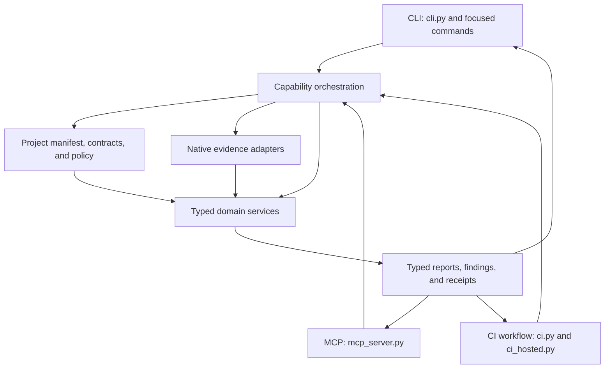

# Capability and dependency map

This map describes where capabilities live today. It is an extension guide,
not a mandate to move working modules into new packages. Project repositories
own design files, requirements, per-project policy, and approvals. This package
owns reusable services, typed contracts, native adapters, and their regression
fixtures.

## Capability flow

An adapter validates transport-specific arguments and permissions, then calls
the same typed operation used by other surfaces. Operations select source
scope, check project intent and policy, request native evidence where needed,
and coordinate domain services. A domain predicate must not import or call a
CLI, MCP, browser, or CI surface. CI orchestration is allowed to call domain
services; domain predicates do not call back into CI.

## Owners and authority

| Capability                         | Primary owners                                                                                  | Inputs and authority                                                          | Output and surface                                               |
| ---------------------------------- | ----------------------------------------------------------------------------------------------- | ----------------------------------------------------------------------------- | ---------------------------------------------------------------- |
| Project discovery and selection    | `hwrepo/layout.py`, `selection.py`, repository catalog services                                 | Explicit project root, checked-in project catalog, portable paths             | Resolved project scope to CLI, MCP, and CI operations            |
| Native capture                     | `validate.py`, `native_*` and `ci_hosted_*` adapters, KiCad-specific services                   | Exact KiCad version, project source files, native tool output                 | Typed source-bound evidence with version and source identity     |
| Design lint                        | `hwrepo/design_lint.py` facade; `design_lint_*` coordinators; theme-owned predicates and models | Project-authored maps/policy plus native schematic or PCB evidence            | Catalogued findings and coverage through CLI, MCP, and CI        |
| Electrical analysis and simulation | `hwrepo/electrical_*`, `simulation_*`, and their typed requirement/model owners                 | Project-authored requirements, declared model inputs, tool-bound measurements | Analysis reports; no implicit approval or manufacturing decision |
| Parts, CAD, and BOM                | `hwrepo/parts_*`, `cad_*`, BOM and intake services                                              | Project identity, selected source CAD, reviewed mappings                      | Preview, validation, and explicit apply operations               |
| Generated artifact access          | `hwrepo/artifact_access.py`                                                                     | Configured build scopes, stable regular-file reads                            | Checked artifact paths and bytes for services and adapters       |
| Project source reads and edits     | `hwrepo/project_source_access.py`, `bounded_file_content.py`                                    | Project scope, validated authored text, expected digest                       | Bounded reads and optimistic edits shared by CLI and MCP         |
| Product and release                | `hwrepo/product.py`, release and repository services, `ci.py` orchestration                     | Project repository state, release manifest, generated evidence                | Portable acceptance and release evidence through CI/CLI          |
| CLI surface                        | `cli.py` and focused top-level command modules                                                  | User arguments and local permissions                                          | Calls typed operations and formats their results                 |
| MCP surface                        | `mcp_server.py` and shared surface mappings                                                     | MCP request, capability permissions, scoped paths                             | Calls typed operations and maps the same typed results           |
| Hosted CI                          | `ci_hosted.py`, `ci_hosted_*`, GitHub workflow and tool-surface registry                        | Pinned environment and checked-out revision                                   | Reproducible gates, annotations, and release artifacts           |

The names above are entry points and owner families, not an exhaustive file
inventory. Before adding a feature, follow its existing service imports and
`tool-surfaces.json`; extend the current owner when one exists. Keep source
requirements and per-project approvals in the project repository. Keep
synthetic failure/control inputs and reusable checks in this repository.

## Representative operation routes

These are starting points for extending existing operations; the surface
registry remains the authoritative inventory of commands, MCP names, parity
tests, and adapter exceptions.

| Operation              | Shared entry point and inputs                                                                                | Result and effects                                                                                          | Registered surface mapping                                                     |
| ---------------------- | ------------------------------------------------------------------------------------------------------------ | ----------------------------------------------------------------------------------------------------------- | ------------------------------------------------------------------------------ |
| Project selection      | `selection.select_projects`: `ProjectRegistry`, `ProjectSelector`, optional `ProductIndex`                   | Deterministic `ProjectRecord` tuple; rejects unknown or duplicate selections                                | Used by selection-aware operations; see their mappings in `tool-surfaces.json` |
| Project detail         | `project_detail.read_project_detail`: repository root and `ProjectDetailRequest`                             | `McpProjectReport`; reads the registered manifest and optional authored check contract without side effects | MCP `get_project`; response name remains compatible with its schema            |
| Design lint inspection | `design_lint_project_inspection.inspect_design_lint_summary`: project root and ID, native summary, evaluator | `DesignLintReport`; combines project-owned policy with source-bound native evidence                         | `design-lint`: CLI and `inspect_design_lint` MCP                               |
| Electrical analysis    | `electrical_runner.analyze`: root and project ID, optional native summary and runner choices                 | `ElectricalAnalysisReport` and generated receipt under the configured build scope                           | `electrical-analysis`: CLI and `analyze_electrical` MCP                        |
| Parts preparation      | `parts_workflow.prepare`: root, project ID, receipt directory, runner and optional preferences               | `PurchasingReport` with source-bound inputs; writes planning receipts                                       | `parts-preparation`: CLI and `prepare_parts` MCP                               |
| Release readiness      | `release.check`: root and authored `ReleaseManifest`                                                         | `ReleaseReadinessReport`; read-only readiness check, no release authorization                               | `release-readiness`: CLI and `check_release` MCP                               |

These entries describe current routes rather than promising that all operation
inputs have already been consolidated into request models. In particular, the
design-lint evaluator callback remains a compatibility boundary under SA-05.

## Dependency rules

1. Adapters depend on typed operations and shared services. Services do not
   depend on adapters.
2. Project-authored intent and native observations remain separate inputs.
   A heuristic candidate is not an authored requirement or approval.
3. Native evidence records the exact source identity and supported tool
   version. A native check does not establish electrical or manufacturing
   approval by itself.
4. A design-lint rule has one predicate owner in its declared theme family.
   Coordinators may dispatch typed theme services but do not accumulate
   individual electrical predicates.
5. CLI, MCP, and CI expose the same typed operation unless
   `tool-surfaces.json` documents a narrow adapter exception.

`tests/test_capability_architecture.py` guards the dependency edge for active design-lint predicate
owners and electrical, parts, CAD, native evidence, PCB geometry, release, layout, selection,
product, supplier handoff, and artifact services. It derives top-level CLI surface modules from the
checked-in surface registry and detects static relative and absolute imports of those modules and
MCP adapters. `validate.py` is an explicit exception: it currently owns native validation services
as well as a CLI entry point. This static check does not detect dynamic imports or enforce every
domain-to-domain edge. Purchasing preferences uses the same project-source operations as MCP through
their transport-neutral owner. MCP retains compatibility exports. The rule-catalog architecture
suites verify that active owners resolve to theme-owned functions and guard fixture reachability and
theme markers. Other architecture suites check module size, native version lanes, and surface
parity.
