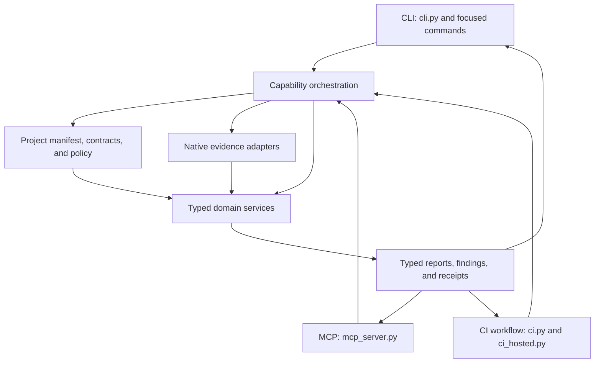

# Capability and dependency map

This map describes where capabilities live today. It is an extension guide,
not a mandate to move working modules into new packages. Project repositories
own design files, requirements, per-project policy, and approvals. This package
owns reusable services, typed contracts, native adapters, and their regression
fixtures.

## Capability flow

An adapter validates transport-specific arguments and permissions, then calls
the same typed operation used by other surfaces. Operations select source
scope, check project intent and policy, request native evidence where needed,
and coordinate domain services. A domain predicate must not import or call a
CLI, MCP, browser, or CI surface. CI orchestration is allowed to call domain
services; domain predicates do not call back into CI.

## Owners and authority

| Capability | Primary owners | Inputs and authority | Output and surface |
| --- | --- | --- | --- |
| Project discovery and selection | `hwrepo/layout.py`, `selection.py`, repository catalog services | Explicit project root, checked-in project catalog, portable paths | Resolved project scope to CLI, MCP, and CI operations |
| Native capture | `validate.py`, `native_*` and `ci_hosted_*` adapters, KiCad-specific services | Exact KiCad version, project source files, native tool output | Typed source-bound evidence with version and source identity |
| Design lint | `hwrepo/design_lint.py` facade; `design_lint_*` coordinators; theme-owned predicates and models | Project-authored maps/policy plus native schematic or PCB evidence | Catalogued findings and coverage through CLI, MCP, and CI |
| Electrical analysis and simulation | `hwrepo/electrical_*`, `simulation_*`, and their typed requirement/model owners | Project-authored requirements, declared model inputs, tool-bound measurements | Analysis reports; no implicit approval or manufacturing decision |
| Parts, CAD, and BOM | `hwrepo/parts_*`, `cad_*`, BOM and intake services | Project identity, selected source CAD, reviewed mappings | Preview, validation, and explicit apply operations |
| Product and release | `hwrepo/product.py`, release and repository services, `ci.py` orchestration | Project repository state, release manifest, generated evidence | Portable acceptance and release evidence through CI/CLI |
| CLI surface | `cli.py` and focused top-level command modules | User arguments and local permissions | Calls typed operations and formats their results |
| MCP surface | `mcp_server.py` and shared surface mappings | MCP request, capability permissions, scoped paths | Calls typed operations and maps the same typed results |
| Hosted CI | `ci_hosted.py`, `ci_hosted_*`, GitHub workflow and tool-surface registry | Pinned environment and checked-out revision | Reproducible gates, annotations, and release artifacts |

The names above are entry points and owner families, not an exhaustive file
inventory. Before adding a feature, follow its existing service imports and
`tool-surfaces.json`; extend the current owner when one exists. Keep source
requirements and per-project approvals in the project repository. Keep
synthetic failure/control inputs and reusable checks in this repository.

## Dependency rules

1. Adapters depend on typed operations and shared services. Services do not
   depend on adapters.
2. Project-authored intent and native observations remain separate inputs.
   A heuristic candidate is not an authored requirement or approval.
3. Native evidence records the exact source identity and supported tool
   version. A native check does not establish electrical or manufacturing
   approval by itself.
4. A design-lint rule has one predicate owner in its declared theme family.
   Coordinators may dispatch typed theme services but do not accumulate
   individual electrical predicates.
5. CLI, MCP, and CI expose the same typed operation unless
   `tool-surfaces.json` documents a narrow adapter exception.

`tests/test_capability_architecture.py` guards the dependency edge for active
design-lint predicate owners and verifies that catalog owners resolve to
theme-owned functions. The existing architecture suites continue to guard
rule fixture reachability, theme markers, module size, native version lanes,
and surface parity.
