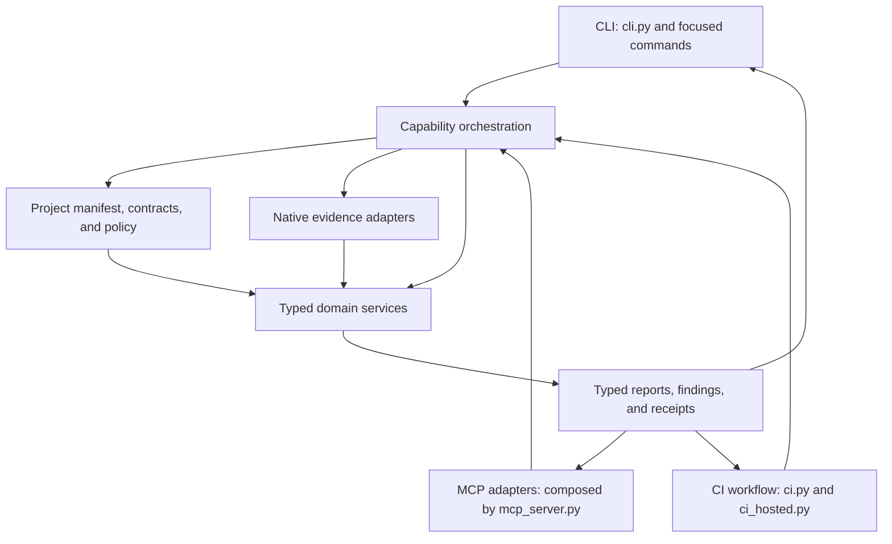

# Capability and dependency map

This map describes where capabilities live today. It is an extension guide,
not a mandate to move working modules into new packages. Project repositories
own design files, requirements, per-project policy, and approvals. This package
owns reusable services, typed contracts, native adapters, and their regression
fixtures.

## Capability flow

An adapter validates transport-specific arguments and permissions, then calls
the same typed operation used by other surfaces. Operations select source
scope, check project intent and policy, request native evidence where needed,
and coordinate domain services. A domain predicate must not import or call a
CLI, MCP, browser, or CI surface. CI orchestration is allowed to call domain
services; domain predicates do not call back into CI.

## Owners and authority

| Capability                         | Primary owners                                                                                                                                                                                           | Inputs and authority                                                                             | Output and surface                                                         |
| ---------------------------------- | -------------------------------------------------------------------------------------------------------------------------------------------------------------------------------------------------------- | ------------------------------------------------------------------------------------------------ | -------------------------------------------------------------------------- |
| Project discovery and selection    | `hwrepo/layout.py`, `selection.py`, repository catalog services                                                                                                                                          | Explicit project root, checked-in project catalog, portable paths                                | Resolved project scope to CLI, MCP, and CI operations                      |
| Native toolchain                   | `hwrepo/native_toolchain.py`                                                                                                                                                                             | Checked-in toolchain catalog and caller-selected CLI                                             | Exact toolchain record and resolved executable for native owners           |
| Native dependency preparation      | `hwrepo/native_dependency_models.py`, `hwrepo/native_dependencies.py`; `native_deps.py` CLI adapter                                                                                                      | Strict request with checkout root, digest-pinned image, and ignored `build/` destination         | Container-ABI wheels and copied runtime for release and hosted CI          |
| Native capture                     | `hwrepo/native_project_validation.py`, `native_project_check_models.py`, `native_project_validation_models.py`, `native_report_parsing.py`, `native_command.py`, KiCad-specific services and CI adapters | Typed request, declared project inputs, exact KiCad version and native output                    | Typed source-bound evidence with version and source identity               |
| Contract coaching                  | `hwrepo/contract_coach.py`, `contract_coach_models.py`, `electrical_netlist_evidence.py`                                                                                                                 | Authored project contract, observed netlist, project identity, and source hashes                 | Non-authorizing `ContractCoachReport`, admitted only after identity checks |
| Design lint                        | `hwrepo/design_lint.py` facade; `design_lint_*` coordinators; theme-owned predicates/models; `netlist_contract_models.py`                                                                                | Project-authored maps/policy plus admitted netlist and native schematic or PCB evidence          | Catalogued findings and coverage through CLI, MCP, and CI                  |
| Electrical analysis and simulation | `hwrepo/electrical_*`, `netlist_contract_models.py`, `electrical_report_models.py`, `simulation_*`, and their typed requirement/model owners                                                             | Project-authored requirements, observed netlists, declared model inputs, tool-bound measurements | Analysis reports; no implicit approval or manufacturing decision           |
| Parts, CAD, and BOM                | `hwrepo/parts_*`, `cad_*`, BOM and intake services; `purchasing_preference_models.py`, `purchasing_models.py`, `digikey_handoff_models.py`, `supplier_handoff_models.py`                                 | Project identity, reviewed CAD/parts, source hashes and supplier intent                          | Typed order and source-bound handoff; never authorizes purchase or build   |
| Generated artifact access          | `hwrepo/artifact_access.py`                                                                                                                                                                              | Configured build scopes, stable regular-file reads                                               | Checked artifact paths and bytes for services and adapters                 |
| Project source inventory           | `hwrepo/project_source_hashes.py`, `source_state_models.py`                                                                                                                                              | Explicit checkout root and declared source roots                                                 | Observed Git identity and typed source hashes used by verification         |
| Project source reads and edits     | `hwrepo/project_source_access.py`, `bounded_file_content.py`                                                                                                                                             | Project scope, validated authored text, expected digest                                          | Bounded reads and optimistic edits shared by CLI and MCP                   |
| Documentation policy               | `hwrepo/documentation_models.py`, `documentation.py`                                                                                                                                                     | Repository-authored roots and narrowly scoped, expiring exceptions                               | Typed Markdown graph findings through static and CI reports                |
| Project diagnostics and rescue     | `hwrepo/diagnostics_models.py`, `diagnostics.py`, `rescue.py`, `import_review_models.py`                                                                                                                 | Project/import observations and selected portable or native evidence                             | Typed coaching or partial-island report; neither authorizes a build        |
| Product and release                | `hwrepo/product.py`, `product_models.py`, `release_contract_models.py`, `release_model_types.py`, `release_report_models.py`, release and repository services, `ci.py` orchestration                     | Project repository state, authored release manifest, generated evidence                          | Portable acceptance and release evidence through CI/CLI                    |
| CLI surface                        | `cli.py` and focused top-level command modules                                                                                                                                                           | User arguments and local permissions                                                             | Calls typed operations and formats their results                           |
| MCP surface                        | `mcp_server.py` composition root; capability-owned `mcp_*` registration adapters                                                                                                                         | MCP request, capability permissions, scoped paths                                                | Calls typed operations and maps the same typed results                     |
| Hosted CI                          | `ci_hosted.py`, `ci_hosted_*`, GitHub workflow and tool-surface registry                                                                                                                                 | Pinned environment and checked-out revision                                                      | Reproducible gates, annotations, and release artifacts                     |

Prerelease lint selection is owned by `scripts/lint_gate_scope.py` and invoked
by the GitHub workflow. It validates annotated area/rule selectors, test paths,
and native fixture switches before emitting the pytest expression and lane
environment. Domain services remain independent of this CI adapter.

The names above are entry points and owner families, not an exhaustive file
inventory. Before adding a feature, follow its existing service imports and
`tool-surfaces.json`; extend the current owner when one exists. Keep source
requirements and per-project approvals in the project repository. Keep
synthetic failure/control inputs and reusable checks in this repository.

## Representative operation routes

These are starting points for extending existing operations; the surface
registry remains the authoritative inventory of commands, MCP names, parity
tests, and adapter exceptions.

| Operation                 | Shared entry point and inputs                                                                                                                                                                      | Result and effects                                                                                                                        | Registered surface mapping                                                                                                        |
| ------------------------- | -------------------------------------------------------------------------------------------------------------------------------------------------------------------------------------------------- | ----------------------------------------------------------------------------------------------------------------------------------------- | --------------------------------------------------------------------------------------------------------------------------------- |
| Project verification      | `project_verification.verify_request`: root plus `ProjectVerificationRequest` (project, depth, runner, tool names, receipt, detail); `project_verification_report_models.py` owns the typed result | `ProjectVerificationReport`; captures source-bound portable/native/electrical evidence in a fresh `build/` receipt                        | CLI `kicad_tooling.verify` and MCP `check_project` use this operation; the old positional Python API adapts to its request        |
| Project diagnostics       | `diagnostics.diagnose_project_request`, `diagnose_import_request`, `rescue.rescue_project_request`; typed requests carry project/source/toolchain and optional portable/native/BOM evidence        | `DiagnosticReport` or explicitly partial `LocalRescueReport`; journal must match checkout and project scope                               | Template CLI and MCP workflow route through the same request contracts; positional Python functions remain compatibility adapters |
| Portable project lane     | `project_static_pipeline.run_project_static_pipeline`: root plus `ProjectStaticPipelineRequest` (project IDs, workers); contracts in `project_static_pipeline_models.py`                           | `ProjectStaticPipelineReport`; repository-wide `StaticPipelineReport` belongs to `static_pipeline_models.py`                              | CI selected-project lane and project verification share the operation; `ci.project_static_pipeline` adapts the old signature      |
| Native project checks     | `native_project_check.run_native_project_check`: root plus `NativeProjectCheckRequest` (output, CLI, optional project IDs)                                                                         | `CheckAllSummary` and per-project native evidence; writes only to the caller-scoped output directory                                      | `check_all`, `ci --kicad`, MCP native-scope, and project verification share the service                                           |
| Native project validation | `native_project_validation.validate_project`: root plus `NativeProjectValidationRequest` (output, CLI, config path)                                                                                | `ValidationSummary` from `native_project_validation_models.py`; runs exact native commands and binds artifacts to declared project source | `native_project_check` and release operations call the service; `validate.py` adapts its CLI and legacy positional API            |
| Native dependencies       | `native_dependencies.prepare_native_dependencies`: `NativeDependencyPreparationRequest` (checkout root, image, output)                                                                             | ABI-matched wheels and copied installed runtime under the requested ignored `build/` destination                                          | Release preparation calls the service; `native_deps.py` keeps its CLI and positional compatibility adapter                        |
| Governance lint           | `governance_lint.lint`: root and optional selected project IDs                                                                                                                                     | `GovernanceLintReport`; validates authored project, catalog, toolchain, and governance records                                            | Governance CLI adapter, portable/native lanes, and project-policy consumers                                                       |
| Project selection         | `selection.select_projects`: `ProjectRegistry`, `ProjectSelector`, optional `ProductIndex`                                                                                                         | Deterministic `ProjectRecord` tuple; rejects unknown or duplicate selections                                                              | Used by selection-aware operations; see their mappings in `tool-surfaces.json`                                                    |
| Project detail            | `project_detail.read_project_detail`: repository root and `ProjectDetailRequest`                                                                                                                   | `McpProjectReport`; reads the registered manifest and optional authored check contract without side effects                               | MCP `get_project`; response name remains compatible with its schema                                                               |
| Comparison state          | `comparison_change.change_state`: same-typed optional baseline and candidate values                                                                                                                | `Change` in `comparison_change_models.py`; distinguishes added, removed, changed, and unchanged values                                    | Shared by BOM, board/product variant, and verification-history services; `bom_change.py` remains a compatibility export           |
| Findings-view export      | `findings_view.build_findings_view`: project root/ID, saved native summary, optional lint report                                                                                                   | `FindingsViewReport` and offline review files; reads saved evidence without running native tools                                          | `findings-view`: CLI `kicad_tooling.findings_view` and MCP `export_findings_view`                                                 |
| Verification history      | `verification_history.compare_verification_history`: project root/ID and selected baseline/candidate overview receipts; optional release/readiness receipts                                        | `VerificationHistoryReport`; native, findings, and verification receipts enter through the closed `HistoryReceiptModel` union             | CLI and MCP `export_verification_history` share the saved-evidence comparison service                                             |
| Design lint inspection    | `design_lint.inspect_request`: root plus `DesignLintInspectionRequest` (project ID and native summary path)                                                                                        | `DesignLintReport`; combines project-owned policy with source-bound native evidence                                                       | `design-lint`: CLI, MCP workflow, and verification call the same typed operation                                                  |
| Electrical analysis       | `electrical_runner.analyze_request`: root plus `ElectricalAnalysisRequest` (project, output, evidence, tools, runner)                                                                              | `ElectricalAnalysisReport` and source-bound receipt under the configured build scope                                                      | CLI, MCP, verification, release preparation, and scope checks use the same operation                                              |
| Parts preparation         | `parts_workflow.prepare_request`: root plus `PartsPreparationRequest` (project, output, evidence, preferences, quantities, runner)                                                                 | `PurchasingReport`; checks source/catalog drift and retains report, HTML, CSV, and artifact manifest                                      | CLI and MCP share the operation; MCP gates fresh checks and export permissions                                                    |
| Release readiness         | `release.check`: root and authored `ReleaseManifest`                                                                                                                                               | `ReleaseReadinessReport`; read-only readiness check, no release authorization                                                             | `release-readiness`: CLI and `check_release` MCP                                                                                  |
| Release archives          | `packaging.package`, `verify`, and `restore` through scoped workflow operations                                                                                                                    | `ReleasePackageReport`; fresh ignored ZIP/checkouts; verification runs no restored project code                                           | `mcp_release.register_release_tools`; package and restore require export permission                                               |

These entries describe current routes and their typed request boundaries. The
legacy design-lint `inspect_summary` function maps its arguments into the typed
inspection request; project inspection owns evaluation and source freshness.
The electrical `analyze` function remains a compatibility adapter; application
surfaces use `ElectricalAnalysisRequest`. Authored component contracts and
observed netlists are owned by `netlist_contract_models.py`; `models.py` and
`project_models.py` retain compatibility exports while production services
import the owner directly. The [electrical data-routing
decision](ELECTRICAL_ANALYSIS_DATA_ROUTING.md) records its authored-intent,
capture, evaluation, and receipt handoffs.
Diagnosis and rescue requests enforce the selected project, native/BOM pairing,
captured portable-report identity, and receipt checkout/project identity before
evaluation or receipt writes.
`electrical_netlist_evidence.admit_netlist_evidence` retains the complete
`ContractCoachReport` from `contract_coach_models.py` while checking project
and source identity before its observation reaches requirement predicates.
`models.py` retains its identity-compatible export. I²C, CAN, USB-C, and SPI state
dispatch belongs to
`electrical_bus_evaluation.evaluate_electrical_bus_requirements`. It receives
only those typed requirements and the admitted netlist, then delegates
calculations to the existing predicate owners. PCB return-path and test-access
stages similarly route through `electrical_pcb_evaluation` with
family-specific requests. The PCB evidence union retains `NOT_REQUESTED`,
`UNAVAILABLE` with capture context, and `OBSERVED` with the successful command
and typed snapshot. Capture remains in the operation, which preserves its
command index and snapshot receipt writes. Simulator version and case
evaluation now use `electrical_simulation_evaluation`; its request checks case
source hashes, and its result retains the exact version command, authored
cases, per-case commands, and findings. Project verification keeps its CLI
module as a thin adapter and retains the former positional Python call
while CLI and MCP construct `ProjectVerificationRequest` for the
capability-owned orchestrator. Parts preparation retains its
positional `prepare` adapter for existing callers, while CLI and MCP use
`PartsPreparationRequest` and the operation owns final report publication.

## Dependency rules

1. Adapters depend on typed operations and shared services. Services do not
   depend on adapters.
2. Project-authored intent and native observations remain separate inputs.
   A heuristic candidate is not an authored requirement or approval.
3. Native evidence records the exact source identity and supported tool
   version. A native check does not establish electrical or manufacturing
   approval by itself.
4. A design-lint rule has one predicate owner in its declared theme family.
   Coordinators may dispatch typed theme services but do not accumulate
   individual electrical predicates.
5. CLI, MCP, and CI expose the same typed operation unless
   `tool-surfaces.json` documents a narrow adapter exception.

Project verification coordinates the typed portable and native services; it
no longer imports the `ci.py` or `check_all.py` CLI modules. Their public
positional functions remain compatibility adapters. Standalone diagnostics and
release preparation also call `project_static_pipeline.run_project_static_pipeline`
with `ProjectStaticPipelineRequest`; the CI wrapper stays a compatibility
adapter. Governance lint now owns
catalog and authored-policy evaluation under `hwrepo`; internal services share
`project_source_hashes.hash_project_sources` for declared input inventories.
`validate.hashes` remains a compatibility export. Single-project native
validation now lives in `native_project_validation.validate_project` and takes
`NativeProjectValidationRequest`; `validate.py` retains its CLI and positional
compatibility adapter.

MCP registration can live in a capability-owned adapter when that keeps
`mcp_server.py` focused on composition. For example,
`mcp_project_inventory.py` owns project inventory/detail registration and
`mcp_visualization_exports.py` owns saved review exports. These adapters keep
startup permissions and transport argument conversion at the edge, then call
the shared typed service; they do not duplicate domain evaluation. Release
checks and archive operations are registered by `mcp_release.py`.

`tests/test_capability_architecture.py` guards the dependency edge for active design-lint predicate
owners and electrical, parts, CAD, native evidence, PCB geometry, release, layout, selection,
product, supplier handoff, source hashing, and artifact services. It derives top-level CLI surface
modules from the checked-in surface registry and detects static relative and absolute imports of
those modules and MCP adapters. `validate.py` remains a CLI and compatibility surface; capability
owners import `native_toolchain`, `native_project_validation`, `native_report_parsing`, and
`native_command` directly. This static check does not detect dynamic imports or enforce every
domain-to-domain edge. Purchasing preferences uses the same project-source operations as MCP through
their transport-neutral owner. MCP retains compatibility exports. The rule-catalog architecture
suites verify that active owners resolve to theme-owned functions and guard fixture reachability and
theme markers. Other architecture suites check module size, native version lanes, and surface
parity.
