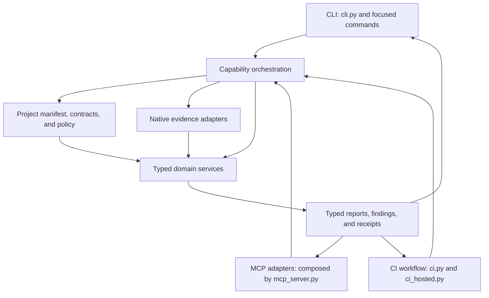

# Capability and dependency map

This map describes where capabilities live today. It is an extension guide,
not a mandate to move working modules into new packages. Project repositories
own design files, requirements, per-project policy, and approvals. This package
owns reusable services, typed contracts, native adapters, and their regression
fixtures.

## Capability flow

An adapter validates transport-specific arguments and permissions, then calls
the same typed operation used by other surfaces. Operations select source
scope, check project intent and policy, request native evidence where needed,
and coordinate domain services. A domain predicate must not import or call a
CLI, MCP, browser, or CI surface. CI orchestration is allowed to call domain
services; domain predicates do not call back into CI.

## Owners and authority

| Capability                         | Primary owners                                                                                                                                                                                                                                                                                                                                                                      | Inputs and authority                                                                                                | Output and surface                                                                                                                                          |
| ---------------------------------- | ----------------------------------------------------------------------------------------------------------------------------------------------------------------------------------------------------------------------------------------------------------------------------------------------------------------------------------------------------------------------------------- | ------------------------------------------------------------------------------------------------------------------- | ----------------------------------------------------------------------------------------------------------------------------------------------------------- |
| Project discovery and selection    | `hwrepo/layout.py`, `hwrepo/discovery.py`, `selection.py`, repository catalog services                                                                                                                                                                                                                                                                                              | Explicit project root, source-bound discovery policy and manifest snapshot, portable paths                          | Resolved project scope to CLI, MCP, and CI operations; `load_registry` remains a compatibility projection                                                   |
| Native toolchain                   | `hwrepo/native_toolchain.py`                                                                                                                                                                                                                                                                                                                                                        | Checked-in toolchain catalog and caller-selected CLI                                                                | Exact toolchain record and resolved executable for native owners                                                                                            |
| Native dependency preparation      | `hwrepo/native_dependency_models.py`, `hwrepo/native_dependencies.py`; `native_deps.py` CLI adapter                                                                                                                                                                                                                                                                                 | Strict request with checkout root, digest-pinned image, and ignored `build/` destination                            | Container-ABI wheels and copied runtime for release and hosted CI                                                                                           |
| Native capture                     | `hwrepo/native_project_validation.py`, `native_project_check_models.py`, `native_project_validation_models.py`, `native_report_parsing.py`, `native_command.py`, KiCad-specific services and CI adapters                                                                                                                                                                            | Typed request, declared project inputs, exact KiCad version and native output                                       | Typed source-bound evidence with version and source identity                                                                                                |
| Contract coaching                  | `hwrepo/contract_coach.py`, `contract_coach_models.py`, `electrical_netlist_evidence.py`                                                                                                                                                                                                                                                                                            | Authored project contract, observed netlist, project identity, and source hashes                                    | Non-authorizing `ContractCoachReport`, admitted only after identity checks                                                                                  |
| Design lint                        | `hwrepo/design_lint.py` facade; `design_lint_*` coordinators; theme-owned predicates/models; `netlist_contract_models.py`                                                                                                                                                                                                                                                           | Project-authored maps/policy plus admitted netlist and native schematic or PCB evidence                             | Catalogued findings and coverage through CLI, MCP, and CI                                                                                                   |
| Electrical analysis and simulation | `hwrepo/electrical_*`, `netlist_contract_models.py`, `electrical_report_models.py`, `simulation_*`, and their typed requirement/model owners                                                                                                                                                                                                                                        | Project-authored requirements, observed netlists, declared model inputs, tool-bound measurements                    | Analysis reports; no implicit approval or manufacturing decision                                                                                            |
| Parts, CAD, and BOM                | `hwrepo/parts_*`, `part_selection_sources.py`, `cad_*`, BOM and intake services; purchasing, DigiKey, and supplier-handoff models                                                                                                                                                                                                                                                   | Project identity, reviewed CAD/parts, source hashes, explicit absent-input preconditions, and supplier intent       | Typed order and source-bound handoff; never authorizes purchase or build                                                                                    |
| KiCad source-expression parsing    | `hwrepo/kicad_sexpr.py`                                                                                                                                                                                                                                                                                                                                                             | Raw KiCad schematic, board, footprint, symbol-library, and rule source                                              | Typed spans/tokens and a read-only named property index consumed directly by source-domain services                                                         |
| BOM/design cross-probe             | `cross_probe_operation_models.py` owns the typed request; `cross_probe_admission.py` admits and revalidates receipts and retained evidence; `cross_probe.py` composes anchors and publishes; `cross_probe_reconciliation.py` owns location projection and variant population; `cross_probe_variant.py`, `cross_probe_board.py`, `cross_probe_schematic.py` own their source readers | Current source hashes, admitted parts and findings receipts, retained drawings, and optional named-variant evidence | `CrossProbeReport` and reversible local marker view through the shared typed operation used by CLI, MCP, and variant review; no approval or build authority |
| Generated artifact access          | `hwrepo/artifact_access.py`                                                                                                                                                                                                                                                                                                                                                         | Configured build scopes, stable regular-file reads                                                                  | Checked artifact paths and bytes for services and adapters                                                                                                  |
| Project source inventory           | `hwrepo/project_source_hashes.py`, `source_state_models.py`                                                                                                                                                                                                                                                                                                                         | Explicit checkout root and declared source roots                                                                    | Observed Git identity and typed source hashes used by verification                                                                                          |
| Project source reads and edits     | `hwrepo/project_source_access.py`, `bounded_file_content.py`                                                                                                                                                                                                                                                                                                                        | Project scope, validated authored text, expected digest                                                             | Bounded reads and optimistic edits shared by CLI and MCP                                                                                                    |
| Documentation policy               | `hwrepo/documentation_models.py`, `documentation.py`                                                                                                                                                                                                                                                                                                                                | Repository-authored roots and narrowly scoped, expiring exceptions                                                  | Typed Markdown graph findings through static and CI reports                                                                                                 |
| Project diagnostics and rescue     | `hwrepo/diagnostics_models.py`, `diagnostics.py`, `rescue.py`, `import_review_models.py`                                                                                                                                                                                                                                                                                            | Project/import observations and selected portable or native evidence                                                | Typed coaching or partial-island report; neither authorizes a build                                                                                         |
| Product and release                | `hwrepo/product.py`, `product_source_inputs.py`, `product_models.py`, `release_contract_models.py`, `release_model_types.py`, `release_report_models.py`, release and repository services, `ci.py` orchestration                                                                                                                                                                    | Project repository state, authored release manifest, generated evidence                                             | Portable acceptance and release evidence through CI/CLI                                                                                                     |
| CLI surface                        | `cli.py` and focused top-level command modules                                                                                                                                                                                                                                                                                                                                      | User arguments and local permissions                                                                                | Calls typed operations and formats their results                                                                                                            |
| MCP surface                        | `mcp_server.py` composition root; capability-owned `mcp_*` registration adapters                                                                                                                                                                                                                                                                                                    | MCP request, capability permissions, scoped paths                                                                   | Calls typed operations and maps the same typed results                                                                                                      |
| Hosted CI                          | `ci_hosted.py`, `ci_hosted_*`, GitHub workflow and tool-surface registry                                                                                                                                                                                                                                                                                                            | Pinned environment and checked-out revision                                                                         | Reproducible gates, annotations, and release artifacts                                                                                                      |

Product output projections live in `hwrepo/generation_outputs.py` and consume
the typed `ProductRepository` with its captured index and product identities.
`hwrepo/generation.py` owns publication, drift checks, and retained review
snapshots while preserving the existing projection imports. A snapshot records
integrity data; it does not approve a release. Repository lookup maps are
defensive read-only copies, so callers cannot mutate a captured lookup apart
from the source identity that produced it.

Product visualization parses its captured receipt bytes into a
`ProductIndexDocument` and passes that same document into shared-catalog
loading. Its source hash uses the captured document identity, so the final
freshness check detects an index edit during export.

Prerelease lint selection is owned by `scripts/lint_gate_scope.py` and invoked
by the GitHub workflow. It validates annotated area/rule selectors, test paths,
and native fixture switches before emitting the pytest expression and lane
environment. Domain services remain independent of this CI adapter.

The names above are entry points and owner families, not an exhaustive file
inventory. Before adding a feature, follow its existing service imports and
`tool-surfaces.json`; extend the current owner when one exists. Keep source
requirements and per-project approvals in the project repository. Keep
synthetic failure/control inputs and reusable checks in this repository.

## Representative operation routes

These are starting points for extending existing operations; the surface
registry remains the authoritative inventory of commands, MCP names, parity
tests, and adapter exceptions.

| Operation                 | Shared entry point and inputs                                                                                                                                                                      | Result and effects                                                                                                                        | Registered surface mapping                                                                                                        |
| ------------------------- | -------------------------------------------------------------------------------------------------------------------------------------------------------------------------------------------------- | ----------------------------------------------------------------------------------------------------------------------------------------- | --------------------------------------------------------------------------------------------------------------------------------- |
| Project verification      | `project_verification.verify_request`: root plus `ProjectVerificationRequest` (project, depth, runner, tool names, receipt, detail); `project_verification_report_models.py` owns the typed result | `ProjectVerificationReport`; captures source-bound portable/native/electrical evidence in a fresh `build/` receipt                        | CLI `kicad_tooling.verify` and MCP `check_project` use this operation; the old positional Python API adapts to its request        |
| Project diagnostics       | `diagnostics.diagnose_project_request`, `diagnose_import_request`, `rescue.rescue_project_request`; typed requests carry project/source/toolchain and optional portable/native/BOM evidence        | `DiagnosticReport` or explicitly partial `LocalRescueReport`; journal must match checkout and project scope                               | Template CLI and MCP workflow route through the same request contracts; positional Python functions remain compatibility adapters |
| Portable project lane     | `project_static_pipeline.run_project_static_pipeline`: root plus `ProjectStaticPipelineRequest` (project IDs, workers); contracts in `project_static_pipeline_models.py`                           | `ProjectStaticPipelineReport`; repository-wide `StaticPipelineReport` belongs to `static_pipeline_models.py`                              | CI selected-project lane and project verification share the operation; `ci.project_static_pipeline` adapts the old signature      |
| Native project checks     | `native_project_check.run_native_project_check`: root plus `NativeProjectCheckRequest` (output, CLI, optional project IDs)                                                                         | `CheckAllSummary` and per-project native evidence; writes only to the caller-scoped output directory                                      | `check_all`, `ci --kicad`, MCP native-scope, and project verification share the service                                           |
| Native project validation | `native_project_validation.validate_project`: root plus `NativeProjectValidationRequest` (output, CLI, config path)                                                                                | `ValidationSummary` from `native_project_validation_models.py`; runs exact native commands and binds artifacts to declared project source | `native_project_check` and release operations call the service; `validate.py` adapts its CLI and legacy positional API            |
| Native dependencies       | `native_dependencies.prepare_native_dependencies`: `NativeDependencyPreparationRequest` (checkout root, image, output)                                                                             | ABI-matched wheels and copied installed runtime under the requested ignored `build/` destination                                          | Release preparation calls the service; `native_deps.py` keeps its CLI and positional compatibility adapter                        |
| Governance lint           | `governance_lint.lint`: root and optional project IDs; typed discovery, policy, record, product, and evidence owners                                                                               | `GovernanceLintReport`; report schema 1 validates authored inputs and rechecks captured sources without claiming an atomic receipt        | Governance CLI adapter, portable/native lanes, and project-policy consumers                                                       |
| Project selection         | `selection.select_projects`: `ProjectRegistry`, `ProjectSelector`, optional `ProductIndex`                                                                                                         | Deterministic `ProjectRecord` tuple; rejects unknown or duplicate selections                                                              | Used by selection-aware operations; see their mappings in `tool-surfaces.json`                                                    |
| Project detail            | `project_detail.read_project_detail`: repository root and `ProjectDetailRequest`                                                                                                                   | `McpProjectReport`; reads the registered manifest and optional authored check contract without side effects                               | MCP `get_project`; response name remains compatible with its schema                                                               |
| Comparison state          | `comparison_change.change_state`: same-typed optional baseline and candidate values                                                                                                                | `Change` in `comparison_change_models.py`; distinguishes added, removed, changed, and unchanged values                                    | Shared by BOM, board/product variant, and verification-history services; `bom_change.py` remains a compatibility export           |
| Findings-view export      | `findings_view.build_findings_view`: project root/ID, saved native summary, optional lint report                                                                                                   | `FindingsViewReport` and offline review files; reads saved evidence without running native tools                                          | `findings-view`: CLI `kicad_tooling.findings_view` and MCP `export_findings_view`                                                 |
| Verification history      | `verification_history.compare_verification_history`: project root/ID and selected baseline/candidate overview receipts; optional release/readiness receipts                                        | `VerificationHistoryReport`; native, findings, and verification receipts enter through the closed `HistoryReceiptModel` union             | CLI and MCP `export_verification_history` share the saved-evidence comparison service                                             |
| Design lint inspection    | `design_lint.inspect_request`: root plus `DesignLintInspectionRequest` (project ID and native summary path)                                                                                        | `DesignLintReport`; combines project-owned policy with source-bound native evidence                                                       | `design-lint`: CLI, MCP workflow, and verification call the same typed operation                                                  |
| Electrical analysis       | `electrical_runner.analyze_request`: root plus `ElectricalAnalysisRequest` (project, output, evidence, tools, runner)                                                                              | `ElectricalAnalysisReport` and source-bound receipt under the configured build scope                                                      | CLI, MCP, verification, release preparation, and scope checks use the same operation                                              |
| Parts preparation         | `parts_workflow.prepare_request`: root plus `PartsPreparationRequest` (project, output, evidence, preferences, quantities, runner)                                                                 | `PurchasingReport`; typed source and policy path-digest maps; bound receipt artifacts                                                     | CLI and MCP share the operation; MCP gates fresh checks and export permissions                                                    |
| Release readiness         | `release.check`: root and authored `ReleaseManifest`                                                                                                                                               | `ReleaseReadinessReport`; read-only readiness check, no release authorization                                                             | `release-readiness`: CLI and `check_release` MCP                                                                                  |
| Release archives          | `packaging.package`, `verify`, and `restore` through scoped workflow operations                                                                                                                    | `ReleasePackageReport`; fresh ignored ZIP/checkouts; verification runs no restored project code                                           | `mcp_release.register_release_tools`; package and restore require export permission                                               |

Governance lint parses each shared catalog from one stable regular-file read.
Its parts, interface, library, and toolchain indexes retain that catalog's
repository path and SHA-256. `load_registry_snapshot` retains the repository
layout adapter source state and digest, discovery-policy identity, and each
project manifest's exact path and digest beside its typed value; `load_registry`
remains the compatibility projection. The operation uses the captured layout
for team-policy selection, library roots, and project configuration, then
rechecks the layout adapter, discovery policy, and every project manifest before
returning. The configured team policy is read once and passed to each
`GovernanceRecordReview`, which pairs its source identity with the exact
project-record bytes evaluated. Its final barrier also rechecks shared
catalogs and policy, the product index, selected project check contracts,
reviewed governance records, selected product records, selected library
evidence, production mechanical handoffs, project-source inventories, and
project-file membership. The report does not retain all input identities or
claim an atomic snapshot or durable provenance receipt. See the governance
routes in the architecture backlog and the
[governance data-routing decision](GOVERNANCE_LINT_DATA_ROUTING.md).

`governance_lint_scope.py` resolves the requested project set, its dependent
products, and the referenced part/interface/library/toolchain IDs into an
immutable `GovernanceLintProjectScope`. The coordinator sends each captured
registry entry and `GovernanceLintSharedInputs` through a
`GovernanceLintProjectPolicyRequest` to `governance_lint_project_policy.py`.
That owner returns project issues with the config document, governance-record
review, and source inventory that the coordinator needs for its final
freshness checks. `governance_lint_catalog_policy.py` consumes the captured
registry snapshot, shared catalog indexes, and project scope. It applies
library-path and release-policy rules repository-wide while restricting
interface, part, library, and toolchain record checks to selected dependencies.
`governance_lint.py` retains ordered orchestration and freshness coordination;
a caller audit found no current need to persist those input identities in the
public governance report.

`governance_lint_filesystem_inputs.py` owns library provenance/licensing and
mechanical handoff inputs. `project_source_hashes.py` owns declared source-file
inventories, while `project_file_membership.py` owns bounded KiCad project-file
discovery. `governance_records.py` provides their stable file identity.

These entries describe current routes and their typed request boundaries. The
legacy design-lint `inspect_summary` function maps its arguments into the typed
inspection request; project inspection owns source freshness and constructs a
`DesignLintEvaluationRequest`, while `evaluate_request` owns policy and finding
evaluation. The public `evaluate(...)` function remains a compatibility
adapter over that typed route.
The electrical `analyze` function remains a compatibility adapter; application
surfaces use `ElectricalAnalysisRequest`. Authored component contracts and
observed netlists are owned by `netlist_contract_models.py`; `models.py` and
`project_models.py` retain compatibility exports while production services
import the owner directly. The [electrical data-routing
decision](ELECTRICAL_ANALYSIS_DATA_ROUTING.md) records its authored-intent,
capture, evaluation, and receipt handoffs.
Diagnosis and rescue requests enforce the selected project, native/BOM pairing,
captured portable-report identity, and receipt checkout/project identity before
evaluation or receipt writes.
`electrical_netlist_evidence.admit_netlist_evidence` retains the complete
`ContractCoachReport` from `contract_coach_models.py` while checking project
and source identity before its observation reaches requirement predicates.
`models.py` retains its identity-compatible export. I²C, CAN, USB-C, and SPI state
dispatch belongs to
`electrical_bus_evaluation.evaluate_electrical_bus_requirements`. It receives
only those typed requirements and the admitted netlist, then delegates
calculations to the existing predicate owners. PCB return-path and test-access
stages similarly route through `electrical_pcb_evaluation` with
family-specific requests. The PCB evidence union retains `NOT_REQUESTED`,
`UNAVAILABLE` with capture context, and `OBSERVED` with the successful command
and typed snapshot. Capture remains in the operation, which preserves its
command index and snapshot receipt writes. Simulator version and case
evaluation now use `electrical_simulation_evaluation`; its request checks case
source hashes, and its result retains the exact version command, authored
cases, per-case commands, and findings. Project verification keeps its CLI
module as a thin adapter and retains the former positional Python call
while CLI and MCP construct `ProjectVerificationRequest` for the
capability-owned orchestrator. Parts preparation retains its
positional `prepare` adapter for existing callers, while CLI and MCP use
`PartsPreparationRequest` and the operation owns final report publication.

## Product hierarchy source route

`product_source_inputs.read_product_source` validates a `ProductRecord` from stable file bytes and
retains its repository path and exact digest. `ProductRepository.product_sources` keeps that
identity alongside the parsed product. Governance input capture reads the product index once and
passes its typed value plus the already captured part/interface catalogs into selected product
loading. Selected product records retain an explicit availability state and are rechecked before the
diagnostic returns. `product.product_occurrence_index` produces an immutable
`ProductOccurrenceIndex`; its typed instance paths use the empty string for the root and dot-joined
authored references for children. Generation, product visualization, saved BOM comparisons, and
release population checks pass that same source-bound index. The existing `product.occurrences`
function remains a compatibility projection. Product instance path values remain strings in report
JSON. Variant and revision BOM comparison share a read-only `VariantBomInstanceIndex` keyed by
`ProductInstancePath`; comparison report paths use the same domain type while retaining their string
JSON representation.

Release variant resolution uses `layout.read_repository_layout` and the stable
product-source readers in `product_source_inputs.py`. It rechecks the captured
layout, index, and selected product records before returning the existing typed
`ReleaseVariant` values. `releasing.prepare` then validates those revisions
against its own product repository capture and binds candidate publication to
the clean Git source state.

The release CLI and MCP review workflow construct `ReleasePreparationRequest`
and call `releasing.prepare_request`. The legacy positional `releasing.prepare`
function only adapts its arguments into that request. The authored
`ReleaseManifest` and its JSON schema remain separate and unchanged.

## Schematic geometry candidate source identity

The schematic geometry, text-placement, and symbol-body candidate projectors
share `SchematicGeometrySourceIdentity`, owned by
`design_lint_schematic_geometry_candidate_evidence.py`. It retains the exact
child schematic path and digest, sheet-instance path, human-readable sheet
path, root schematic path and digest, and canonical source-tree digest. Each
projector turns that frozen identity into the established report fields at the
candidate boundary. Their serialized keys and order remain unchanged.

## Schematic hierarchical reference route

`schematic_geometry_source.schematic_instance_references` resolves each placed
symbol UUID to its exact project reference for one hierarchical sheet
occurrence. It returns a `SchematicInstanceReferenceResolution` owned by
`schematic_geometry_models.py`, with the source path and digest, project name,
sheet-instance path, a read-only reference index, and parse issues. The
schematic geometry tree checks the digest against the retained source bytes
before scanning; cross-probe uses the same resolution for symbol anchors. A
missing or ambiguous instance reference remains an issue and keeps geometry
coverage partial. The route changes no serialized report fields.

## Cross-probe schematic symbol-anchor route

`cross_probe_schematic.schematic_symbol_anchors` consumes an already captured
`VerifiedSchematicSourceTree` and returns a `SchematicSymbolAnchorResolution`
owned by `cross_probe_schematic_models.py`. The result binds the project and
root schematic context to a read-only reference-to-anchor index, issues, and
hashes for only the visited schematic sources. `COMPLETE`, `PARTIAL`, and
`BLOCKED` distinguish resolved hierarchy, retained mapping issues, and a
missing root source. `CrossProbeLocationEvidence` keeps this result intact and
checks its source hashes against the admitted project inventory before
projecting anchors. The 32 MiB cross-probe read bound and serialized report
fields remain unchanged.

`cross_probe_schematic.schematic_drawing_bindings` returns a
`SchematicDrawingBindingResolution` from the same model owner. It retains the
exact schematic drawing records, current hashes for sources used in binding,
the canonical inventory digest, a read-only sheet-instance index, and binding
issues. `COMPLETE`, `PARTIAL`, and `NOT_REQUESTED` distinguish a complete
unique map, a missing/stale/ambiguous mapping, and an input with no schematic
drawings. `CrossProbeLocationEvidence` keeps the resolution intact and checks
its source hashes before projecting the index. The legacy single-root SVG
fallback and published report fields remain unchanged.

## Cross-probe board-marker route

`cross_probe_board.resolve_cross_probe_board_markers` returns a
`CrossProbeBoardMarkerResolution` that binds the board path and SHA-256 to the
read-only footprint-anchor index. It also retains the exact findings-view
receipt, candidate PCB drawings, and explicit `UNAVAILABLE`, `UNIQUE`,
`AMBIGUOUS`, or `UNSUPPORTED` drawing state. A verified board with no
placements is `COMPLETE`; a missing or stale board is `BLOCKED`.
`CrossProbeLocationEvidence` retains this result and checks its board digest
against the admitted source inventory before reconciliation. Existing report
fields, marker behavior, and issue text remain unchanged.

## Part selection and CAD source preconditions

`part_selection_sources.py` owns the source set used by part selection,
automatic CAD assignment, and sourced CAD-library import. It consumes the
named `ModelSourceResolution` from `model_population_sources.py` and shared-root
policy functions from `model_population.py`; model paths, manifest slots, and
KiCad references remain separate fields. Its immutable
`PartCadSourceSnapshot` binds the project ID to declared project-source hashes,
catalog and policy inputs, registered project manifests, eligible reviewed CAD
assets, and the preferences path even when that file is absent. Freshness
checks recapture the same set and reject a different project or any changed,
added, removed, or newly present input.

`part_picker.py` retains its old private snapshot helpers only as local
compatibility projections. `auto_cad.py` and `cad_library.py` import the shared
capture and freshness owners directly. Persisted `PartSelectionMap`,
`AutoCadPlan`, and `CadImportPlan` keep their existing JSON object fields for
preconditions and output hashes; the in-memory maps are defensive read-only
copies. A null precondition still means the named optional source was absent
when the plan was reviewed. These plans authorize only their established
source-edit operations and do not imply electrical or physical approval.

## Dependency rules

1. Adapters depend on typed operations and shared services. Services do not
   depend on adapters.
2. Project-authored intent and native observations remain separate inputs.
   A heuristic candidate is not an authored requirement or approval.
3. Native evidence records the exact source identity and supported tool
   version. A native check does not establish electrical or manufacturing
   approval by itself.
4. A design-lint rule has one predicate owner in its declared theme family.
   Coordinators may dispatch typed theme services but do not accumulate
   individual electrical predicates.
5. CLI, MCP, and CI expose the same typed operation unless
   `tool-surfaces.json` documents a narrow adapter exception.

Project verification coordinates the typed portable and native services; it
no longer imports the `ci.py` or `check_all.py` CLI modules. Their public
positional functions remain compatibility adapters. Standalone diagnostics and
release preparation also call `project_static_pipeline.run_project_static_pipeline`
with `ProjectStaticPipelineRequest`; the CI wrapper stays a compatibility
adapter. Governance lint now owns
catalog and authored-policy evaluation under `hwrepo`; internal services share
`project_source_hashes.hash_project_sources` for declared input inventories.
`validate.hashes` remains a compatibility export. Single-project native
validation now lives in `native_project_validation.validate_project` and takes
`NativeProjectValidationRequest`; `validate.py` retains its CLI and positional
compatibility adapter.

MCP registration can live in a capability-owned adapter when that keeps
`mcp_server.py` focused on composition. For example,
`mcp_project_inventory.py` owns project inventory/detail registration and
`mcp_visualization_exports.py` owns saved review exports. These adapters keep
startup permissions and transport argument conversion at the edge, then call
the shared typed service; they do not duplicate domain evaluation. Release
checks and archive operations are registered by `mcp_release.py`.

`tests/test_capability_architecture.py` guards the dependency edge for active design-lint predicate
owners, all `design_lint_*` services and the design-lint facade, schematic-geometry services and
facade, and electrical, parts, CAD, native evidence, PCB geometry, release, layout, selection,
product, supplier handoff, source hashing, and artifact services. It derives top-level CLI surface
modules from the checked-in surface registry and detects static relative and absolute imports of
those modules and MCP adapters. `validate.py` remains a CLI and compatibility surface; capability
owners import `native_toolchain`, `native_project_validation`, `native_report_parsing`, and
`native_command` directly. This static check does not detect dynamic imports or enforce every
domain-to-domain edge. Purchasing preferences uses the same project-source operations as MCP through
their transport-neutral owner. MCP retains compatibility exports. The rule-catalog architecture
suites verify that active owners resolve to theme-owned functions and guard fixture reachability and
theme markers. Other architecture suites check module size, native version lanes, and surface
parity.

## Audited catalog-to-surface design-lint routes

These five end-to-end audits identify distinct input contracts while sharing
catalog disposition, report assembly, and CLI/MCP evaluation.

| Rule                                        | Authored/native input boundary                                                                              | Predicate owner                                                                        | Limit of the result                                                                                                   |
| ------------------------------------------- | ----------------------------------------------------------------------------------------------------------- | -------------------------------------------------------------------------------------- | --------------------------------------------------------------------------------------------------------------------- |
| `connector.mapped_supply_domains_share_net` | Source-matched connector coverage plus native schematic netlist                                             | `design_lint_connectors_supply_domains.py#mapped_supply_domains_shared_net_candidates` | Distinct authored domain labels on one net prompt review; they do not prove voltage incompatibility or a board fault. |
| `pcb.custom_drc_text_variable_review`       | Verified `.kicad_dru`, `.kicad_pro`, and `.kicad_pcb` paths/digests plus configured KiCad version           | `pcb_dru_rule_review.py#text_variable_custom_drc_rule_candidates`                      | Reports unresolved text-variable use; it does not resolve values or certify DRC intent.                               |
| `pcb.schematic_pcb_value_mismatch`          | Source-bound schematic netlist and shared native PCB snapshot; named variants also require matching exports | `pcb_component_values.py#compare_schematic_pcb_values`                                 | Compares CAD value text; it does not establish component identity, assembly intent, or physical population.           |
| `pcb.schematic_pcb_pad_net_mismatch`        | Source-bound schematic pin assignments and shared native PCB pad snapshot, schema 12 through 15             | `pcb_pad_net_comparison.py#compare_schematic_pcb_pad_nets`                             | Compares exact same-reference/pin assignments; it does not infer copper continuity or physical conduction.            |
| `bus.usb_unmapped_multi_pin_topology`       | Native unsupported multi-pin USB topology plus current authored data-path map scope                         | `usb_peer_unsupported_topology.py#unsupported_usb_multi_pin_path_candidates`           | Requests exact map coverage; it does not assert component conduction, a data path, or a defect.                       |

Each route reaches project inspection, typed candidate generation, the shared
`evaluate_request` disposition service, and report assembly. CLI and MCP
inspection and reconciliation use the same typed services. Their route detail
and focused synthetic regressions are in `DESIGN_LINT_DATA_ROUTING.md`.

## Source-bound schematic-to-PCB component checks

The schematic-to-board inventory, population, value, and pad-net checks share
native PCB acquisition but keep their predicates and evidence owners separate.

| Stage                            | Owner                                                                                                                                              | Contract and boundary                                                                                                                                                  |
| -------------------------------- | -------------------------------------------------------------------------------------------------------------------------------------------------- | ---------------------------------------------------------------------------------------------------------------------------------------------------------------------- |
| Project intake                   | `design_lint_project_inspection.py`                                                                                                                | Admits the native schematic netlist, authored policy, project identity, and source hashes.                                                                             |
| Shared native PCB capture        | `design_lint_pcb_geometry_capture.capture_pcb_geometry_source`                                                                                     | Verifies board identity, exact KiCad version/image, probe identity, refilled zones, command shape, and snapshot/command receipts; returns `PcbGeometrySourceEvidence`. |
| Shared inventory coordination    | `design_lint_pcb_component_inventory_scan.scan_pcb_component_inventory` and `pcb_component_inventory.evaluate_native_component_inventory_coverage` | Routes the same source receipt to inventory, population, value, and pad-net comparisons while retaining comparison-specific coverage states.                           |
| Pad-net predicate                | `pcb_pad_net_comparison.compare_schematic_pcb_pad_nets`                                                                                            | Compares exact schematic pin and native same-numbered pad assignments for matching references and footprints; supports snapshot schemas 12 through 15.                 |
| Pad-net candidate and projection | `design_lint_pcb_pad_net_candidates.py` and `design_lint_pcb_pad_net_candidate_evidence.py`                                                        | Projects either a mismatch or a blocked comparison with the shared source receipt.                                                                                     |
| Evaluation and surfaces          | `design_lint_evaluation.py` and the registered design-lint adapters                                                                                | Applies catalog policy/disposition and exposes the same typed route through CLI, MCP, and reconciliation.                                                              |

The inventory coordinator may report overall inventory coverage as complete
while an individual predicate comparison is blocked. Missing or stale shared
source evidence blocks the comparisons that depend on it; an explicit `off`
mode is disabled coverage. The pad-net predicate does not infer connector
bonding, routed copper continuity, or physical conduction. The detailed
handoffs and synthetic route regression are recorded in
`DESIGN_LINT_DATA_ROUTING.md`.

`PcbConnectivitySnapshot` owns the versioned native observation contract in
`pcb_connectivity_snapshot.py`. Its ordered validators separate schema-field
requirements from cross-observation relationships; a private read-only
`_PcbConnectivityIndex` carries normalized pad, via, zone, and track identities
between those checks. Zone references use a named case-folded key. Schema
requirements use their introduction version, so a later schema inherits
earlier inventory requirements without repeating an expanding version set.
Capture and receipt owners still verify the snapshot bytes against the board,
probe command, and source identities; the model validates internal evidence
consistency only.

The USB unmapped-topology route keeps the unsupported path and typed authored
map input on `UsbUnmappedMultiPinTopologyCandidate`. Its evidence mapping is a
theme-owned projection in `design_lint_usb_unmapped_topology_candidate_evidence.py`;
the scanner still owns applicability and the finding's wording. Evaluation
applies the configured review/block/off mode after candidate construction. The
prompt asks for project-authored coverage and does not establish pass-through
behavior, a confirmed path, or an electrical defect.

## Named-variant PCB position-export route

`pcb_variant_position_export.py` owns `PcbVariantPositionExport`. It parses a
stable regular-file read, hashes those exact bytes, and exposes references plus
an immutable reference-to-value map and explicit `PRESENT`/`ABSENT` value-column
state. `capture_variant_population` reuses that digest in the retained export
receipt and binds the parsed source to it. `PcbVariantPopulationCapture`
validates the receipt path and digest against the matching variant evidence.
`cross_probe_variant` uses the same owner and rejects position exports whose
parsed bytes do not match that receipt. A missing value column blocks capture
when the configured KiCad version supports value export; older unsupported
versions retain an explicit internal status. Serialized coverage JSON remains
unchanged.

## Release board-variant selection

`release_board_variant_selection.py` resolves selected product variants into
an immutable per-project `ASSIGNED` or `DEFAULT` choice. Every selected product
source remains attached by repository path and SHA-256, including sources that
produce no board override. Readiness and release preparation recheck those
bytes before using the choices and before publishing a candidate. The
`selected_board_variants` mapping in `release.py` is a compatibility
projection; internal consumers use the typed resolution. Manifest JSON and
native export policy remain unchanged.
