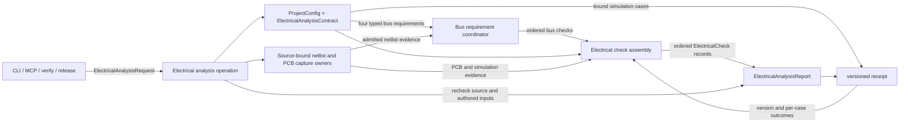

# Electrical analysis data-routing decision

This decision defines the electrical analysis handoffs before any runner
reorganization. It keeps report schema `1`, check meaning, receipt locations,
and surface behavior stable. The goal is to make source authority, intent,
evidence, and absence states visible at each stage; reducing file size is not
an acceptance criterion.

## Current route

| Stage               | Current owner and record                                                                                                       | Data passed forward                                                                                                                        | Absence and freshness meaning                                                                                                                                                                                                                                                    |
| ------------------- | ------------------------------------------------------------------------------------------------------------------------------ | ------------------------------------------------------------------------------------------------------------------------------------------ | -------------------------------------------------------------------------------------------------------------------------------------------------------------------------------------------------------------------------------------------------------------------------------- |
| Request             | CLI `electrical.py`, MCP `mcp_electrical.py`, verification, release, or scope adapter; `ElectricalAnalysisRequest`             | Project ID, output location, optional saved native summary, CLI names, and runner mode; checkout root remains a separate explicit argument | The runner mode is used only when this operation must capture a netlist. A supplied summary selects retained-evidence inspection instead.                                                                                                                                        |
| Project intent      | `electrical.selected_config`, `electrical.load_analysis`; `ProjectConfig` and `ElectricalAnalysisContract`                     | Authoritative project kind, KiCad version/image, source roots, requirements, models, and simulation cases                                  | No electrical contract is `NOT_CONFIGURED`. Within a contract, an omitted optional section (`None`), `AnalysisPending`, `AnalysisNotApplicable`, and a concrete requirement remain distinct.                                                                                     |
| Source binding      | `electrical.bind_electrical_inputs`; project source hashes and requirement/model digests                                       | Source and authored-input path-to-digest inventory                                                                                         | Missing or stale declared inputs fail the run. Inputs and project configuration are checked again after evaluation, along with the repository source state.                                                                                                                      |
| Netlist observation | `contract_coach.capture` or `inspect_summary`; `ContractCoachReport`                                                           | Source hashes, native command, summary identity, optional observed `NetlistContract`, and review-only status                               | Capture is conditional on a requirement needing a netlist. A blocked report or missing observation cannot satisfy a configured requirement.                                                                                                                                      |
| PCB observation     | `pcb_return_path_capture.capture_native_pcb_connectivity`; `ElectricalPcbEvidence` in `electrical_pcb_evidence.py`             | `NOT_REQUESTED`, `UNAVAILABLE` with its command/reason, or `OBSERVED` with command, project ID, and typed snapshot                         | Capture is conditional on return-path or probe-envelope requirements. A wrong project kind remains a source failure; missing or failed native evidence remains `NOT_RUN`.                                                                                                        |
| Simulation          | `electrical_simulation_evaluation.evaluate_electrical_simulations`; `SimulationVersionEvidence` and `SimulationCaseResult`     | Project ID, expected design hashes, authored case/model, exact ngspice version command, per-case command/checks, and generated artifacts   | No cases is `NOT_REQUESTED`. An unavailable exact version leaves each case `NOT_RUN`; a case preparation/execution error is a case `FAIL`. Failed version commands remain hashed artifacts, while the public `commands` index retains a version entry only after an exact match. |
| Evaluation          | `electrical_bus_evaluation.evaluate_electrical_bus_requirements`; `electrical_pcb_evaluation` for return paths and test access | Narrow typed requirement requests plus admitted netlist/PCB evidence or simulation measurement                                             | Pending, not-applicable, absent evidence, and failed checks produce separate check states. A passing check is limited to the declared contract and observed evidence.                                                                                                            |
| Receipt             | `electrical_runner.analyze_request`; `ElectricalAnalysisReport`                                                                | Source state, input/artifact hashes, command evidence, and ordered `ElectricalCheck` records                                               | Report schema `1` remains the public JSON contract. Its limits explicitly exclude electrical approval, physical verification, and manufacturing acceptance.                                                                                                                      |

CLI analysis, MCP analysis, verification, release preparation, and selected
scope checks already construct the same strict request and call
`analyze_request`. `analyze` is a positional compatibility adapter; its
injected runner remains a test seam. Keep those surface and compatibility
boundaries while improving internal handoffs.

## Data decisions

1. **Keep authored intent separate from observations.** The electrical
   contract owns reviewed requirements and model hashes. Netlist and PCB
   records own what the selected native tools observed. A heuristic or native
   result must not be promoted into authored intent.
2. **Do not collapse absence states.** Preserve the difference between an
   absent electrical contract, an omitted optional section, pending review,
   explicit non-applicability, an unrequested capture, a blocked capture, and a
   missing observation. Do not normalize these to `None`, `False`, or an empty
   mapping at a new service boundary.
3. **Keep capture provenance with its observation through evaluation.** The
   netlist producer returns a `ContractCoachReport` containing the project,
   source hashes, netlist digest, native summary/command, status, and optional
   observation. `electrical_netlist_evidence.admit_netlist_evidence` now
   validates project identity, ready status, netlist digest, and exact source
   hashes. Its `OBSERVED` record retains the complete producer report until the
   existing theme predicates receive the typed `NetlistContract`. A blocked,
   incomplete, or stale report remains `UNAVAILABLE`; no requested capture is
   represented separately as `NOT_REQUESTED`.
   PCB capture now has its own `NOT_REQUESTED`, `UNAVAILABLE`, and `OBSERVED`
   union. The unavailable case retains the command when capture returned one
   and the reason when capture failed or produced no snapshot. The observed
   case retains the project, successful command, typed snapshot, and access
   request digest. Existing return-path checks still compare board, KiCad,
   image, and probe provenance and emit their existing findings.
4. **Use evidence-family inputs, not one optional mega-context.** Netlist,
   PCB connectivity, and simulation are different producers with different
   absence rules. Any new intermediate record should belong to its evidence or
   requirement family and contain only the fields that family consumes. Do
   not create a global bag of optional evidence to replace the runner's local
   variables.
5. **Keep useful maps, make their domains explicit.** The report's
   path-to-digest maps and command-ID-to-command map are homogeneous indexes
   with defined value types; they are not opaque object dictionaries. Use the
   existing `RepositoryPath`, `Digest`, and `Identifier` primitives in
   internal annotations too. A new record is justified when it adds a domain
   invariant or groups one producer's evidence, not merely to wrap a map.
6. **Keep orchestration distinct from predicates.** The operation owns project
   selection, evidence planning/capture, freshness rechecks, and receipt
   assembly. Electrical requirement owners keep their domain calculations and
   comparisons. A coordinator may map requirement states to those owners, but
   it must not become a second home for electrical predicates.
7. **Route bus checks through a narrow family request.** I²C pull-up, CAN
   termination, USB-C, and SPI requirements plus admitted netlist evidence now
   enter `ElectricalBusEvaluationRequest`. Its owner validates that configured
   bus requirements requested capture, then delegates calculations to the
   existing theme predicates in their established report order. Missing
   optional sections produce no row; pending and not-applicable sections keep
   their authored statuses.
8. **Route PCB requirements by evidence family.**
   `ElectricalPcbReturnEvaluationRequest` carries only the return-path
   requirement, selected project, and PCB evidence. The test-access request
   carries only test-access intent, the matching netlist evidence, and PCB
   evidence for its probe-envelope stage. These owners preserve the established
   report order and delegate to the existing return-path and test-access
   predicates; the runner still owns capture planning, command indexing, and
   receipt writes.
9. **Keep simulator version and case evidence together.** The simulation
   request carries only the selected project cases, current design-source
   hashes, requested ngspice version, and execution paths. The simulation
   owner distinguishes no requested cases, unavailable version evidence, and
   observed version evidence, then retains each authored case beside its
   command and findings. Source hashes must match before invocation; each
   model/deck digest is checked during deck construction. Public report
   assembly preserves the existing command index and check order.

## Target handoff

The operation should plan captures from typed requirement variants, keep each
capture's producer record available through the matching evaluation boundary,
and assemble checks in the current deterministic order. It should not pass
arbitrary mappings between phases. `input_sha256`, `artifacts_sha256`, and
`commands` remain serialized report indexes; the report schema and fingerprints
must not change as part of this internal routing work.

## Pilot and acceptance

Netlist admission and bus-family evaluation established the first route pilot.
PCB return-path and test-access evaluation now use the same approach, with
separate typed requests for the two requirement families. Keep follow-on
changes within the electrical operation. Simulation now uses a typed request
and result that keeps version provenance and each authored case through
evaluation. Preserve the old positional `analyze` adapter, public report
schema, check order, receipt contents, and each theme predicate. Split code
only when a separate owner follows from this route, not to meet a line
threshold.

The admission tests cover not-requested, blocked, ready, missing-observation,
missing-digest, cross-project, and stale-source evidence. The electrical
CLI/MCP parity suite exercises no electrical contract; omitted, pending, and
not-applicable sections; ready netlist evidence; blocked or stale saved
evidence; stale project input; and a repository change during evaluation. It
preserves ordered checks, report JSON, and the shared operation route.

On 2026-10-31, `.venv/bin/python -I -m pytest tests/test_electrical*.py
tests/test_capability_architecture.py -q` passed with 288 tests and 34
subtests; one exact native KiCad test was skipped because the native lane was
not configured. The focused netlist admission module passed nine tests and the
bus evaluation module passed five. Ruff, focused Pyright, Rumdl, and
`git diff --check` passed. These synthetic and parity checks do not establish
electrical or manufacturing approval.
