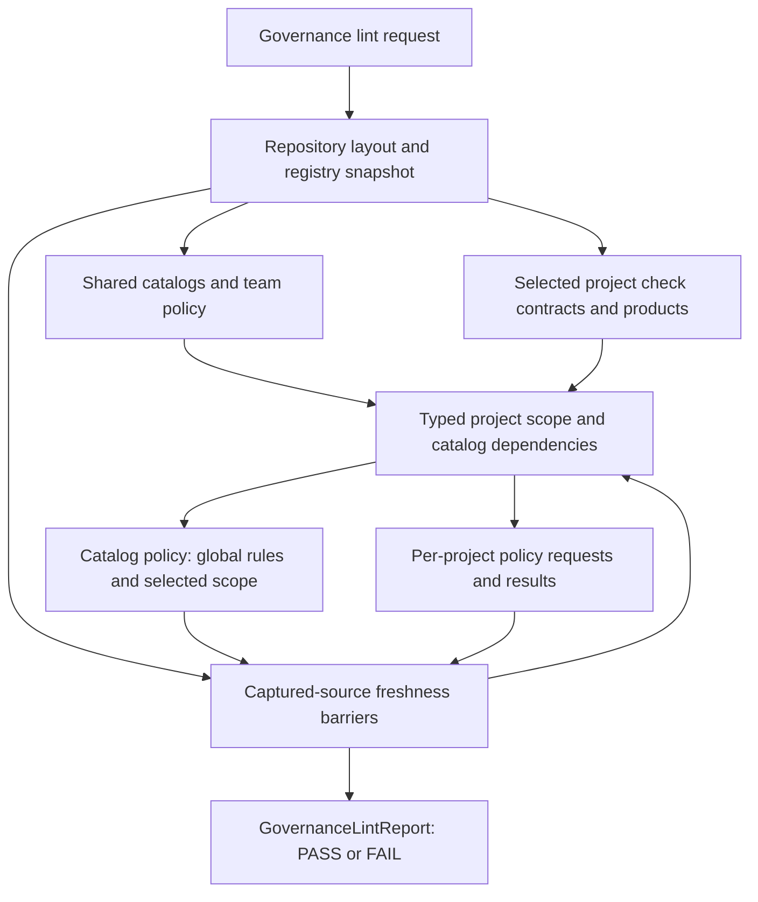

# Governance lint data-routing decision

This note defines the current source and policy handoffs in governance lint.
It distinguishes a live diagnostic result from a durable, source-bound receipt.
Module size is not an acceptance criterion for this route.

## Current operation

The operation validates repository-wide catalog structure and applies project
semantics to all declared projects or a selected subset. A selected lane also
loads products that depend on the selection and the related system-wiring or
harness-interface contracts. Catalog policy receives the captured registry
snapshot, shared catalogs, and named project scope. It keeps repository-wide
library-path and release-policy rules in force while applying interface, part,
library, and toolchain checks to selected dependency IDs. Each project check
receives a named request built from the captured registry entry and shared
inputs; its result retains the config, governance review, source inventory, and
project identity needed by later freshness checks. The report is a current
diagnostic; it is not a release approval or a durable receipt of repository
inputs.

## Source route inventory

| Input family                                                      | Current owner and typed record                                                                                                                         | Identity retained                                                                                  | Rechecked after evaluation                                  | Returned in report          |
| ----------------------------------------------------------------- | ------------------------------------------------------------------------------------------------------------------------------------------------------ | -------------------------------------------------------------------------------------------------- | ----------------------------------------------------------- | --------------------------- |
| Repository adapter                                                | `layout.read_repository_layout`; `RepositoryLayoutDocument`                                                                                            | Authored/default state, path, and authored-byte digest                                             | Yes, in registry load and final governance barrier          | No                          |
| Discovery policy and project manifests                            | `discovery.read_project_discovery`; `ProjectDiscoveryDocument`, `ProjectRegistryEntry`                                                                 | Repository path and exact-byte digest                                                              | Yes, at snapshot creation and final governance barrier      | No                          |
| Parts, interface, library, toolchain, and release-policy catalogs | `governance_lint_inputs.read_governance_lint_shared_inputs`; typed catalog documents and indexes                                                       | Named repository path and exact-byte digest for each catalog                                       | Yes, in final shared-input freshness barrier                | No                          |
| Team policy                                                       | `read_governance_team_policy`; `GovernanceTeamPolicyDocument`                                                                                          | Repository path and exact-byte digest                                                              | Yes, in final shared-input freshness barrier                | No                          |
| Project governance records                                        | `review_governance_record`; `GovernanceRecordReview`                                                                                                   | Requested path, digest for readable bytes, and explicit missing/unavailable/evaluated state        | Yes, for every reviewed record before return                | Only resulting issue text   |
| Project check contract                                            | `discovery.load_project_config_document_from_snapshot`; `ProjectConfigDocument`, `ProjectTestContractDocument`                                         | Manifest-selected project-local path and exact-byte digest; validated value builds `ProjectConfig` | Yes, in final governance freshness barrier                  | No                          |
| Governance project scope                                          | `governance_lint_scope.resolve_governance_lint_project_scope`; `GovernanceLintProjectScope`                                                            | Selected project records, dependent products, product source inputs, and named catalog ID sets     | Through the source owners in final freshness barriers       | No                          |
| Catalog policy                                                    | `governance_lint_catalog_policy.evaluate_governance_lint_catalog_policy`; `GovernanceLintCatalogPolicyRequest` and `GovernanceLintCatalogPolicyResult` | Registry snapshot, shared catalog documents/indexes, and selected project dependency IDs           | Through the source owners in final freshness barriers       | Only resulting issue text   |
| Per-project policy                                                | `governance_lint_project_policy.evaluate_governance_lint_project_policy`; `GovernanceLintProjectPolicyRequest` and `GovernanceLintProjectPolicyResult` | One captured registry entry, shared inputs, resulting config and reviewed source records           | Yes, by the coordinator through each result's source owners | Only resulting issue text   |
| Electrical requirements                                           | `electrical.policy_issues`; stable input read and `BoundElectricalInputs` within electrical evaluation                                                 | Local input hashes are used to validate electrical cases                                           | Not by governance lint after the check                      | Only resulting issue text   |
| Product index                                                     | `product_source_inputs.read_product_index_document`; `ProductIndexDocument`                                                                            | Repository path and exact-byte digest                                                              | Yes, in final shared-input freshness barrier                | No                          |
| Selected product records                                          | `product_source_inputs.capture_product_record`; `ProductRecordInput`, `ProductSourceIdentity`                                                          | Path/digest for readable bytes; missing and unavailable states remain explicit                     | Yes, in final selected-product freshness barrier            | No                          |
| Library provenance/licensing and mechanical handoff files         | `governance_lint_filesystem_inputs.py`; `GovernanceLintFilesystemInputs`; `governance_records.py` file identity                                        | Requested path, explicit state, stable digest; library digests compared with catalog declarations  | Yes, final governance filesystem freshness barrier          | Only resulting issue text   |
| Project source files                                              | `project_source_hashes.py`; `ProjectSourceInventoryInput` and `SourceHashInventory`                                                                    | Declared roots, explicit availability state, sorted path-to-digest inventory                       | Yes, recaptured before return                               | Only resulting issue text   |
| Project-file membership                                           | `project_file_membership.py`; `ProjectFileMembershipSnapshot`                                                                                          | Configured roots, explicit state, sorted `*.kicad_pro` membership; traversal is bounded            | Yes, roots and membership are re-traversed                  | Only resulting issue text   |
| Result                                                            | `GovernanceLintReport`, schema 1                                                                                                                       | Project IDs, issue strings, status                                                                 | Not applicable                                              | Yes; no input-source fields |

The current freshness barriers recheck the adapter, discovery policy, project
manifests, selected project check contracts, shared catalogs, team policy,
product index, reviewed project governance records, selected product records,
library evidence, production mechanical handoffs, project source inventories,
and project-file membership. Selected product loading consumes the parts and
interface catalog values already captured by the shared-input route. These are
sequential reads and rechecks, not filesystem locks or an atomic snapshot; do
not describe `GovernanceLintReport` as a complete provenance receipt.

## Routing decisions

1. **Keep source authorities explicit.** The project manifest owns project
   selection metadata; its check contract owns validation and design-lint
   settings; shared catalogs own their records; the team policy owns governance
   thresholds. Derived issues do not replace these authored values.
2. **Preserve selected-scope behavior.** Shared catalog parsing and ID
   uniqueness remain repository-wide. Contract semantics and product-dependent
   checks remain limited to the selected projects and their declared product
   dependencies.
3. **Keep absence and invalidity visible.** Missing optional governance records,
   unreadable files, invalid authored documents, and valid documents with policy
   issues stay separate states. Do not turn unavailable source bytes into an
   empty record or a passing check.
4. **Use source-family records.** `GovernanceLintSharedInputs` owns the named
   shared catalogs and team policy; `GovernanceLintProjectScope` owns selected
   project records, dependent products, and the catalog IDs those checks use.
   `GovernanceLintCatalogPolicyRequest` passes those captured values to policy
   checks while retaining repository-wide and selected-record scope. Keep each
   source identity with its source owner. Avoid one generic `dict[str, object]`
   bag or an opaque list of file hashes.
5. **Keep the current report diagnostic.** A caller audit on 2026-11-05 found
   that portable, native, CI, and evidence consumers use governance project
   scope, status, and issue text. None needs the complete input identity set
   for a later decision. Keep schema 1 and defer a persisted receipt until a
   concrete consumer defines its scope, source set, freshness point, and
   absence states. If that need appears, version the receipt and update
   CLI/MCP parity together.

## Incremental route order

1. **Implemented:** bind each selected project check contract to the exact
   manifest-selected path and bytes. Reuse that validated value to build
   `ProjectConfig`, then recheck the source before governance lint returns.
2. **Implemented:** retain shared catalog indexes, team policy, and the product
   index in a named typed input set, then recheck each exact source before
   governance lint returns.
3. **Implemented:** retain the review state and source identity of each
   production governance record and recheck it before return. Selected product
   loading now receives the captured product index and part/interface catalog
   values, records explicit missing/unavailable/evaluated states for selected
   product files, and rechecks their source bytes before return.
4. **Implemented:** retain the selected library provenance/licensing inputs,
   production mechanical handoffs, per-project source inventories, and bounded
   project-file membership. Missing and unavailable states remain explicit;
   final rechecks detect changed identities or membership without claiming an
   atomic filesystem snapshot.
5. **Resolved for current callers:** retain `GovernanceLintReport` as a schema 1
   diagnostic. Portable, native, CI, and evidence callers do not need a durable
   source-provenance receipt. Revisit only when a named consumer requires one.
6. **Implemented:** resolve selection and product dependencies through
   `GovernanceLintProjectScope`, which keeps the selected records, product
   source inputs, and catalog dependency IDs together before policy evaluation.
7. **Implemented:** pass each selected project and the captured shared inputs
   to `governance_lint_project_policy.py` through
   `GovernanceLintProjectPolicyRequest`. Its result keeps the project identity,
   config document, governance-record review, and source inventory together
   until the coordinator completes the existing freshness barriers. Diagnostic
   ordering, selection semantics, and report schema remain unchanged.
8. **Implemented:** evaluate catalog policy through
   `GovernanceLintCatalogPolicyRequest` and
   `GovernanceLintCatalogPolicyResult`. The captured registry snapshot, shared
   catalog documents, and `GovernanceLintProjectScope` keep repository-wide
   library-path and release-policy rules distinct from selected interface,
   part, library, and toolchain checks. The evaluator preserves diagnostic
   order and returns only issues; source identities remain with their owners
   for the existing freshness barriers.
9. **Resolved for current callers:** `resolve_governance_lint_project_scope`
   uses `ProductRepository` locally to derive dependent project and catalog
   IDs, then retains only its selected `ProductRecordInput` tuple for the
   coordinator's final product-source freshness check. The shared inputs retain
   and recheck the `ProductIndexDocument`. No current policy consumer needs the
   full repository after scope resolution, so do not add another snapshot or
   module boundary without a named downstream consumer. Other operations keep
   their `ProductRepository` local for the duration of their own evaluation.

The registry, project-check-contract, shared-input, governance-record,
selected-product, source-inventory, and project-file membership behavior is
covered by `tests/test_project_registry_snapshot.py`,
`tests/test_governance.py`, `tests/test_governance_input_routing.py`,
`tests/test_project_source_hash_inventory.py`, and
`tests/test_project_file_membership.py`. Their scope is deliberately narrower
than a durable governance receipt. Product-repository map immutability and
single-index composition are covered by
`tests/test_product_repository_index_routing.py`.
